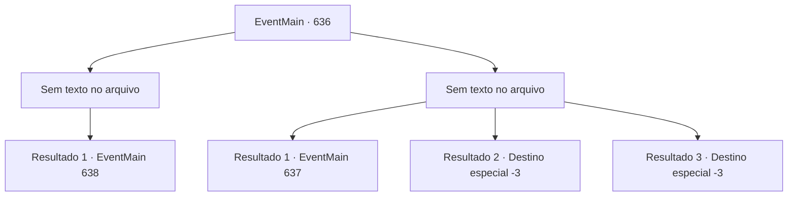

# Eventos principais · 636

[Índice da tabela](index.md) · [Índice geral](../index.md)

ID: `pt:EventMain:636` · Fonte: `EventMain4` · Versão: 1.2.47.

Mapeamento estático dos arquivos; a disponibilidade e a execução dependem do estado da run.

## Texto do evento

*Sem texto no arquivo.*

## Dados de entrada

```json
{
  "id": 636,
  "grade": 1,
  "normalGoal": "",
  "required": ""
}
```

## Mapa das escolhas



## Escolhas e resultados

### Escolha 1

*Sem texto no arquivo; o papel dessa opção depende da interface do jogo.*

Requisitos e outros campos da escolha:

```json
{
  "required": ""
}
```

#### Resultado 1.1


 "Ke, Kek.... Um fim trágico para um traidor..."

 Enquanto Gess desmorona, os braços escuros que se estendem do seu corpo desaparecem. Você tira o fôlego de Gess e se aproxima de Danica, que está deitada no altar. Danica está em um estado de ruína, mas felizmente, ela está respirando superficialmente. Você a abraça imediatamente e saem dali.

 Desde então, as coisas terminaram rapidamente. Os adoradores restantes são eliminados pelos paladinos, e Danica é rapidamente tratada e recupera a consciência. Quando ela te vê, ela agradece. 

 "Obrigada. {1}. Agora é minha vez de cumprir minha promessa. Vou te levar até a Catedral de Yerut, onde está o arcebispo. Tenho certeza de que ele será de grande ajuda na luta contra Kior."

 Então Valen franze a testa contra a opinião de Danica. 

 "Irmãs Danica. Como você pôde fazer isso... na sagrada catedral?"

 Eles te deixam sozinho e começam a discutir entre si.

Continuação registrada: [Evento 638](0638.md) na mesma tabela.

```json
{
  "required": "",
  "chance": "1",
  "nextEvent": 638,
  "type": 2,
  "reward": ""
}
```

### Escolha 2

*Sem texto no arquivo; o papel dessa opção depende da interface do jogo.*

Requisitos e outros campos da escolha:

```json
{
  "required": ""
}
```

#### Resultado 2.1


 "T, O fim para t, o tr, traidor...!"

 Os braços que se estendem de Gess te amarram. E no momento em que ele te estrangula, de repente os paladinos entram com um grito alto. Eles começam a atacar, cercando Gess de uma vez. Graças a isso, Gess tem que te jogar para longe. Imediatamente depois disso, Donna se aproxima de você quando você está caído. 

 "Eu persuadi Valen a vir porque você estava muito atrasado, mas felizmente, não muito tarde."

 Você se levanta e olha para Gess, apoiado por Donna. Em uma situação repentina, Gess começa a rir. Não é apenas uma risada, mas é apenas um tropeço. 

 "KKKK... Khahaha! De fato, como ele disse! Hahaha!!"

 Diante desse comportamento bizarro, tanto Valen quanto os Paladinos interrompem o ataque e o olham.

Continuação registrada: [Evento 637](0637.md) na mesma tabela.

```json
{
  "required": "1_0_2|1_1_2",
  "chance": "1",
  "nextEvent": 637,
  "type": 2,
  "reward": "0_0_-1|0_1_-1"
}
```

#### Resultado 2.2

Os braços que se estendem de Gess te amarram. Você não consegue mover seu corpo, sua voz não sai, como se estivesse acorrentado. No entanto, isso não é o fim. Depois disso, até mesmo seus olhos e ouvidos se tornam distantes, então você não consegue ver nem ouvir nada. Nessa solidão solitária, você de repente percebe que nem mesmo consegue respirar. No final, você até perde sua vida.

Continuação registrada: [Destino especial `-3`](../destinos-especiais.md).

```json
{
  "required": "2_0_2",
  "chance": "1",
  "nextEvent": -3,
  "type": 2,
  "reward": "0_0_-1|0_1_-1"
}
```

#### Resultado 2.3

Os braços que se estendem de Gess te amarram. Você não consegue mover seu corpo, sua voz não sai, como se estivesse acorrentado. No entanto, isso não é o fim. Depois disso, até mesmo seus olhos e ouvidos se tornam distantes, então você não consegue ver nem ouvir nada. Nessa solidão solitária, você de repente percebe que nem mesmo consegue respirar. No final, você até perde sua vida.

Continuação registrada: [Destino especial `-3`](../destinos-especiais.md).

```json
{
  "required": "2_1_2",
  "chance": "1",
  "nextEvent": -3,
  "type": 2,
  "reward": "0_0_-1|0_1_-1"
}
```

## Referências que chegam a este evento

- [Evento 635 · escolha 1 · resultado 1](0635.md#escolha-1)
