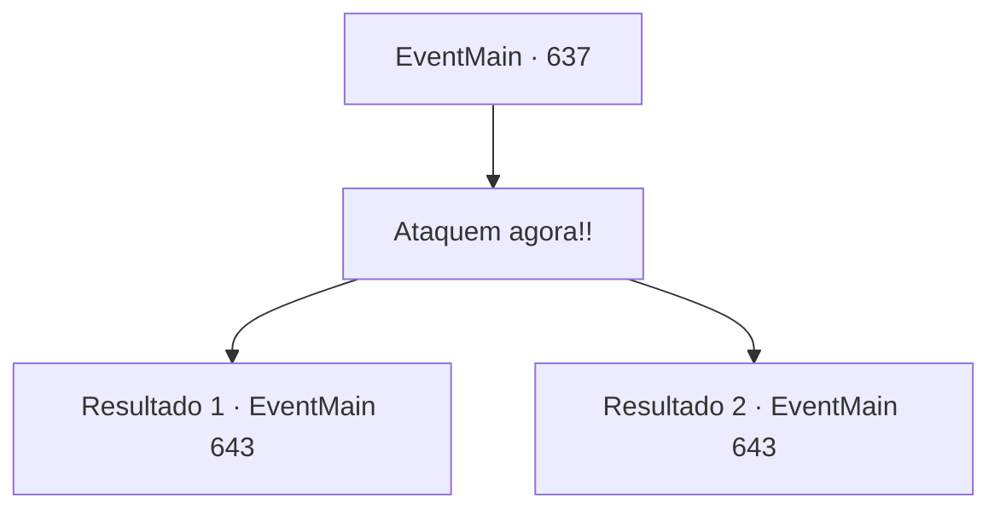

# Eventos principais · 637

[Índice da tabela](index.md) · [Índice geral](../index.md)

ID: `pt:EventMain:637` · Fonte: `EventMain4` · Versão: 1.2.47.

Mapeamento estático dos arquivos; a disponibilidade e a execução dependem do estado da run.

## Texto do evento

*Sem texto no arquivo.*

## Dados de entrada

```json
{
  "id": 637,
  "grade": 1,
  "normalGoal": "",
  "required": ""
}
```

## Mapa das escolhas



## Escolhas e resultados

### Escolha 1

Ataquem agora!!

Requisitos e outros campos da escolha:

```json
{
  "required": ""
}
```

#### Resultado 1.1

Você grita para Valen e os paladinos atacarem imediatamente. Mas parece ser tarde demais. Uma névoa negra se espalha de Danica, que está deitada no altar, e devora todos ali. Logo em seguida, demônios saem da névoa e correm em sua direção.

Continuação registrada: [Evento 643](0643.md) na mesma tabela.

```json
{
  "required": "24_7_1",
  "chance": "1",
  "nextEvent": 643,
  "type": 2,
  "reward": "6_0_154|5_433_1",
  "place": 6
}
```

#### Resultado 1.2

Você grita para Valen e os paladinos atacarem imediatamente. Mas parece ser tarde demais. Uma névoa negra se espalha a partir de Danica, que está deitada no altar, e devora todos ali. Na névoa negra, os paladinos começam a se matar uns aos outros com os olhos brancos abertos. 

 "Oh, meu Deus!! É um monstro!!"

 "Oh! Tere!"

 Na espessa névoa negra, uma chama se choca contra a espada e o escudo. Há sangue no chão que você não sabe de quem é, e os corpos estão se acumulando gradualmente. No meio dessa terrível catástrofe, você percebe que os paladinos estão aterrorizados, como se tivessem encontrado um monstro invencível. Você tenta acalmá-los, mas eles apenas avançam com uma espada.

Continuação registrada: [Evento 643](0643.md) na mesma tabela.

```json
{
  "required": "23_7_1",
  "chance": "1",
  "nextEvent": 643,
  "type": 2,
  "reward": "6_3_50",
  "place": 6
}
```

## Referências que chegam a este evento

- [Evento 636 · escolha 2 · resultado 1](0636.md#escolha-2)
