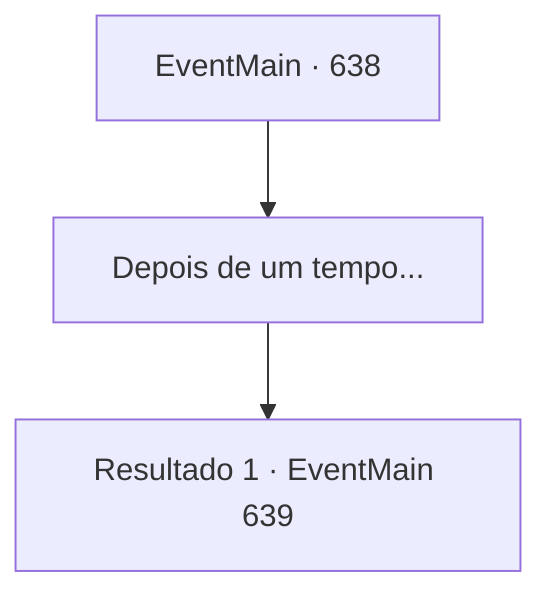

# Eventos principais · 638

[Índice da tabela](index.md) · [Índice geral](../index.md)

ID: `pt:EventMain:638` · Fonte: `EventMain4` · Versão: 1.2.47.

Mapeamento estático dos arquivos; a disponibilidade e a execução dependem do estado da run.

## Texto do evento

*Sem texto no arquivo.*

## Dados de entrada

```json
{
  "id": 638,
  "grade": 1,
  "normalGoal": "",
  "required": ""
}
```

## Mapa das escolhas



## Escolhas e resultados

### Escolha 1

Depois de um tempo...

Requisitos e outros campos da escolha:

```json
{
  "required": ""
}
```

#### Resultado 1.1


 "... Entendo. Vou te levar ao Arcebispo."

 A conversa parece ter terminado com a vitória de Danica. No entanto, Valen olha para você e te avisa que se você fizer algo sem sentido, ela vai te acertar imediatamente. Então você entra na carruagem em direção à catedral, com Danica e Valen. Donna se despede de você e volta para sua oficina. |drawing_tereCathedral| Alguns dias depois, a Catedral de Yerut, que chegou após uma longa viagem de carruagem, é um lugar esplêndido. Todo o prédio é feito de mármore, com uma cúpula azul no topo. Por toda a parede externa há esculturas e pinturas em mosaico em homenagem aos santos de Teretian. Você desce da carroça com Danica e Valen e entra na catedral.

Continuação registrada: [Evento 639](0639.md) na mesma tabela.

```json
{
  "required": "",
  "chance": "1",
  "nextEvent": 639,
  "type": 2,
  "reward": ""
}
```

## Referências que chegam a este evento

- [Evento 636 · escolha 1 · resultado 1](0636.md#escolha-1)
