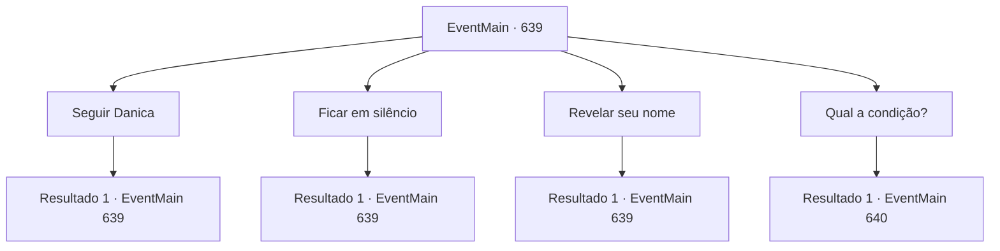

# Eventos principais · 639

[Índice da tabela](index.md) · [Índice geral](../index.md)

ID: `pt:EventMain:639` · Fonte: `EventMain4` · Versão: 1.2.47.

Mapeamento estático dos arquivos; a disponibilidade e a execução dependem do estado da run.

## Texto do evento

*Sem texto no arquivo.*

## Dados de entrada

```json
{
  "id": 639,
  "grade": 1,
  "normalGoal": "",
  "required": ""
}
```

## Mapa das escolhas



## Escolhas e resultados

### Escolha 1

Seguir Danica

Requisitos e outros campos da escolha:

```json
{
  "required": "5_399_0"
}
```

#### Resultado 1.1

Você entra na catedral após Danica. E enquanto você caminha por cerca de cinco minutos, você vê um velho homem em uma túnica sacerdotal vermelha bordada. Sua testa está profundamente enrugada, e sua barba cobre todo o queixo. |drawing_publius| Assim que Danica e Valen o veem, eles se curvam e mostram seu respeito. Ao olhar para ele, você pode ver que ele é o Arcebispo 'Publius'. 

 "Estou feliz em ver que você está saudável, Danica. Você fez um ótimo trabalho. Valen. E... quem é você..?"


Continuação registrada: [Evento 639](0639.md) na mesma tabela.

```json
{
  "required": "",
  "chance": "1",
  "nextEvent": 639,
  "type": 2,
  "reward": "5_399_1"
}
```

### Escolha 2

Ficar em silêncio

Requisitos e outros campos da escolha:

```json
{
  "required": "5_399_1"
}
```

#### Resultado 2.1

Você olha para Publius sem responder à sua pergunta. Mesmo que você descubra que o culpado por todos os incidentes é Kior, ainda é verdade que ele matou sua família. Em seu silêncio, Danica se adianta e explica a situação em seu lugar. Diz Publius, que ouviu toda a história dela. 

 "Hmm.. Entendi. Você era ..."

 Publius para de falar por um momento e olha para a janela ensolarada. E ele continua suas palavras olhando para a pintura em mosaico dos santos. 

 "De qualquer forma, eu sei a história. Vocês vão lutar contra o Kior... Vai ser muito difícil, mas vou cooperar pela causa. No entanto, há uma condição."


Continuação registrada: [Evento 639](0639.md) na mesma tabela.

```json
{
  "required": "",
  "chance": "1",
  "nextEvent": 639,
  "type": 2,
  "reward": "5_399_2"
}
```

### Escolha 3

Revelar seu nome

Requisitos e outros campos da escolha:

```json
{
  "required": "5_399_1"
}
```

#### Resultado 3.1

Quando você revela seu nome, as sobrancelhas de Publius se mexem. 

 "Bem. Eu sabia que você sequestrou Danica e matou irmãos e irmãs. Mas você vem aqui..."

 Danica se aproxima e explica a situação em seu lugar. Diz Publius, que ouviu toda a história dela. 

 "Hmm.. Entendo. Você era ..."

 Publius para de falar por um momento e olha para a janela ensolarada. E ele continua suas palavras olhando para a pintura em mosaico dos santos. 

 "De qualquer forma, eu sei a história. Você vai lutar com os Kior... Vai ser muito difícil, mas vou cooperar pela causa. No entanto, há uma condição."


Continuação registrada: [Evento 639](0639.md) na mesma tabela.

```json
{
  "required": "",
  "chance": "1",
  "nextEvent": 639,
  "type": 2,
  "reward": "5_399_2"
}
```

### Escolha 4

Qual a condição?

Requisitos e outros campos da escolha:

```json
{
  "required": "5_399_2"
}
```

#### Resultado 4.1

Publius diz com um olhar severo para a sua pergunta. 

 "Após matar o demônio Kior, você deve expiar o mal que cometeu. Sua contribuição pode amenizar um pouco o castigo. Você pode prometer?"


Continuação registrada: [Evento 640](0640.md) na mesma tabela.

```json
{
  "required": "",
  "chance": "1",
  "nextEvent": 640,
  "type": 2,
  "reward": ""
}
```

## Referências que chegam a este evento

- [Evento 638 · escolha 1 · resultado 1](0638.md#escolha-1)
- [Evento 639 · escolha 1 · resultado 1](0639.md#escolha-1)
- [Evento 639 · escolha 2 · resultado 1](0639.md#escolha-2)
- [Evento 639 · escolha 3 · resultado 1](0639.md#escolha-3)
