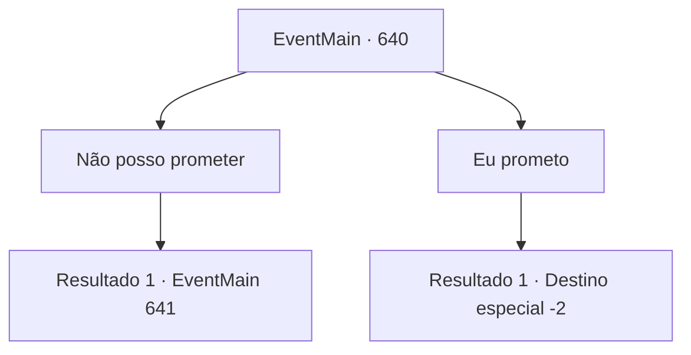

# Eventos principais · 640

[Índice da tabela](index.md) · [Índice geral](../index.md)

ID: `pt:EventMain:640` · Fonte: `EventMain4` · Versão: 1.2.47.

Mapeamento estático dos arquivos; a disponibilidade e a execução dependem do estado da run.

## Texto do evento

*Sem texto no arquivo.*

## Dados de entrada

```json
{
  "id": 640,
  "grade": 1,
  "normalGoal": "",
  "required": ""
}
```

## Mapa das escolhas



## Escolhas e resultados

### Escolha 1

Não posso prometer

Requisitos e outros campos da escolha:

```json
{
  "required": ""
}
```

#### Resultado 1.1

Você recusa a oferta dele, dizendo que não pode prometer. Então, uma espada que voa como um relâmpago é empurrada em seu pescoço. Valen, que estava ao seu lado, mira na espada. Então, Danica interrompe entre você e Valen e grita. 

 "Espera! Arcebispo! Irmã Valen! Que tal dar um tempo para {1} pensar?"

 A pedido dela, Publius pensa por um momento e acena com uma expressão duvidosa. 

 "Hmm... Então vamos fazer isso. Depois venha me encontrar assim que estiver pronto. O prazo é de três meses. Depois disso, vamos matar o kior. Lembre-se, se você não vier, emitirei um mandado de prisão para você."

 Publius, que ameaçou, ordena que Valen te expulse da catedral.

Continuação registrada: [Evento 641](0641.md) na mesma tabela.

```json
{
  "required": "",
  "chance": "1",
  "nextEvent": 641,
  "type": 2,
  "reward": ""
}
```

### Escolha 2

Eu prometo

Requisitos e outros campos da escolha:

```json
{
  "required": ""
}
```

#### Resultado 2.1

Você aceita a oferta dele, dizendo que irá prometer. Ao ouvir sua resposta, Publius olha para você por um momento surpreso, Encerra a conversa em voz baixa. 

 "Ótimo. Vejo você daqui a três meses. Vou preparar tudo até lá."

 Você deixa Publius três meses depois, prometendo voltar à catedral. Danica te acompanha até a saída da cidade.

Continuação registrada: [Destino especial `-2`](../destinos-especiais.md).

```json
{
  "required": "",
  "chance": "1",
  "nextEvent": -2,
  "type": 2,
  "reward": "13_4_20"
}
```

## Referências que chegam a este evento

- [Evento 639 · escolha 4 · resultado 1](0639.md#escolha-4)
