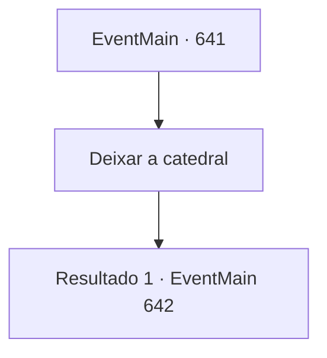

# Eventos principais · 641

[Índice da tabela](index.md) · [Índice geral](../index.md)

ID: `pt:EventMain:641` · Fonte: `EventMain4` · Versão: 1.2.47.

Mapeamento estático dos arquivos; a disponibilidade e a execução dependem do estado da run.

## Texto do evento

*Sem texto no arquivo.*

## Dados de entrada

```json
{
  "id": 641,
  "grade": 1,
  "normalGoal": "",
  "required": ""
}
```

## Mapa das escolhas



## Escolhas e resultados

### Escolha 1

Deixar a catedral

Requisitos e outros campos da escolha:

```json
{
  "required": ""
}
```

#### Resultado 1.1

Você sai da Catedral de Yerut e caminha pelas ruas. Como o sol já se pôs, está difícil encontrar acomodação para passar a noite. No entanto, depois de muito tempo, você não consegue encontrar um quarto para deitar, e o céu está ficando mais escuro. Você segura a gola na brisa fria da noite. Por algum motivo, você se lembra do passado quando jantava com a família. 

 "huhu. Você está sendo enganado pelos fantoches de Tere e tentando se rebelar contra mim. Você é realmente estúpido. {1}."

 Então, de repente, você ouve a voz de Kior em sua cabeça. Você fala mal dele para calá-lo, mas ele não se importa e continua falando. 

 "Tsk tsk. Sinto pena de você. Mesmo que você vingue esse corpo, tudo o que lhe resta é punição. Você realmente vai afirmar ser um ato tão estúpido?"

 A voz ressoa fascinantemente em seus ouvidos. 

 "Esteja ao meu lado novamente. Então você terá vingança, e sua família encontrará descanso..."


Continuação registrada: [Evento 642](0642.md) na mesma tabela.

```json
{
  "required": "",
  "chance": "1",
  "nextEvent": 642,
  "type": 2,
  "reward": ""
}
```

## Referências que chegam a este evento

- [Evento 640 · escolha 1 · resultado 1](0640.md#escolha-1)
