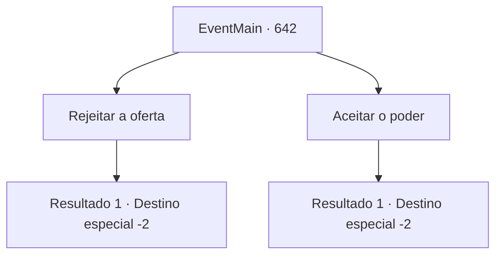

# Eventos principais · 642

[Índice da tabela](index.md) · [Índice geral](../index.md)

ID: `pt:EventMain:642` · Fonte: `EventMain4` · Versão: 1.2.47.

Mapeamento estático dos arquivos; a disponibilidade e a execução dependem do estado da run.

## Texto do evento

*Sem texto no arquivo.*

## Dados de entrada

```json
{
  "id": 642,
  "grade": 1,
  "normalGoal": "",
  "required": ""
}
```

## Mapa das escolhas



## Escolhas e resultados

### Escolha 1

Rejeitar a oferta

Requisitos e outros campos da escolha:

```json
{
  "required": ""
}
```

#### Resultado 1.1

Quando você recusa a oferta, uma voz irritada de Kior é ouvida. 

 "... Não se arrependa. {1}. Haverá mais dor do que morte para você."

 Você ouve sua voz com raiva, não sua voz doce até agora, percebe que a voz assustadora agora é sua voz real. Mas você está determinado a enfrentar suas ameaças.

Continuação registrada: [Destino especial `-2`](../destinos-especiais.md).

```json
{
  "required": "",
  "chance": "1",
  "nextEvent": -2,
  "type": 2,
  "reward": "13_4_20"
}
```

### Escolha 2

Aceitar o poder

Requisitos e outros campos da escolha:

```json
{
  "required": ""
}
```

#### Resultado 2.1

Você aceita a oferta de Kior. E naquele momento, você pode sentir seu poder maligno fluindo novamente. Kior sussurra com uma pequena risada. 

 "Haha. Você fez a escolha certa. {1}. Agora não se preocupe. Este corpo estará com você até o fim em sua vingança."

 Depois de ouvi-lo, você pergunta o que fazer no futuro. Kior responde à pergunta com uma voz relaxada. 

 "Eu vou te dizer quando for a hora. Por enquanto... é melhor você encontrar um lugar para descansar."

 Ele apenas fica em silêncio, dizendo que você só não pode se atrasar para voltar à catedral.

Continuação registrada: [Destino especial `-2`](../destinos-especiais.md).

```json
{
  "required": "",
  "chance": "1",
  "nextEvent": -2,
  "type": 2,
  "reward": "13_4_22|0_5_1|0_6_1|0_12_1"
}
```

## Referências que chegam a este evento

- [Evento 641 · escolha 1 · resultado 1](0641.md#escolha-1)
