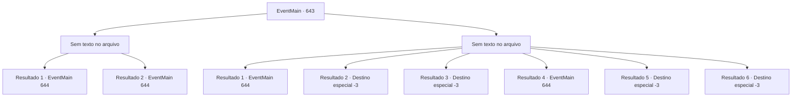

# Eventos principais · 643

[Índice da tabela](index.md) · [Índice geral](../index.md)

ID: `pt:EventMain:643` · Fonte: `EventMain4` · Versão: 1.2.47.

Mapeamento estático dos arquivos; a disponibilidade e a execução dependem do estado da run.

## Texto do evento

*Sem texto no arquivo.*

## Dados de entrada

```json
{
  "id": 643,
  "grade": 1,
  "normalGoal": "",
  "required": ""
}
```

## Mapa das escolhas



## Escolhas e resultados

### Escolha 1

*Sem texto no arquivo; o papel dessa opção depende da interface do jogo.*

Requisitos e outros campos da escolha:

```json
{
  "required": ""
}
```

#### Resultado 1.1

A névoa clareia e você sente que sua cabeça está clara. Depois de respirar por um tempo, você olha lentamente ao redor. A visão diante de você é simplesmente um inferno. Quase todos os paladinos estão espalhados pelo chão, e seu sangue e vísceras mancharam o chão com sangue. Não foi o demônio que você lutou, foram os paladinos. Danica e Donna também estão sangrando. A única exceção é Valen, uma paladina ruiva sentada naquela poça de sangue. 

 "Oh... Oh... Tere... Irmãos e irmãs... Como..."

 Você vira a cabeça e olha na direção de onde ouve o som. Então, Valen é vista empurrando uma espada em seu pescoço. Ela parece muito chocada por ter cortado paladinos com as próprias mãos.

Continuação registrada: [Evento 644](0644.md) na mesma tabela.

```json
{
  "required": "5_433_1",
  "chance": "1",
  "nextEvent": 644,
  "type": 2,
  "reward": ""
}
```

#### Resultado 1.2

Depois de respirar por um tempo, você olha lentamente ao redor. A visão à sua frente é simplesmente um inferno. Quase todos os paladinos estão espalhados pelo chão, e seu sangue e vísceras mancharam o chão com sangue. Não foi o demônio que você lutou, foram os paladinos. Danica e Donna também estão sangrando. A única exceção é Valen, uma paladina ruiva sentada naquela poça de sangue. 

 "Oh... Oh... Tere... Irmãos e irmãs... Como..."

 Você vira a cabeça e olha na direção de onde ouve o som. Então, Valen é vista empurrando uma espada em seu pescoço. Ela parece muito chocada por ter cortado paladinos com as próprias mãos.

Continuação registrada: [Evento 644](0644.md) na mesma tabela.

```json
{
  "required": "18_433_1",
  "chance": "1",
  "nextEvent": 644,
  "type": 2,
  "reward": ""
}
```

### Escolha 2

*Sem texto no arquivo; o papel dessa opção depende da interface do jogo.*

Requisitos e outros campos da escolha:

```json
{
  "required": ""
}
```

#### Resultado 2.1

Você acorda com a dor intensa e repentina. Antes mesmo de perceber, você tem uma flecha cravada em seu braço esquerdo. Você retira a flecha presa em seu braço, respira fundo e olha ao redor lentamente. A visão diante de você é simplesmente um inferno. Quase todos os paladinos estão espalhados pelo chão, e seu sangue e vísceras mancham o chão. Não foi o demônio que você lutou, foram os paladinos. Danica e Donna também estão sangrando. A única exceção é Valen, uma paladina ruiva sentada naquela poça de sangue. 

 "Oh... Oh... Tere... Irmãos e irmãs... Como..."

 Você vira a cabeça e olha na direção de onde ouve o som. Então, Valen é vista empurrando uma espada em seu pescoço. Ela parece muito chocada por ter cortado paladinos com as próprias mãos.

Continuação registrada: [Evento 644](0644.md) na mesma tabela.

```json
{
  "required": "1_0_2|1_1_2|5_433_1",
  "chance": "1",
  "nextEvent": 644,
  "type": 2,
  "reward": "0_0_-1|0_1_-1"
}
```

#### Resultado 2.2

Você acorda e olha ao redor na dor tonta que de repente sente. A visão à sua frente é simplesmente um inferno. Quase todos os paladinos estão espalhados pelo chão, e seu sangue e vísceras mancharam o chão com sangue. Não foi o demônio que você lutou, foram os paladinos. Danica e Donna também estão sangrando. A única exceção é Valen, um paladino ruivo sentado naquela poça de sangue. Você tenta levantar seu corpo do chão. Mas não pode acontecer. Porque seu corpo já estava em dois. Você quer que tudo seja um sonho e se certifica de fechar os olhos. Mas os olhos nunca se abrem novamente.

Continuação registrada: [Destino especial `-3`](../destinos-especiais.md).

```json
{
  "required": "2_0_2|5_433_1",
  "chance": "1",
  "nextEvent": -3,
  "type": 2,
  "reward": "0_0_-1|0_1_-1"
}
```

#### Resultado 2.3

Você acorda e olha ao redor na dor tonta que de repente sente. A visão à sua frente é simplesmente um inferno. Quase todos os paladinos estão espalhados pelo chão, e seu sangue e vísceras mancharam o chão com sangue. Não foi o demônio que você lutou, foram os paladinos. Danica e Donna também estão sangrando. A única exceção é Valen, um paladino ruivo sentado naquela poça de sangue. Você tenta levantar seu corpo do chão. Mas não pode acontecer. Porque seu corpo já estava em dois. Você quer que tudo seja um sonho e se certifica de fechar os olhos. Mas os olhos nunca se abrem novamente.

Continuação registrada: [Destino especial `-3`](../destinos-especiais.md).

```json
{
  "required": "2_1_2|18_433_1",
  "chance": "1",
  "nextEvent": -3,
  "type": 2,
  "reward": "0_0_-1|0_1_-1"
}
```

#### Resultado 2.4

Você rasteja pelo chão e mal consegue escapar para o canto. E lentamente olha ao redor, respirando fundo. A visão diante de você é simplesmente um inferno. Quase todos os paladinos estão espalhados pelo chão, e seu sangue e vísceras mancharam o chão com sangue. Não eram demônios com quem você lutou, eram os paladinos. Danica e Donna também estão sangrando. A única exceção é Valen, uma paladina ruiva sentada naquela poça de sangue. 

 "Oh... Oh... Tere... Irmãos e irmãs... Como..."

 Você vira a cabeça e olha na direção de onde ouve o som. Então, Valen é vista empurrando uma espada em seu pescoço. Ela parece muito chocada por ter cortado paladinos com as próprias mãos.

Continuação registrada: [Evento 644](0644.md) na mesma tabela.

```json
{
  "required": "1_0_2|1_1_2|18_433_1",
  "chance": "1",
  "nextEvent": 644,
  "type": 2,
  "reward": "0_0_-1|0_1_-1"
}
```

#### Resultado 2.5

Uma flecha vinda de algum lugar se crava no seu tornozelo. E antes que você possa sentir a dor, você é atingido na cabeça por uma maça de ferro empunhada por um paladino virado. Num instante, o mundo gira e gira, Sua consciência afunda na escuridão.

Continuação registrada: [Destino especial `-3`](../destinos-especiais.md).

```json
{
  "required": "2_0_2|18_433_1",
  "chance": "1",
  "nextEvent": -3,
  "type": 2,
  "reward": "0_0_-1|0_1_-1"
}
```

#### Resultado 2.6

Uma flecha vinda de algum lugar se crava no seu tornozelo. E antes que você possa sentir a dor, você é atingido na cabeça por uma maça de ferro empunhada por um paladino virado. Num instante, o mundo gira e gira, Sua consciência afunda na escuridão.

Continuação registrada: [Destino especial `-3`](../destinos-especiais.md).

```json
{
  "required": "2_1_2|18_433_1",
  "chance": "1",
  "nextEvent": -3,
  "type": 2,
  "reward": "0_0_-1|0_1_-1"
}
```

## Referências que chegam a este evento

- [Evento 637 · escolha 1 · resultado 1](0637.md#escolha-1)
- [Evento 637 · escolha 1 · resultado 2](0637.md#escolha-1)
- [Evento 645 · escolha 1 · resultado 1](0645.md#escolha-1)
- [Evento 645 · escolha 1 · resultado 2](0645.md#escolha-1)
- [Evento 645 · escolha 2 · resultado 1](0645.md#escolha-2)
- [Evento 645 · escolha 2 · resultado 2](0645.md#escolha-2)
- [Evento 646 · escolha 1 · resultado 1](0646.md#escolha-1)
- [Evento 646 · escolha 1 · resultado 2](0646.md#escolha-1)
- [Evento 646 · escolha 2 · resultado 1](0646.md#escolha-2)
- [Evento 646 · escolha 2 · resultado 2](0646.md#escolha-2)
