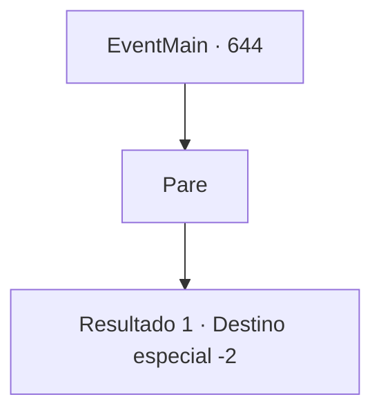

# Eventos principais · 644

[Índice da tabela](index.md) · [Índice geral](../index.md)

ID: `pt:EventMain:644` · Fonte: `EventMain4` · Versão: 1.2.47.

Mapeamento estático dos arquivos; a disponibilidade e a execução dependem do estado da run.

## Texto do evento

*Sem texto no arquivo.*

## Dados de entrada

```json
{
  "id": 644,
  "grade": 1,
  "normalGoal": "",
  "required": ""
}
```

## Mapa das escolhas



## Escolhas e resultados

### Escolha 1

Pare

Requisitos e outros campos da escolha:

```json
{
  "required": ""
}
```

#### Resultado 1.1

Na sua voz, Valen larga sua espada e olha para você. Ela olha para você com olhos vazios e solta sua voz. 

 "Eu... matei meus colegas com as minhas próprias mãos. Mesmo que não tenha sido minha vontade, eu os matei! Eu tenho que pagar por isso. Não consigo sobreviver sozinha assim."

 Você pergunta a ela quem se vinga deles. Então ela abre os olhos bem abertos. Mordendo os lábios até sangrar, ela se levanta lentamente. 

 "Sim, você está certo. Kior... Eu preciso me vingar do demônio."

 Valen reflete por um momento, e então continua falando. 

 "Arhena. Nos vemos lá. Esteja preparado."

 Depois de terminar de falar, ela sai sem se despedir.

Continuação registrada: [Destino especial `-2`](../destinos-especiais.md).

```json
{
  "required": "",
  "chance": "1",
  "nextEvent": -2,
  "type": 2,
  "reward": "13_4_21"
}
```

## Referências que chegam a este evento

- [Evento 643 · escolha 1 · resultado 1](0643.md#escolha-1)
- [Evento 643 · escolha 1 · resultado 2](0643.md#escolha-1)
- [Evento 643 · escolha 2 · resultado 1](0643.md#escolha-2)
- [Evento 643 · escolha 2 · resultado 4](0643.md#escolha-2)
