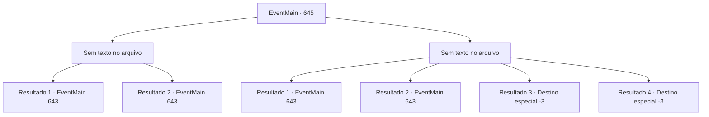

# Eventos principais · 645

[Índice da tabela](index.md) · [Índice geral](../index.md)

ID: `pt:EventMain:645` · Fonte: `EventMain4` · Versão: 1.2.47.

Mapeamento estático dos arquivos; a disponibilidade e a execução dependem do estado da run.

## Texto do evento

*Sem texto no arquivo.*

## Dados de entrada

```json
{
  "id": 645,
  "grade": 1,
  "normalGoal": "",
  "required": ""
}
```

## Mapa das escolhas



## Escolhas e resultados

### Escolha 1

*Sem texto no arquivo; o papel dessa opção depende da interface do jogo.*

Requisitos e outros campos da escolha:

```json
{
  "required": ""
}
```

#### Resultado 1.1

Os paladinos, que derrubaram os adoradores, descansam por um tempo e depois entram no esconderijo dos adoradores. É bastante escuro, bastante úmido e o chão está lamacento, tornando-se um lugar inconveniente para caminhar. Por quanto tempo você caminhou assim, O lugar para onde você chega após uma longa caminhada é um espaço estranho cheio de esqueletos e velas. Nele, há Danica deitada no altar e Gess preparando algo. 

 "...Todos! Avancem!"

 Valen, que testemunha a aparição, imediatamente dá uma ordem para avançar em voz alta. E esse é o momento. Uma fumaça negra se espalha de Danica, que está deitada no altar, e devora todos ali. Logo depois, demônios saem da névoa.

Continuação registrada: [Evento 643](0643.md) na mesma tabela.

```json
{
  "required": "24_7_1",
  "chance": "1",
  "nextEvent": 643,
  "type": 2,
  "reward": "6_0_154|5_433_1",
  "place": 6
}
```

#### Resultado 1.2

Os paladinos, que derrubaram os adoradores, descansam por um tempo e depois entram no esconderijo dos adoradores. É bastante escuro, bastante úmido e o chão está lamacento, tornando-se um lugar inconveniente para caminhar. Por quanto tempo você caminhou assim, O lugar para onde você chega após uma longa caminhada é um espaço estranho cheio de esqueletos e velas. Nele, há Danica deitada no altar e Gess preparando algo. 

 "...Todos! Avancem!"

 Valen, que testemunha a aparição, imediatamente dá uma ordem para avançar em voz alta. E esse é o momento. Uma fumaça negra se espalha de Danica, que está deitada no altar, e devora todos ali. Na névoa negra, os paladinos começam a se matar uns aos outros com os olhos brancos abertos. 

 "Oh, meu Deus!! É um monstro!!"

 "Oh! Cuidado!"

 Na espessa névoa negra, uma chama atinge a espada e o escudo. Há sangue no chão que você não sabia de quem era, e os corpos estão se acumulando gradualmente. No meio dessa terrível catástrofe, você percebe que os paladinos estão aterrorizados, como se tivessem encontrado um monstro invencível. Você tenta acalmá-los, mas eles apenas avançam com uma espada.

Continuação registrada: [Evento 643](0643.md) na mesma tabela.

```json
{
  "required": "23_7_1",
  "chance": "1",
  "nextEvent": 643,
  "type": 2,
  "reward": "6_0_50",
  "place": 6
}
```

### Escolha 2

*Sem texto no arquivo; o papel dessa opção depende da interface do jogo.*

Requisitos e outros campos da escolha:

```json
{
  "required": ""
}
```

#### Resultado 2.1

Você é atacado por um adorador. Nesse momento, um paladino levanta seu escudo para te proteger, Outros paladinos correm e matam o adorador. Você é levantado com o apoio do paladino. 

 Os paladinos, que derrotaram os adoradores, descansam um pouco e então entram no esconderijo dos adoradores. É bastante escuro, bastante úmido e o chão está lamacento, tornando-se um lugar inconveniente para caminhar. Por quanto tempo você caminhou assim, O lugar para onde você chega após uma longa caminhada é um espaço estranho cheio de esqueletos e velas. Nele, há Danica deitada no altar e Gess preparando algo. 

 "...Todos! Avancem!"

 Valen, que testemunha a aparição, imediatamente dá uma ordem para avançar em voz alta. E esse é o momento. Uma fumaça negra se espalha de Danica, que está deitada no altar, e devora todos ali. Logo depois, demônios saem da névoa.

Continuação registrada: [Evento 643](0643.md) na mesma tabela.

```json
{
  "required": "1_0_2|1_1_2|24_7_1",
  "chance": "1",
  "nextEvent": 643,
  "type": 2,
  "reward": "0_0_-1|0_1_-1|6_0_154|5_433_1",
  "place": 6
}
```

#### Resultado 2.2

Você é atacado por um adorador. Nesse momento, um paladino levanta seu escudo para te proteger, Outros paladinos correm e derrubam o adorador. Você é levantado com o apoio do paladino. 

 Os paladinos, que derrotaram os adoradores, descansam por um tempo e então entram no esconderijo dos adoradores. É bastante escuro, bastante úmido e o chão está lamacento, tornando-se um lugar inconveniente para caminhar. Por quanto tempo você caminhou assim, O lugar para onde você chega após uma longa caminhada é um espaço estranho cheio de esqueletos e velas. Nele, há Danica deitada no altar e Gess preparando algo. 

 "...Todos! Avancem!"

 Valen, que testemunha a aparição, imediatamente dá uma ordem para avançar em voz alta. E esse é o momento. Uma fumaça negra se espalha de Danica, que está deitada no altar, e devora todos ali. Na névoa negra, os paladinos começam a se matar uns aos outros com os olhos brancos abertos. 

 "Oh, meu Deus!! É um monstro!!"

 "Oh! Cuidado!"

 Na espessa névoa negra, uma chama atinge a espada e o escudo. Há sangue no chão que você não sabe de quem é, e os corpos estão se acumulando gradualmente. No meio dessa terrível catástrofe, você percebe que os paladinos estão aterrorizados, como se tivessem encontrado um monstro invencível. Você tenta acalmá-los, mas eles apenas avançam com uma espada.

Continuação registrada: [Evento 643](0643.md) na mesma tabela.

```json
{
  "required": "1_0_2|1_1_2|23_7_1",
  "chance": "1",
  "nextEvent": 643,
  "type": 2,
  "reward": "0_0_-1|0_1_-1|6_0_50|5_433_1",
  "place": 6
}
```

#### Resultado 2.3

A luta é claramente uma vitória para os paladinos. Mas isso não significa sua vitória. Depois de lutar ferozmente, você se ajoelha na dor que de repente sente atrás de você. Olhando para trás, você pode ver um adorador com uma adaga e um sorriso cruel. 

 "{1}! {1}! Aguente firme!"

 Donna se aproxima apressadamente, mas sua consciência está ficando turva. Então vem um silêncio sombrio.

Continuação registrada: [Destino especial `-3`](../destinos-especiais.md).

```json
{
  "required": "2_0_2",
  "chance": "1",
  "nextEvent": -3,
  "type": 2,
  "reward": "0_0_-1|0_1_-1"
}
```

#### Resultado 2.4

A luta é claramente uma vitória para os paladinos. Mas isso não significa sua vitória. Depois de lutar ferozmente, você se ajoelha na dor que de repente sente atrás de você. Olhando para trás, você pode ver um adorador com uma adaga e um sorriso cruel. 

 "{1}! {1}! Aguente firme!"

 Donna se aproxima apressadamente, mas sua consciência está ficando turva. Então vem um silêncio sombrio.

Continuação registrada: [Destino especial `-3`](../destinos-especiais.md).

```json
{
  "required": "2_1_2",
  "chance": "1",
  "nextEvent": -3,
  "type": 2,
  "reward": "0_0_-1|0_1_-1"
}
```

## Referências que chegam a este evento

- [Evento 634 · escolha 1 · resultado 2](0634.md#escolha-1)
- [Evento 634 · escolha 2 · resultado 1](0634.md#escolha-2)
- [Evento 635 · escolha 2 · resultado 1](0635.md#escolha-2)
