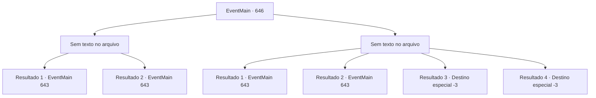

# Eventos principais · 646

[Índice da tabela](index.md) · [Índice geral](../index.md)

ID: `pt:EventMain:646` · Fonte: `EventMain4` · Versão: 1.2.47.

Mapeamento estático dos arquivos; a disponibilidade e a execução dependem do estado da run.

## Texto do evento

*Sem texto no arquivo.*

## Dados de entrada

```json
{
  "id": 646,
  "grade": 1,
  "normalGoal": "",
  "required": ""
}
```

## Mapa das escolhas



## Escolhas e resultados

### Escolha 1

*Sem texto no arquivo; o papel dessa opção depende da interface do jogo.*

Requisitos e outros campos da escolha:

```json
{
  "required": ""
}
```

#### Resultado 1.1

Os paladinos derrubam os Hezrous e seguem para o esconderijo do adorador de demônios. É bastante longe, então você caminha mais de meio dia além da vila onde lutou contra os demônios. 

 "Te, Tere! Fique amaldiçoado!"

 Ao entrar no desfiladeiro onde se acredita estarem os esconderijos dos adoradores, você pode vê-los reunidos. Gess, que está na frente deles, olha para os paladinos e ergue algo, gritando a maldição. <color=red>É a cabeça de Danica, distorcida pela dor.</color> E naquele exato momento, fumaça negra sai da cabeça de Danica e devora todos ali. Logo em seguida, demônios saem da névoa.

Continuação registrada: [Evento 643](0643.md) na mesma tabela.

```json
{
  "required": "24_7_1",
  "chance": "1",
  "nextEvent": 643,
  "type": 2,
  "reward": "6_0_154|5_433_1",
  "place": 6
}
```

#### Resultado 1.2

Os paladinos derrubam os Hezrous e seguem para o esconderijo do adorador de demônios. É bastante longe, então você caminha mais de meio dia além da vila onde lutaram contra os demônios. 

 "Te, Tere! Fiquem amaldiçoados!"

 Ao entrar no desfiladeiro onde se acredita estarem os esconderijos dos adoradores, você pode vê-los reunidos. Gess, que está na frente deles, olha para os paladinos e ergue algo, gritando a maldição. <color=red>É a cabeça de Danica, distorcida pela dor.</color> E naquele exato momento, fumaça negra sai da cabeça de Danica e devora todos ali. Na névoa negra, os paladinos começam a se matar uns aos outros com os olhos brancos abertos. 

 "Oh, meu Deus!! É um monstro!!"

 "Oh! Tere!"

 Sangue sem sentido escorre pelo chão, e os corpos se acumulam. Nesse terrível desastre, você percebe que os paladinos estão alucinando. Mas antes que possam se acalmar, a espada voa em sua direção.

Continuação registrada: [Evento 643](0643.md) na mesma tabela.

```json
{
  "required": "23_7_1",
  "chance": "1",
  "nextEvent": 643,
  "type": 2,
  "reward": "6_0_50",
  "place": 6
}
```

### Escolha 2

*Sem texto no arquivo; o papel dessa opção depende da interface do jogo.*

Requisitos e outros campos da escolha:

```json
{
  "required": ""
}
```

#### Resultado 2.1

As unhas do demônio rasgam sua carne, Você se ajoelha, sangrando. Em um momento de crise, um paladino correndo até você derruba o demônio e te apoia. Olhando ao redor, a batalha parece ter voltado para a vitória dos paladinos. 

 Os paladinos derrubam os Hezrous e seguem em direção ao esconderijo do adorador do demônio. É bastante distante, então você caminha mais de meio dia além da vila onde lutou contra os demônios. 

 "Te, Tere! Fique amaldiçoado!"

 Ao entrar no desfiladeiro onde se acredita estarem os esconderijos dos adoradores, você pode vê-los reunidos. Gess, que está na frente deles, olha para os paladinos e ergue algo, gritando a maldição. <color=red>É a cabeça de Danica, distorcida pela dor.</color> E naquele exato momento, fumaça negra sai da cabeça de Danica e devora todos ali. Logo em seguida, demônios saem da névoa.

Continuação registrada: [Evento 643](0643.md) na mesma tabela.

```json
{
  "required": "1_0_2|1_1_2|24_7_1",
  "chance": "1",
  "nextEvent": 643,
  "type": 2,
  "reward": "0_0_-1|0_1_-1|6_0_154|5_433_1",
  "place": 6
}
```

#### Resultado 2.2

As unhas do demônio rasgam sua carne, Você se ajoelha, sangrando. Em um momento de crise, um paladino correndo até você derruba o demônio e te apoia. Olhando ao redor, a batalha parece ter retornado à vitória dos paladinos. 

 Os paladinos derrubam os Hezrous e seguem para o esconderijo do adorador do demônio. É bastante distante, então você caminha mais de meio dia além da vila onde lutaram contra os demônios. 

 "Te, Tere! Fique amaldiçoado!"

 Ao entrar no desfiladeiro onde se acredita estarem os esconderijos dos adoradores, você pode vê-los reunidos. Gess, que está na frente deles, olha para os paladinos e ergue algo, gritando a maldição. <color=red>É a cabeça de Danica, distorcida pela dor.</color> E naquele exato momento, uma fumaça negra sai da cabeça de Danica e devora todos ali. Na névoa negra, os paladinos começam a se matar com os olhos brancos abertos. 

 "Oh, meu Deus!! É um monstro!!"

 "Oh! Tere!"

 Sangue sem sentido escorre pelo chão, e os corpos se acumulam. Naquele terrível desastre, você percebe que os paladinos estão alucinando. Mas antes que eles possam se acalmar, a espada voa em sua direção.

Continuação registrada: [Evento 643](0643.md) na mesma tabela.

```json
{
  "required": "1_0_2|1_1_2|23_7_1",
  "chance": "1",
  "nextEvent": 643,
  "type": 2,
  "reward": "0_0_-1|0_1_-1|6_0_50",
  "place": 6
}
```

#### Resultado 2.3

A luta é claramente uma vitória para os paladinos. Mas isso não significa a sua vitória. Depois de lutar ferozmente, você se ajoelha na dor que de repente sente atrás de você. Olhando para trás, você pode ver alguém sorrindo maliciosamente, com os dentes brilhantes de sangue expostos. Você fecha os olhos, sentindo sua consciência ficando turva.

Continuação registrada: [Destino especial `-3`](../destinos-especiais.md).

```json
{
  "required": "2_0_2",
  "chance": "1",
  "nextEvent": -3,
  "type": 2,
  "reward": "0_0_-1|0_1_-1"
}
```

#### Resultado 2.4

A luta é claramente uma vitória para os paladinos. Mas isso não significa sua vitória. Depois de lutar ferozmente, você se ajoelha na dor que de repente sente atrás de você. Olhando para trás, você pode ver alguém sorrindo maliciosamente, com os dentes brilhantes de sangue expostos. Você fecha os olhos, sentindo sua consciência ficando turva.

Continuação registrada: [Destino especial `-3`](../destinos-especiais.md).

```json
{
  "required": "2_1_2",
  "chance": "1",
  "nextEvent": -3,
  "type": 2,
  "reward": "0_0_-1|0_1_-1"
}
```

## Referências que chegam a este evento

- [Evento 633 · escolha 1 · resultado 2](0633.md#escolha-1)
- [Evento 633 · escolha 2 · resultado 2](0633.md#escolha-2)
