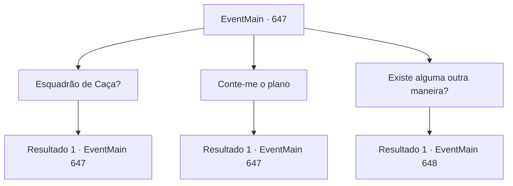

# Eventos principais · 647

[Índice da tabela](index.md) · [Índice geral](../index.md)

ID: `pt:EventMain:647` · Fonte: `EventMain4` · Versão: 1.2.47.

Mapeamento estático dos arquivos; a disponibilidade e a execução dependem do estado da run.

## Texto do evento

Você estava esperando por Gess na periferia de 'Brownville'. A cidade, famosa por seus imponentes edifícios turísticos, escondia uma das piores favelas, um local cheio de miséria e corrupção. Era o lugar perfeito para evitar os olhares atentos da Igreja de Teresia. Enquanto aguardava dentro de um edifício abandonado, os seguidores apareceram. Ges, que estava à frente do grupo, se curvou para você com pressa e disse:  

 "Senhor, uma informação importante. O esquadrão de caça de Teresia está procurando pelo contratante."


## Dados de entrada

```json
{
  "id": 647,
  "grade": 1,
  "normalGoal": "",
  "required": "1_2_75|13_4_10"
}
```

## Mapa das escolhas



## Escolhas e resultados

### Escolha 1

Esquadrão de Caça?

Requisitos e outros campos da escolha:

```json
{
  "required": "5_400_0"
}
```

#### Resultado 1.1

Gess gagueja e explica quando você pergunta sobre as forças punitivas. Eles são um grupo de cerca de 20 pessoas, formado pelos paladinos de Tere e aventureiros famosos. Seu único objetivo é a sua subjugação. 

 "Bem, de acordo com as informações que reunimos, eles estarão nesta cidade em alguns dias. Mas já montamos um plano. Hehe..."

 Gess ri baixinho com seu sorriso estranho habitual.

Continuação registrada: [Evento 647](0647.md) na mesma tabela.

```json
{
  "required": "",
  "chance": "1",
  "nextEvent": 647,
  "type": 2,
  "reward": "5_400_1"
}
```

### Escolha 2

Conte-me o plano

Requisitos e outros campos da escolha:

```json
{
  "required": "5_400_1"
}
```

#### Resultado 2.1

Quando você pede pelo plano, Gess cospe e explica. 

 "Nós, nós vamos encontrar um aliado que possa derrotar as forças punitivas."

 Com isso, Gess sugere duas opções. Uma delas é realizar uma cerimônia para invocar os demônios de Kior. A outra é reanimar um monstro poderoso como uma besta morta-viva. 

 "Acontece que há uma caverna de dragão azul por perto. É um grande risco, mas... Se você matá-lo e pegar seu coração... Nós podemos transformá-lo em morto-vivo."

 Agora é a hora de correr riscos, você pensa. Gess pede sua opinião sobre qual das duas opções você quer seguir.

Continuação registrada: [Evento 647](0647.md) na mesma tabela.

```json
{
  "required": "",
  "chance": "1",
  "nextEvent": 647,
  "type": 2,
  "reward": "5_400_2"
}
```

### Escolha 3

Existe alguma outra maneira?

Requisitos e outros campos da escolha:

```json
{
  "required": "5_400_2"
}
```

#### Resultado 3.1

Você pergunta a Gess se há alguma outra maneira. Gess pondera por um momento sua pergunta e então fala com um sorriso malicioso. 

 "Tentando enganar o dragão azul para nos ajudar é outra opção... KeKe..."

 O plano que Gess descreve é simples. Diga ao dragão azul que as forças punitivas estão vindo atrás dele em vez disso. Gess explica que se o dragão azul concordar em ser seu aliado, você não precisará transformá-lo em morto-vivo. 

 "O que você gostaria de fazer? Por favor, tome uma decisão."

 Os olhos de Gess estão em você.

Continuação registrada: [Evento 648](0648.md) na mesma tabela.

```json
{
  "required": "",
  "chance": "1",
  "nextEvent": 648,
  "type": 2,
  "reward": ""
}
```

## Referências que chegam a este evento

- [Evento 647 · escolha 1 · resultado 1](0647.md#escolha-1)
- [Evento 647 · escolha 2 · resultado 1](0647.md#escolha-2)
