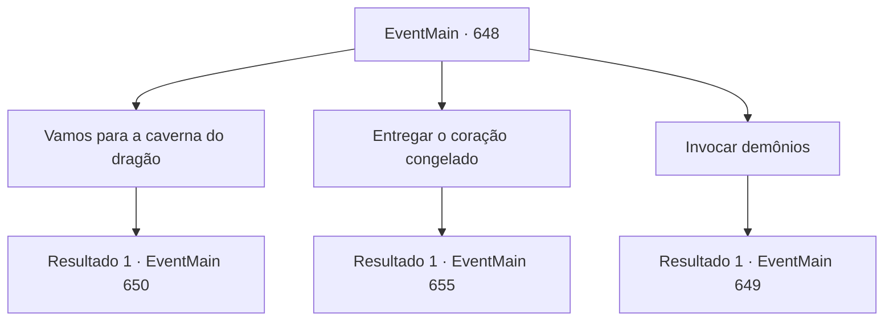

# Eventos principais · 648

[Índice da tabela](index.md) · [Índice geral](../index.md)

ID: `pt:EventMain:648` · Fonte: `EventMain4` · Versão: 1.2.47.

Mapeamento estático dos arquivos; a disponibilidade e a execução dependem do estado da run.

## Texto do evento

*Sem texto no arquivo.*

## Dados de entrada

```json
{
  "id": 648,
  "grade": 1,
  "normalGoal": "",
  "required": ""
}
```

## Mapa das escolhas



## Escolhas e resultados

### Escolha 1

Vamos para a caverna do dragão

Requisitos e outros campos da escolha:

```json
{
  "required": ""
}
```

#### Resultado 1.1

Você deixa os bairros pobres com os adoradores de Kior e segue em direção à toca do dragão. Ela está localizada no lado de um penhasco a vários quilômetros de distância. Abaixo da entrada da toca, ondas fortes batem contra as rochas. E há uma densa selva cercando o penhasco. Você caminha pela selva enquanto os adoradores de Kior olham nervosamente para o mar. 

 "Só um pouco, um pouco mais longe daqui."

 Mas assim que Gess termina de falar, os Lizardfolk saltam da selva. Eles imediatamente começam a atacar os adoradores. 

 "Kyaaaoooo--!!!"

 Os Lizardfolk não são de conversa. Você saca sua arma e entra na batalha.

Continuação registrada: [Evento 650](0650.md) na mesma tabela.

```json
{
  "required": "",
  "chance": "1",
  "nextEvent": 650,
  "type": 2,
  "reward": "6_3_10",
  "place": 1
}
```

### Escolha 2

Entregar o coração congelado

Requisitos e outros campos da escolha:

```json
{
  "required": "8_113_1"
}
```

#### Resultado 2.1

Você já obteve um Coração Congelado, então você o entrega para Gess. Gess pega o coração do dragão e olha para você com olhos surpresos. 

 "Oh, oh, oh, você já te,tem! I,Isso é p,perfeito."

 Gess te leva para uma casa na favela. E se escondendo dos olhares curiosos no porão, ele começa a se preparar para a cerimônia com os adoradores.

Continuação registrada: [Evento 655](0655.md) na mesma tabela.

```json
{
  "required": "",
  "chance": "1",
  "nextEvent": 655,
  "type": 2,
  "reward": "5_849_1"
}
```

### Escolha 3

Invocar demônios

Requisitos e outros campos da escolha:

```json
{
  "required": ""
}
```

#### Resultado 3.1

Você decidiu convocar os demônios de Kior. Com sua escolha, Gess acena com a cabeça e explica o que você precisará para convocá-los. 

 "Eu, eu posso reunir a, a maioria das coisas p, para a cerimônia, ma, mas eu preciso de uma o, oferta f, fresca."

 Gess diz que uma Orbe de Wyvern parece ser uma oferta ritual adequada. 

 "Wy, wyverns vi, vivem nas montanhas a, por aqui..."

 Gess olha para você, como se quisesse que você vá procurar um wyvern.

Continuação registrada: [Evento 649](0649.md) na mesma tabela.

```json
{
  "required": "",
  "chance": "1",
  "nextEvent": 649,
  "type": 2,
  "reward": ""
}
```

## Referências que chegam a este evento

- [Evento 647 · escolha 3 · resultado 1](0647.md#escolha-3)
