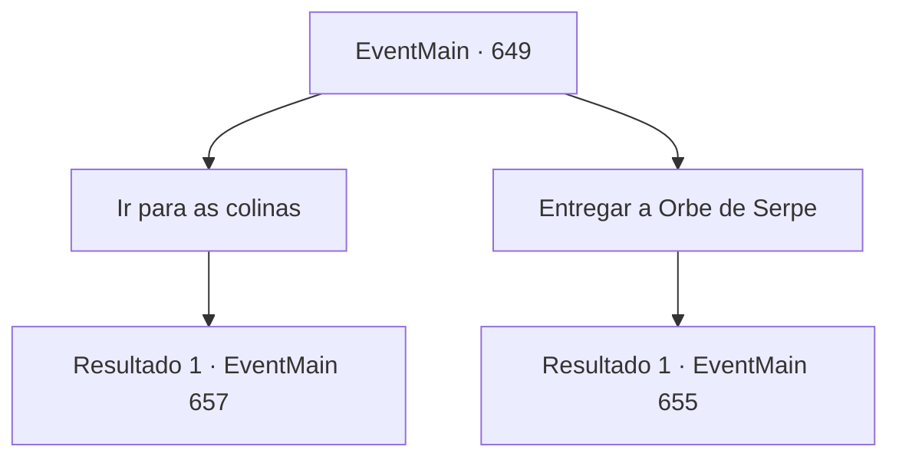

# Eventos principais · 649

[Índice da tabela](index.md) · [Índice geral](../index.md)

ID: `pt:EventMain:649` · Fonte: `EventMain4` · Versão: 1.2.47.

Mapeamento estático dos arquivos; a disponibilidade e a execução dependem do estado da run.

## Texto do evento

*Sem texto no arquivo.*

## Dados de entrada

```json
{
  "id": 649,
  "grade": 1,
  "normalGoal": "",
  "required": ""
}
```

## Mapa das escolhas



## Escolhas e resultados

### Escolha 1

Ir para as colinas

Requisitos e outros campos da escolha:

```json
{
  "required": ""
}
```

#### Resultado 1.1

Você segue para as montanhas próximas com alguns dos adoradores. Parece que Gess estava certo. Ao se aproximar das montanhas, você ouve o grito agudo e distintivo de um Wyvern. Quando você olha ao redor, percebe muita água da chuva no chão e o rio que corre ao longo do caminho está lamacento. Você apressa seus passos, evitando as poças sujas. 

 "Wyvern! Tem um wyvern aqui!"

 Conforme você continua mais adentro da cadeia de montanhas, olha para o céu para ver do que os adoradores estão gritando. Com um grito, um wyvern está voando em sua direção.

Continuação registrada: [Evento 657](0657.md) na mesma tabela.

```json
{
  "required": "",
  "chance": "1",
  "nextEvent": 657,
  "type": 2,
  "reward": "6_0_40",
  "place": 1
}
```

### Escolha 2

Entregar a Orbe de Serpe

Requisitos e outros campos da escolha:

```json
{
  "required": "8_45_1"
}
```

#### Resultado 2.1

Você já obteve uma Orbe de Wyvern, então você a entrega para Gess. Gess pega a orbe e olha para você com olhos surpresos. 

 "Oh, oh, oh, você já te,tem! I,Isso é p,perfeito."

 Gess te leva para uma casa na favela. E se escondendo de olhares curiosos no porão, ele começa a se preparar para a cerimônia com os adoradores.

Continuação registrada: [Evento 655](0655.md) na mesma tabela.

```json
{
  "required": "",
  "chance": "1",
  "nextEvent": 655,
  "type": 2,
  "reward": "5_850_1"
}
```

## Referências que chegam a este evento

- [Evento 648 · escolha 3 · resultado 1](0648.md#escolha-3)
