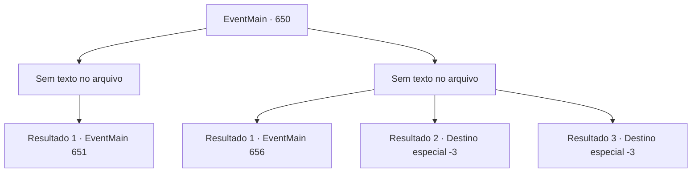

# Eventos principais · 650

[Índice da tabela](index.md) · [Índice geral](../index.md)

ID: `pt:EventMain:650` · Fonte: `EventMain4` · Versão: 1.2.47.

Mapeamento estático dos arquivos; a disponibilidade e a execução dependem do estado da run.

## Texto do evento

*Sem texto no arquivo.*

## Dados de entrada

```json
{
  "id": 650,
  "grade": 1,
  "normalGoal": "",
  "required": ""
}
```

## Mapa das escolhas



## Escolhas e resultados

### Escolha 1

*Sem texto no arquivo; o papel dessa opção depende da interface do jogo.*

Requisitos e outros campos da escolha:

```json
{
  "required": ""
}
```

#### Resultado 1.1

Você joga fora a cabeça de um guerreiro Lizardfolk e olha ao redor. Os outros Lizardfolk também estão todos mortos. Você retoma sua jornada em direção à caverna do dragão. Mas naquele exato momento, algo acontece.

 <link=shake> 'Vaaarrrooooom!'</link> |drawing_blueDragon| Um raio cai do céu, e algo enorme fica em seu caminho. Ele tem escamas azuis e asas, e te encara com seus olhos dourados. É um dragão azul. 

 "Vocês, punks arrogantes! Como ousam colocar os pés no meu domínio e matar meus homens? Vocês vão morrer!!"

 O dragão azul grita e se prepara para atacar.

Continuação registrada: [Evento 651](0651.md) na mesma tabela.

```json
{
  "required": "",
  "chance": "1",
  "nextEvent": 651,
  "type": 2,
  "reward": ""
}
```

### Escolha 2

*Sem texto no arquivo; o papel dessa opção depende da interface do jogo.*

Requisitos e outros campos da escolha:

```json
{
  "required": ""
}
```

#### Resultado 2.1

A luta contra os Lizardfolk não é uma batalha. É uma 'caçada' unilateral onde você e todos os adoradores são forçados a fugir. Há quanto tempo você está correndo? Depois de mal se livrar dos Lizardfolk, você olha ao redor. Felizmente, não há sinal de inimigos por perto. Você só pode ouvir passos ao longe. 

 "Heeg... E-eu acho que teremos que procurar outra oferenda."

 Você concorda com as palavras de Gess e descobre para onde seguir em seguida.

Continuação registrada: [Evento 656](0656.md) na mesma tabela.

```json
{
  "required": "1_0_2|1_1_2",
  "chance": "1",
  "nextEvent": 656,
  "type": 2,
  "reward": "0_0_-1|0_1_-1"
}
```

#### Resultado 2.2

A luta contra os Lizardfolk não é uma batalha. É uma 'caçada' unilateral. Você acaba sendo a presa deles.

Continuação registrada: [Destino especial `-3`](../destinos-especiais.md).

```json
{
  "required": "2_0_2",
  "chance": "1",
  "nextEvent": -3,
  "type": 2,
  "reward": "0_0_-1|0_1_-1"
}
```

#### Resultado 2.3

A luta contra os Lizardfolk não é uma batalha. É uma 'caçada' unilateral. Você acaba sendo a presa deles.

Continuação registrada: [Destino especial `-3`](../destinos-especiais.md).

```json
{
  "required": "2_1_2",
  "chance": "1",
  "nextEvent": -3,
  "type": 2,
  "reward": "0_0_-1|0_1_-1"
}
```

## Referências que chegam a este evento

- [Evento 648 · escolha 1 · resultado 1](0648.md#escolha-1)
