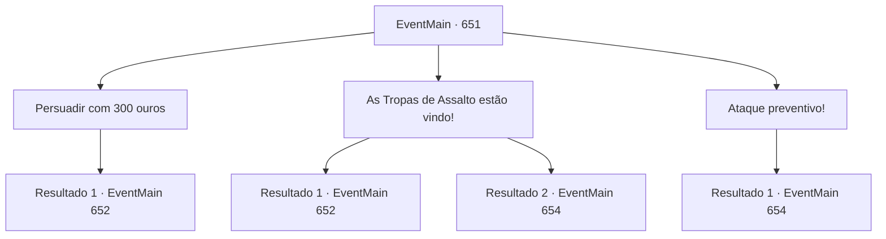

# Eventos principais · 651

[Índice da tabela](index.md) · [Índice geral](../index.md)

ID: `pt:EventMain:651` · Fonte: `EventMain4` · Versão: 1.2.47.

Mapeamento estático dos arquivos; a disponibilidade e a execução dependem do estado da run.

## Texto do evento

*Sem texto no arquivo.*

## Dados de entrada

```json
{
  "id": 651,
  "grade": 1,
  "normalGoal": "",
  "required": ""
}
```

## Mapa das escolhas



## Escolhas e resultados

### Escolha 1

Persuadir com 300 ouros

Requisitos e outros campos da escolha:

```json
{
  "required": "1_4_300"
}
```

#### Resultado 1.1

Você oferece 300 ouro ao dragão azul e se curva educadamente. Ele examina seu gesto enquanto você declara que tem uma mensagem urgente. O dragão azul olha para as moedas brilhantes, então rapidamente tosse e acena com a cabeça. 

 "Hmm. Você sabe ser educado. Tudo bem, vou ouvir você em particular. Fale."

 Parece que ele não se importa muito com o fato de os Lizardfolk estarem mortos. Você mente para o dragão azul e diz que 'As forças punitivas de Tere estão te perseguindo'. O dragão acredita em suas palavras e sua raiva queima como um fogo. 

 "Como ousam...! Os fanáticos estão vindo atrás de mim?!"

 O dragão azul rosna e abre suas asas. Você acalma o dragão azul enfurecido oferecendo ajuda. Então o dragão respira fundo e responde a você. 

 "Tudo bem. Você tem um plano para lidar com esses valentões arrogantes?"

 Quando ele faz essa pergunta, você elabora um plano para lidar com a força punitiva.

Continuação registrada: [Evento 652](0652.md) na mesma tabela.

```json
{
  "required": "",
  "chance": "1",
  "nextEvent": 652,
  "type": 2,
  "reward": "0_4_-300"
}
```

### Escolha 2

As Tropas de Assalto estão vindo!

Requisitos e outros campos da escolha:

```json
{
  "required": ""
}
```

#### Resultado 2.1

Você mente para o dragão azul e diz 'As forças punitivas de Tere estão te perseguindo'. O dragão não acredita em você no começo, mas eventualmente cai na sua lábia. A raiva do dragão começa a queimar como um fogo. 

 "Como ousam...! Os fanáticos estão vindo atrás de mim?!"

 O dragão azul rosna e abre suas asas. Você acalma o furioso dragão azul oferecendo ajuda. Então o dragão respira fundo e responde a você. 

 "Tudo bem. Você tem um plano para lidar com esses valentões arrogantes?"

 Quando ele faz essa pergunta, você elabora um plano para lidar com a força punitiva.

Continuação registrada: [Evento 652](0652.md) na mesma tabela.

```json
{
  "required": "",
  "chance": "1|0_7_1",
  "nextEvent": 652,
  "type": 0,
  "reward": ""
}
```

#### Resultado 2.2

Você mente para o dragão azul e diz 'As forças punitivas de Tere estão te perseguindo'. O dragão não acredita. Pelo contrário, ele ri de você e refuta logicamente sua afirmação. 

 "Hahaha! Você acha que os fanáticos de Tere estão perdendo tempo me perseguindo e deixando os adoradores de demônios sem controle? Que mentira convincente!"

 O dragão azul explode em risos e voa para o céu. Ele te banha com sua respiração de relâmpago. Você rapidamente se esquiva e pega sua arma, escapando de seu ataque.

Continuação registrada: [Evento 654](0654.md) na mesma tabela.

```json
{
  "required": "",
  "chance": "16",
  "nextEvent": 654,
  "type": 1,
  "reward": "6_0_157",
  "place": 1
}
```

### Escolha 3

Ataque preventivo!

Requisitos e outros campos da escolha:

```json
{
  "required": ""
}
```

#### Resultado 3.1

Você ataca o dragão antes que ele possa chegar até você. No entanto, o dragão voa para o céu para evitar o ataque. Ele cospe raios em você e nos adoradores. 

 "P, Protejam o Con, contratante!"

 Com o grito de Gess, os adoradores lançam feitiços malignos no dragão. Você evita a respiração de raios, procurando uma oportunidade para matar o dragão.

Continuação registrada: [Evento 654](0654.md) na mesma tabela.

```json
{
  "required": "",
  "chance": "1",
  "nextEvent": 654,
  "type": 2,
  "reward": "6_0_157",
  "place": 1
}
```

## Referências que chegam a este evento

- [Evento 650 · escolha 1 · resultado 1](0650.md#escolha-1)
