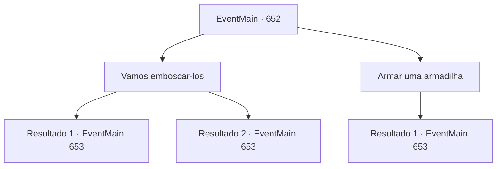

# Eventos principais · 652

[Índice da tabela](index.md) · [Índice geral](../index.md)

ID: `pt:EventMain:652` · Fonte: `EventMain4` · Versão: 1.2.47.

Mapeamento estático dos arquivos; a disponibilidade e a execução dependem do estado da run.

## Texto do evento

*Sem texto no arquivo.*

## Dados de entrada

```json
{
  "id": 652,
  "grade": 1,
  "normalGoal": "",
  "required": ""
}
```

## Mapa das escolhas



## Escolhas e resultados

### Escolha 1

Vamos emboscar-los

Requisitos e outros campos da escolha:

```json
{
  "required": ""
}
```

#### Resultado 1.1

Você sugere uma emboscada. Nós sabemos de qual direção o inimigo está vindo. Então vamos esperar por eles e atacar primeiro para ganhar vantagem. O dragão azul acena como se sua sugestão fosse razoável. Você e os adoradores se escondem ao longo da rota que você espera que a força punitiva tome.

 No dia seguinte, você está esperando no local da emboscada planejada. Um adorador se aproxima de você e sussurra. 

 "A força punitiva chegou."

 Como esperado, eles estão vindo em direção ao seu esconderijo. Todos estão usando capas com a marca de Tere. Liderando-os está uma mulher paladina de cabelos vermelhos. Tendo identificado seus inimigos, você e os adoradores imediatamente os atacam. Com o ataque repentino, a força punitiva vacila de surpresa. Então o dragão azul aparece do céu e lança um sopro de relâmpago. 

 "Vocês arrogantes! Morram!!"

 O grito alto do dragão azul ressoa no meio do campo de batalha.

Continuação registrada: [Evento 653](0653.md) na mesma tabela.

```json
{
  "required": "",
  "chance": "1|0_6_1",
  "nextEvent": 653,
  "type": 0,
  "reward": "6_2_149",
  "place": 1
}
```

#### Resultado 1.2

Você sugere uma emboscada. Nós sabemos de qual direção o inimigo está vindo. Então vamos esperar por eles e atacar primeiro para ganhar vantagem. O dragão azul acena como se sua sugestão fosse razoável. Você e os adoradores se escondem ao longo da rota que você espera que a força punitiva tome.

 No dia seguinte, você está esperando no local da emboscada planejada. Um adorador se aproxima de você e sussurra. 

 "A força punitiva chegou."

 Como esperado, eles estão vindo em direção ao seu esconderijo. Todos estão usando capas com a marca de Tere. Liderando-os está uma mulher paladina de cabelos vermelhos. Mas antes que você possa atacar, alguém grita. 

 "É uma emboscada!"

 Você e os adoradores imediatamente avançam contra eles, e a força punitiva lança um contra-ataque sem perder o ritmo. Mas logo em seguida, eles são atordoados pelo dragão azul que aparece do céu. 

 "Vocês arrogantes! Morram!!"

 O grito alto do dragão azul ressoa no meio do campo de batalha.

Continuação registrada: [Evento 653](0653.md) na mesma tabela.

```json
{
  "required": "",
  "chance": "15",
  "nextEvent": 653,
  "type": 1,
  "reward": "6_0_149",
  "place": 1
}
```

### Escolha 2

Armar uma armadilha

Requisitos e outros campos da escolha:

```json
{
  "required": "8_38_1"
}
```

#### Resultado 2.1

Você sugere armar armadilhas e depois atacá-los. O dragão azul concorda que essa é uma boa ideia e sugere onde colocar as armadilhas. Você cava algumas armadilhas de queda e depois se esconde com os adoradores na selva. 

 Quando o crepúsculo cai, um grito soa do meio da selva. Conforme planejado, a força punitiva cai em suas armadilhas. 

 "Aaarrrg!!"

 Todos eles estão usando capas com a marca de Tere. Liderando-os está uma mulher paladina de cabelos vermelhos. Após confirmar que estão presos, você imediatamente ordena que os adoradores os ataquem. Então o dragão azul aparece do céu e lança um sopro de relâmpago. 

 "Vocês punks arrogantes! Morram!!"

 O grito alto do dragão azul ressoa no meio do campo de batalha.

Continuação registrada: [Evento 653](0653.md) na mesma tabela.

```json
{
  "required": "",
  "chance": "1",
  "nextEvent": 653,
  "type": 2,
  "reward": "4_38_1|6_2_149",
  "place": 1
}
```

## Referências que chegam a este evento

- [Evento 651 · escolha 1 · resultado 1](0651.md#escolha-1)
- [Evento 651 · escolha 2 · resultado 1](0651.md#escolha-2)
