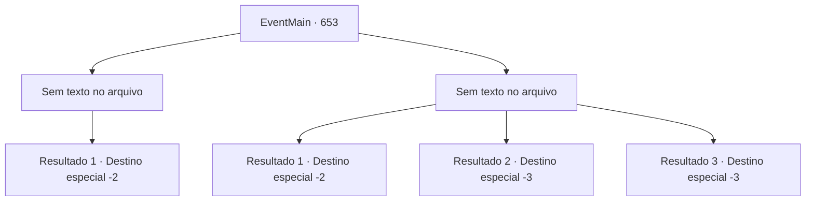

# Eventos principais · 653

[Índice da tabela](index.md) · [Índice geral](../index.md)

ID: `pt:EventMain:653` · Fonte: `EventMain4` · Versão: 1.2.47.

Mapeamento estático dos arquivos; a disponibilidade e a execução dependem do estado da run.

## Texto do evento

*Sem texto no arquivo.*

## Dados de entrada

```json
{
  "id": 653,
  "grade": 1,
  "normalGoal": "",
  "required": ""
}
```

## Mapa das escolhas



## Escolhas e resultados

### Escolha 1

*Sem texto no arquivo; o papel dessa opção depende da interface do jogo.*

Requisitos e outros campos da escolha:

```json
{
  "required": ""
}
```

#### Resultado 1.1

Quando a luta desesperada contra a força punitiva termina, apenas você e um punhado de adoradores sobreviveram. A força lutou até o último suspiro. Eles quase te dominaram, então provavelmente foi apenas sorte que você os venceu. Você olha para o corpo da paladina caída. Seu cabelo vermelho está espalhado de sangue pelo chão. 

 "Ela é Valen. Ela era chamada de a paladina mais poderosa de Tere... Keke..."

 Você ouve Gess rir e então dedica as almas de todos os falecidos a Kior. Gess observa a cena e então fala com você, inclinando a cabeça no chão. 

 "E,Então, nós vamos i,ir agora. Eu v,vou c,contatá-lo novamente assim que o p,próximo plano estiver pronto."

 Gess se despede e leva os adoradores restantes embora.

Continuação registrada: [Destino especial `-2`](../destinos-especiais.md).

```json
{
  "required": "",
  "chance": "1",
  "nextEvent": -2,
  "type": 2,
  "reward": "13_4_18"
}
```

### Escolha 2

*Sem texto no arquivo; o papel dessa opção depende da interface do jogo.*

Requisitos e outros campos da escolha:

```json
{
  "required": ""
}
```

#### Resultado 2.1

No combate desesperado, a força punitiva ganha a vantagem. Gess te diz para fugir. 

 "Isso, isso, isso não pode estar acontecendo. Por favor, corra, fuja...!"

 Atendendo ao seu pedido, você foge do campo de batalha, deixando os adoradores para trás.

Continuação registrada: [Destino especial `-2`](../destinos-especiais.md).

```json
{
  "required": "1_0_2|1_1_2",
  "chance": "1",
  "nextEvent": -2,
  "type": 2,
  "reward": "0_0_-1|0_1_-1|13_4_19"
}
```

#### Resultado 2.2

A mulher de cabelos vermelhos corta sua garganta com sua espada. Você teria considerado um jogo de espadas admirável se não estivesse do lado recebedor do golpe. Seu corpo perde a cabeça e desaba.

Continuação registrada: [Destino especial `-3`](../destinos-especiais.md).

```json
{
  "required": "2_0_2",
  "chance": "1",
  "nextEvent": -3,
  "type": 2,
  "reward": "0_0_-1|0_1_-1"
}
```

#### Resultado 2.3

A mulher de cabelos vermelhos corta sua garganta com sua espada. Você teria considerado um jogo de espadas admirável se não estivesse do lado recebedor do golpe. Seu corpo perde a cabeça e desaba.

Continuação registrada: [Destino especial `-3`](../destinos-especiais.md).

```json
{
  "required": "2_1_2",
  "chance": "1",
  "nextEvent": -3,
  "type": 2,
  "reward": "0_0_-1|0_1_-1"
}
```

## Referências que chegam a este evento

- [Evento 652 · escolha 1 · resultado 1](0652.md#escolha-1)
- [Evento 652 · escolha 1 · resultado 2](0652.md#escolha-1)
- [Evento 652 · escolha 2 · resultado 1](0652.md#escolha-2)
- [Evento 655 · escolha 1 · resultado 1](0655.md#escolha-1)
- [Evento 655 · escolha 1 · resultado 2](0655.md#escolha-1)
- [Evento 656 · escolha 1 · resultado 1](0656.md#escolha-1)
- [Evento 656 · escolha 1 · resultado 2](0656.md#escolha-1)
- [Evento 656 · escolha 3 · resultado 1](0656.md#escolha-3)
- [Evento 658 · escolha 1 · resultado 1](0658.md#escolha-1)
- [Evento 658 · escolha 2 · resultado 1](0658.md#escolha-2)
