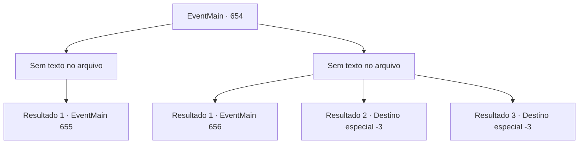

# Eventos principais · 654

[Índice da tabela](index.md) · [Índice geral](../index.md)

ID: `pt:EventMain:654` · Fonte: `EventMain4` · Versão: 1.2.47.

Mapeamento estático dos arquivos; a disponibilidade e a execução dependem do estado da run.

## Texto do evento

*Sem texto no arquivo.*

## Dados de entrada

```json
{
  "id": 654,
  "grade": 1,
  "normalGoal": "",
  "required": ""
}
```

## Mapa das escolhas



## Escolhas e resultados

### Escolha 1

*Sem texto no arquivo; o papel dessa opção depende da interface do jogo.*

Requisitos e outros campos da escolha:

```json
{
  "required": ""
}
```

#### Resultado 1.1

O corpo gigante do dragão azul cai com um estrondo ensurdecedor. Você rapidamente sobe no dragão caído e arranca seu coração. O coração do dragão azul é grande, quente e tem uma corrente elétrica. Ao entregá-lo a Gess, ele murmura com uma expressão encantada. 

 "Oh, oh, Isso é... o c, coração do dragão...!"

 Gess entra na toca do dragão, dizendo: 'Vamos nos apressar e realizar a cerimônia'. E usando a toca como local de ritual, ele começa a preparar a cerimônia para transformar o dragão em um seguidor morto-vivo.

Continuação registrada: [Evento 655](0655.md) na mesma tabela.

```json
{
  "required": "",
  "chance": "1",
  "nextEvent": 655,
  "type": 2,
  "reward": "3_245_1|5_849_1"
}
```

### Escolha 2

*Sem texto no arquivo; o papel dessa opção depende da interface do jogo.*

Requisitos e outros campos da escolha:

```json
{
  "required": ""
}
```

#### Resultado 2.1

O dragão azul não é algo que você possa lidar. O dragão queima e mata adoradores com seus raios e os esmaga com seu corpo enorme. Tudo o que você pode fazer é reunir os adoradores sobreviventes e fugir.

 Depois de mal conseguir se livrar do dragão, você olha ao redor. Felizmente, não há sinal de inimigos por perto. Você só consegue ouvir passos ao longe. 

 "Heeg... E-eu acho que te-temos que pr-procurar uma, outra oferenda."

 Você concorda com as palavras de Gess e descobre para onde seguir em seguida.

Continuação registrada: [Evento 656](0656.md) na mesma tabela.

```json
{
  "required": "1_0_2|1_1_2",
  "chance": "1",
  "nextEvent": 656,
  "type": 2,
  "reward": "0_0_-1|0_1_-1"
}
```

#### Resultado 2.2

O raio do dragão azul continua a atingir você. O poder do raio é suficiente para queimar você até a morte em um instante.

Continuação registrada: [Destino especial `-3`](../destinos-especiais.md).

```json
{
  "required": "2_0_2",
  "chance": "1",
  "nextEvent": -3,
  "type": 2,
  "reward": "0_0_-1|0_1_-1"
}
```

#### Resultado 2.3

O raio do dragão azul continua a atingir você. O poder do raio é suficiente para queimar você até a morte em um instante.

Continuação registrada: [Destino especial `-3`](../destinos-especiais.md).

```json
{
  "required": "2_1_2",
  "chance": "1",
  "nextEvent": -3,
  "type": 2,
  "reward": "0_0_-1|0_1_-1"
}
```

## Referências que chegam a este evento

- [Evento 651 · escolha 2 · resultado 2](0651.md#escolha-2)
- [Evento 651 · escolha 3 · resultado 1](0651.md#escolha-3)
