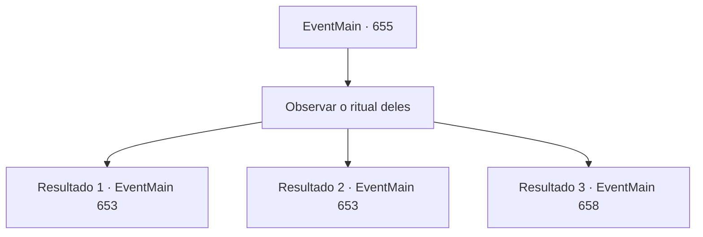

# Eventos principais · 655

[Índice da tabela](index.md) · [Índice geral](../index.md)

ID: `pt:EventMain:655` · Fonte: `EventMain4` · Versão: 1.2.47.

Mapeamento estático dos arquivos; a disponibilidade e a execução dependem do estado da run.

## Texto do evento

*Sem texto no arquivo.*

## Dados de entrada

```json
{
  "id": 655,
  "grade": 1,
  "normalGoal": "",
  "required": ""
}
```

## Mapa das escolhas



## Escolhas e resultados

### Escolha 1

Observar o ritual deles

Requisitos e outros campos da escolha:

```json
{
  "required": ""
}
```

#### Resultado 1.1

|drawing_DemonSummon| Durante um dia inteiro, os adoradores se prepararam para a cerimônia. Eles pintaram círculos mágicos com tinta vermelha no chão, acenderam velas e os arrumaram cuidadosamente. Finalmente, Gess coloca o coração do dragão no centro dos círculos mágicos e inicia a cerimônia. 

 "Meu grande mestre...! Por favor... receba nosso sacrifício e nos dê força...!"

 Gess corta seu braço com uma adaga e derrama sangue nos círculos mágicos. Os círculos mágicos manchados de sangue brilham escuros e devoram o coração e o sangue. Imediatamente depois, o espaço ao redor deles é grandemente distorcido. E um dragão feito de ossos aparece. <link=shake>

 "Grrrhhhhh...!!"

</link> O dragão de ossos uiva com uma voz grotesca e sombria. É nesse momento que a força punitiva irrompe repentinamente na sala da cerimônia. 

 "Aqui! Há adoradores de demônios aqui!"

 Todos eles estão usando capas com a marca de Tere, e liderando-os está uma mulher paladina de cabelos vermelhos. As forças punitivas não têm medo do dragão de ossos.

Continuação registrada: [Evento 653](0653.md) na mesma tabela.

```json
{
  "required": "8_245_1|5_849_1",
  "chance": "1",
  "nextEvent": 653,
  "type": 2,
  "reward": "4_245_1|6_0_149",
  "place": 1
}
```

#### Resultado 1.2

|drawing_DemonSummon| Durante um dia inteiro, os adoradores se prepararam para a cerimônia. Eles pintaram círculos mágicos com tinta vermelha no chão, acenderam velas e os arrumaram cuidadosamente. Finalmente, Gess coloca o coração do dragão no centro dos círculos mágicos e inicia a cerimônia. 

 "Meu grande mestre...! Por favor... receba nosso sacrifício e nos dê força...!"

 Gess corta seu braço com uma adaga e derrama sangue nos círculos mágicos. Os círculos mágicos manchados de sangue brilham escuros e devoram o coração e o sangue. Imediatamente depois, o espaço ao redor deles é grandemente distorcido. E um dragão feito de ossos aparece. <link=shake>

 "Grrrhhhhh...!!"

</link> O dragão de ossos uiva com uma voz grotesca e sombria. É nesse momento que a força punitiva irrompe repentinamente na sala da cerimônia. 

 "Aqui! Há adoradores de demônios aqui!"

 Todos eles estão usando capas com a marca de Tere, e liderando-os está uma mulher paladina de cabelos vermelhos. As forças punitivas não têm medo do dragão de ossos.

Continuação registrada: [Evento 653](0653.md) na mesma tabela.

```json
{
  "required": "8_113_1|5_849_1",
  "chance": "1",
  "nextEvent": 653,
  "type": 2,
  "reward": "4_113_1|6_0_149",
  "place": 1
}
```

#### Resultado 1.3

|drawing_DemonSummon| Durante um dia inteiro, os adoradores se prepararam para a cerimônia. Eles pintaram círculos mágicos com tinta vermelha no chão, acenderam velas e as arranjaram cuidadosamente. Por fim, Gess coloca o orbe do wyvern no centro dos círculos mágicos e inicia a cerimônia. 

 "Meu grande mestre...! Por favor... receba nosso sacrifício e nos dê força...!"

 Gess corta seu braço com uma adaga e derrama sangue nos círculos mágicos. Os círculos mágicos manchados de sangue brilham escuros e devoram o coração e o sangue. Imediatamente após isso, o espaço ao redor deles é grandemente distorcido. Diante deles aparece um demônio muito mais alto do que qualquer humano, com garras afiadas e um odor repugnante. Esses 'Hezrou' são convocados durante a cerimônia. Ao final da cerimônia, oito hezrou foram convocados. Mas Gess diz que não será fácil derrotar a força punitiva e diz 'ainda precisamos de uma estratégia'.

Continuação registrada: [Evento 658](0658.md) na mesma tabela.

```json
{
  "required": "8_45_1|5_850_1",
  "chance": "1",
  "nextEvent": 658,
  "type": 2,
  "reward": "4_45_1"
}
```

## Referências que chegam a este evento

- [Evento 648 · escolha 2 · resultado 1](0648.md#escolha-2)
- [Evento 649 · escolha 2 · resultado 1](0649.md#escolha-2)
- [Evento 654 · escolha 1 · resultado 1](0654.md#escolha-1)
