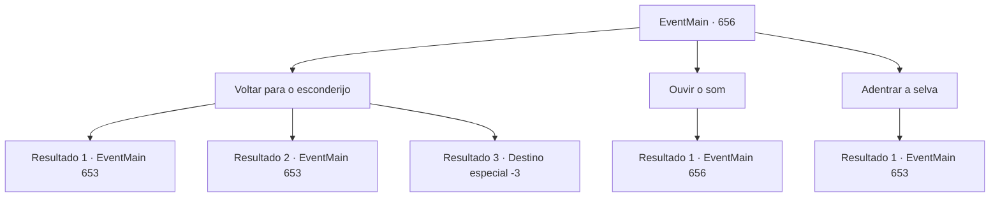

# Eventos principais · 656

[Índice da tabela](index.md) · [Índice geral](../index.md)

ID: `pt:EventMain:656` · Fonte: `EventMain4` · Versão: 1.2.47.

Mapeamento estático dos arquivos; a disponibilidade e a execução dependem do estado da run.

## Texto do evento

*Sem texto no arquivo.*

## Dados de entrada

```json
{
  "id": 656,
  "grade": 1,
  "normalGoal": "",
  "required": ""
}
```

## Mapa das escolhas



## Escolhas e resultados

### Escolha 1

Voltar para o esconderijo

Requisitos e outros campos da escolha:

```json
{
  "required": ""
}
```

#### Resultado 1.1

Você pede aos adoradores para voltarem ao seu esconderijo. Você planeja se reagrupar antes de ir procurar outra oferenda. Mas o plano falha antes mesmo de começar. Alguém ataca você e seus adoradores enquanto vocês estão tentando voltar para a cidade. 

 'Whiiiizzzz--!!' 

 Você olha para os atacantes, evitando a flecha que voa repentinamente em sua direção. Eles estão usando capas com a marca de Tere, e liderando-os está uma mulher paladina de cabelos ruivos. 

 "Adoradores de demônios estão aqui! Não deixem nenhum deles escapar!"

 Assim começa a batalha.

Continuação registrada: [Evento 653](0653.md) na mesma tabela.

```json
{
  "required": "",
  "chance": "1|0_6_1",
  "nextEvent": 653,
  "type": 0,
  "reward": "6_3_149",
  "place": 1
}
```

#### Resultado 1.2

Você pede aos adoradores para voltarem ao seu esconderijo. Você planeja se reagrupar antes de ir procurar outra oferenda. Mas o plano falha antes mesmo de começar. Alguém ataca você e seus adoradores enquanto vocês estão tentando voltar para a cidade. 

 'Whiiiizzzz--!!' 

 Depois de ser atingido pelo repentino ataque de flecha, você range os dentes e olha para os atacantes. Todos eles estão usando capas com a marca de Tere, e liderando-os está uma mulher paladina de cabelos vermelhos. 

 "Adoradores de demônios estão aqui! Não deixem nenhum deles escapar!"

 Assim começa a batalha.

Continuação registrada: [Evento 653](0653.md) na mesma tabela.

```json
{
  "required": "1_0_2",
  "chance": "14",
  "nextEvent": 653,
  "type": 1,
  "reward": "0_0_-1|6_3_149",
  "place": 1
}
```

#### Resultado 1.3

Você pede aos adoradores para voltarem ao seu esconderijo. Você planeja se reagrupar antes de ir procurar outra oferenda. Mas o plano falha antes mesmo de começar. Alguém te ataca e aos seus adoradores enquanto vocês tentam voltar para a cidade. 

 'Whiiiizzzz--!!' 

 Uma flecha perfura repentinamente o seu pescoço. Os adoradores correm até você com medo nos olhos e começam a gritar. Mas você não ouve seus gritos, pois sua mente fica em branco.

Continuação registrada: [Destino especial `-3`](../destinos-especiais.md).

```json
{
  "required": "2_0_2",
  "chance": "14",
  "nextEvent": -3,
  "type": 1,
  "reward": "0_0_-1"
}
```

### Escolha 2

Ouvir o som

Requisitos e outros campos da escolha:

```json
{
  "required": "5_401_0"
}
```

#### Resultado 2.1

Você ouve para identificar a origem dos passos. O som está vindo da direção da estrada para Brownville. Gess também está ouvindo e compartilha seus pensamentos. 

 "Parece que estão conversando... Eu ouço. Acho, acho que há mais de dez pessoas."


Continuação registrada: [Evento 656](0656.md) na mesma tabela.

```json
{
  "required": "",
  "chance": "1",
  "nextEvent": 656,
  "type": 2,
  "reward": "5_401_1"
}
```

### Escolha 3

Adentrar a selva

Requisitos e outros campos da escolha:

```json
{
  "required": ""
}
```

#### Resultado 3.1

Você lidera os adoradores profundamente na selva. Você ia procurar outra oferta lá, mas infelizmente não encontrou nada para oferecer. Ao entardecer, de repente Gess te para e aponta para algo. Ao olhar na direção que ele está apontando, você vê os paladinos de Tere e aventureiros experientes procurando pela selva. 

 "É, é a força punitiva!"

 Eles já estão bem perto, então você não pode fugir. Você saca sua arma e ordena aos adoradores que os ataquem. Quando eles ouvem seu grupo se aproximando, a força punitiva rapidamente avança em sua direção. 

 "Adoradores de demônios estão aqui! Não deixem nenhum deles escapar!"

 A primeira a chegar até você é uma mulher de cabelos vermelhos que aparenta estar liderando a força.

Continuação registrada: [Evento 653](0653.md) na mesma tabela.

```json
{
  "required": "",
  "chance": "1",
  "nextEvent": 653,
  "type": 2,
  "reward": "6_3_149",
  "place": 1
}
```

## Referências que chegam a este evento

- [Evento 650 · escolha 2 · resultado 1](0650.md#escolha-2)
- [Evento 654 · escolha 2 · resultado 1](0654.md#escolha-2)
- [Evento 656 · escolha 2 · resultado 1](0656.md#escolha-2)
- [Evento 657 · escolha 2 · resultado 1](0657.md#escolha-2)
