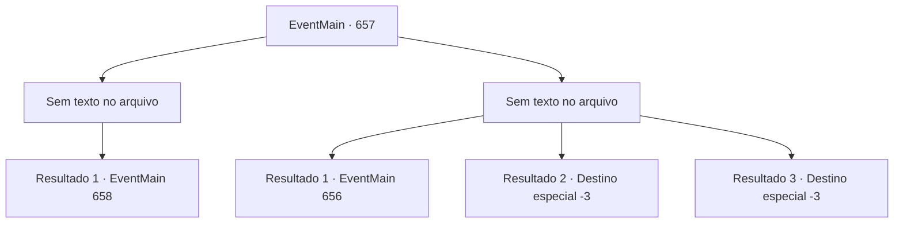

# Eventos principais · 657

[Índice da tabela](index.md) · [Índice geral](../index.md)

ID: `pt:EventMain:657` · Fonte: `EventMain4` · Versão: 1.2.47.

Mapeamento estático dos arquivos; a disponibilidade e a execução dependem do estado da run.

## Texto do evento

*Sem texto no arquivo.*

## Dados de entrada

```json
{
  "id": 657,
  "grade": 1,
  "normalGoal": "",
  "required": ""
}
```

## Mapa das escolhas



## Escolhas e resultados

### Escolha 1

*Sem texto no arquivo; o papel dessa opção depende da interface do jogo.*

Requisitos e outros campos da escolha:

```json
{
  "required": ""
}
```

#### Resultado 1.1

|drawing_DemonSummon| Durante um dia inteiro, os adoradores se prepararam para a cerimônia. Eles pintaram círculos mágicos com tinta vermelha no chão, acenderam velas e as arranjaram cuidadosamente. Por fim, Gess coloca o orbe do wyvern no centro dos círculos mágicos e inicia a cerimônia. 

 "Meu grande mestre...! Por favor... receba nosso sacrifício e nos dê força...!"

 Gess corta seu braço com uma adaga e derrama sangue nos círculos mágicos. Os círculos mágicos manchados de sangue brilham escuros e devoram o coração e o sangue. Imediatamente após isso, o espaço ao redor deles se distorce muito e começa a cheirar terrivelmente. Diante deles aparece um demônio muito mais alto do que qualquer humano, com garras afiadas e um odor repugnante. Esses 'Hezrou' são convocados durante a cerimônia. No final da cerimônia, oito hezrous foram convocados. Mas Gess diz que não será fácil vencer a força punitiva e diz 'ainda precisamos de uma estratégia'.

Continuação registrada: [Evento 658](0658.md) na mesma tabela.

```json
{
  "required": "",
  "chance": "1",
  "nextEvent": 658,
  "type": 2,
  "reward": "3_45_1"
}
```

### Escolha 2

*Sem texto no arquivo; o papel dessa opção depende da interface do jogo.*

Requisitos e outros campos da escolha:

```json
{
  "required": ""
}
```

#### Resultado 2.1

Após o violento ataque do wyvern, você foge como um louco. Com um adorador ferido como refeição, o Wyvern felizmente está ocupado demais para te perseguir. Há quanto tempo você está correndo? Você olha ao redor enquanto recupera o fôlego e se apoia na árvore. Felizmente, não há sinal de inimigos por perto. Você só consegue ouvir passos ao longe. 

 "Heeg... E-eu acho que te-temos que pr-procurar uma o-outra ofer-offerenda."

 Você concorda com as palavras de Gess e descobre para onde seguir em seguida.

Continuação registrada: [Evento 656](0656.md) na mesma tabela.

```json
{
  "required": "1_0_2|1_1_2",
  "chance": "1",
  "nextEvent": 656,
  "type": 2,
  "reward": "0_0_-1|0_1_-1"
}
```

#### Resultado 2.2

As mandíbulas enfurecidas do wyvern se fecham em torno da sua cabeça. Você é devorado pelo wyvern antes de ter a chance de escapar.

Continuação registrada: [Destino especial `-3`](../destinos-especiais.md).

```json
{
  "required": "2_0_2",
  "chance": "1",
  "nextEvent": -3,
  "type": 2,
  "reward": "0_0_-1|0_1_-1"
}
```

#### Resultado 2.3

As mandíbulas enfurecidas do wyvern se fecham em torno da sua cabeça. Você é devorado pelo wyvern antes de ter a chance de escapar.

Continuação registrada: [Destino especial `-3`](../destinos-especiais.md).

```json
{
  "required": "2_1_2",
  "chance": "1",
  "nextEvent": -3,
  "type": 2,
  "reward": "0_0_-1|0_1_-1"
}
```

## Referências que chegam a este evento

- [Evento 649 · escolha 1 · resultado 1](0649.md#escolha-1)
