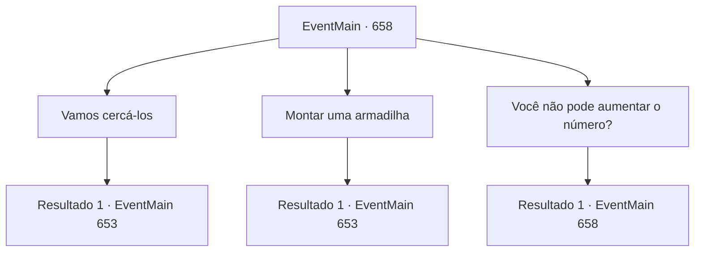

# Eventos principais · 658

[Índice da tabela](index.md) · [Índice geral](../index.md)

ID: `pt:EventMain:658` · Fonte: `EventMain4` · Versão: 1.2.47.

Mapeamento estático dos arquivos; a disponibilidade e a execução dependem do estado da run.

## Texto do evento

*Sem texto no arquivo.*

## Dados de entrada

```json
{
  "id": 658,
  "grade": 1,
  "normalGoal": "",
  "required": ""
}
```

## Mapa das escolhas



## Escolhas e resultados

### Escolha 1

Vamos cercá-los

Requisitos e outros campos da escolha:

```json
{
  "required": ""
}
```

#### Resultado 1.1

Você propõe cercá-los de ambos os lados. Gess acena com a cabeça, dizendo que é uma boa ideia. Ele ajuda você a encontrar o local certo para se esconder para a emboscada.

 No dia seguinte, a força punitiva entra na selva, gritando. A força punitiva é composta pelos paladinos e aventureiros de Tere. A pessoa que lidera o grupo é uma mulher paladina de cabelos vermelhos. 

 "Algo está fedendo."

 Ela olha ao redor por um momento e aponta sua espada para os arbustos onde você está escondido. 

 "Sigam-me! Ali, os adoradores de demônios estão se escondendo!"


Continuação registrada: [Evento 653](0653.md) na mesma tabela.

```json
{
  "required": "",
  "chance": "1",
  "nextEvent": 653,
  "type": 2,
  "reward": "6_3_149",
  "place": 1
}
```

### Escolha 2

Montar uma armadilha

Requisitos e outros campos da escolha:

```json
{
  "required": "8_38_1"
}
```

#### Resultado 2.1

Você sugere armar armadilhas e depois atacá-los. Gess concorda que essa é uma boa ideia e sugere onde você deve colocar as armadilhas. Você cava algumas armadilhas de queda e depois se esconde com os adoradores na selva. 

 Quando o crepúsculo cai, um grito soa do meio da selva. Conforme planejado, a força punitiva cai em suas armadilhas. 

 "Aaarrrg!!"

 Todos eles estão usando capas com a marca de Tere. Liderando-os está uma mulher paladina de cabelos vermelhos. Após confirmar que estão presos, você imediatamente ordena que os adoradores os ataquem. Os adoradores correm em direção às armadilhas com total abandono. 

 "É uma emboscada! Prepare-se para o ataque!!"

 Sob o comando da mulher, a força punitiva se liberta das armadilhas, parecendo um pouco envergonhados.

Continuação registrada: [Evento 653](0653.md) na mesma tabela.

```json
{
  "required": "",
  "chance": "1|0_12_1",
  "nextEvent": 653,
  "type": 0,
  "reward": "4_38_1|6_0_149",
  "place": 1
}
```

### Escolha 3

Você não pode aumentar o número?

Requisitos e outros campos da escolha:

```json
{
  "required": "5_402_0"
}
```

#### Resultado 3.1

Você pergunta a Kior se ele pode aumentar o número de demônios. Oito hezrous certamente ajudarão, mas ainda não é suficiente para lidar com a força punitiva. Em resposta à sua pergunta, Kior sussurra com um tom de arrependimento. 

 "Desculpe, mas a qualidade do sacrifício é baixa. Este é um feitiço bastante difícil também"

.

Continuação registrada: [Evento 658](0658.md) na mesma tabela.

```json
{
  "required": "",
  "chance": "1",
  "nextEvent": 658,
  "type": 2,
  "reward": "5_402_1"
}
```

## Referências que chegam a este evento

- [Evento 655 · escolha 1 · resultado 3](0655.md#escolha-1)
- [Evento 657 · escolha 1 · resultado 1](0657.md#escolha-1)
- [Evento 658 · escolha 3 · resultado 1](0658.md#escolha-3)
