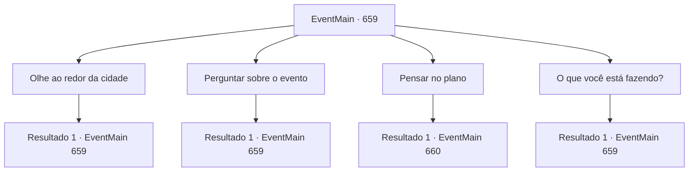

# Eventos principais · 659

[Índice da tabela](index.md) · [Índice geral](../index.md)

ID: `pt:EventMain:659` · Fonte: `EventMain4` · Versão: 1.2.47.

Mapeamento estático dos arquivos; a disponibilidade e a execução dependem do estado da run.

## Texto do evento

Você entrou na grande cidade de 'Hawa', conhecida por suas imponentes muralhas, enquanto o ambiente ao seu redor estava agitado e vibrante. Os cidadãos da cidade estavam comemorando, misturando-se alegremente com os visitantes. Bandeiras com o símbolo de Tere estavam espalhadas por todo lugar, e sacerdotes e cavaleiros da Igreja de Tere circulavam entre a multidão, conversando com os moradores e observando o progresso das festividades.  Parece que o evento era em celebração a algum grande feriado religioso, provavelmente relacionado a Tere, e a cidade estava repleta de suas imagens e figuras. Aproveitando a movimentação, você se misturou à multidão, evitando chamar atenção enquanto caminhava pelas ruas de Hawa. Os cavaleiros de Tere estavam em patrulha, mas devido ao grande número de pessoas, eles não perceberam sua presença.  Enquanto passava entre as casas e as lojas, você começou a planejar em silêncio como poderia eliminar Publius, ainda em busca de uma oportunidade que não o colocasse em risco.

## Dados de entrada

```json
{
  "id": 659,
  "grade": 1,
  "normalGoal": "",
  "required": "1_2_75|13_4_12"
}
```

## Mapa das escolhas



## Escolhas e resultados

### Escolha 1

Olhe ao redor da cidade

Requisitos e outros campos da escolha:

```json
{
  "required": "5_403_0|5_404_0"
}
```

#### Resultado 1.1

Você caminha ao redor de Hawa e observa a cidade. Hawa é uma cidade grande, repleta de prédios únicos. No entanto, onde quer que você vá, todas as estradas levam à praça central, então você não precisa se preocupar em se perder. Você olha ao redor da praça central de Hawa. A praça é grande o suficiente para acomodar milhares de pessoas, e uma estátua de Tere está no centro. 

 "Ei!! Se apresse e se mova! Vamos nos atrasar para o prazo!"

 Quando você olha para o lado, vê trabalhadores ocupados com algo.

Continuação registrada: [Evento 659](0659.md) na mesma tabela.

```json
{
  "required": "",
  "chance": "1",
  "nextEvent": 659,
  "type": 2,
  "reward": "5_403_1"
}
```

### Escolha 2

Perguntar sobre o evento

Requisitos e outros campos da escolha:

```json
{
  "required": "5_403_0|5_404_0"
}
```

#### Resultado 2.1

Você conversa com os moradores de Hawa e faz perguntas sobre o evento. Eventualmente, uma mulher que parece interessada em você responde à pergunta com um pequeno sorriso. 

 "Eles estão preparando um evento para celebrar o aniversário de Tere. Ah, agora que penso nisso, o Arcebispo disse que estaria falando na Praça Central no dia do festival. Se você estiver interessado..."

 Você sai depois de ouvir a explicação da mulher. Logo em seguida, você ouve a voz de Kior. 

 "Huhu... Fazendo um discurso na praça central... É como se ele estivesse pedindo para ser morto"

.

Continuação registrada: [Evento 659](0659.md) na mesma tabela.

```json
{
  "required": "",
  "chance": "1",
  "nextEvent": 659,
  "type": 2,
  "reward": "5_404_1"
}
```

### Escolha 3

Pensar no plano

Requisitos e outros campos da escolha:

```json
{
  "required": "-1|5_403_2|5_404_1"
}
```

#### Resultado 3.1

Você se acomoda em uma antiga pousada fora da cidade, Você pensa no plano, considerando as informações que obteve da cidade e o que possui.

Continuação registrada: [Evento 660](0660.md) na mesma tabela.

```json
{
  "required": "",
  "chance": "1",
  "nextEvent": 660,
  "type": 2,
  "reward": ""
}
```

### Escolha 4

O que você está fazendo?

Requisitos e outros campos da escolha:

```json
{
  "required": "5_403_1"
}
```

#### Resultado 4.1

Você pergunta aos trabalhadores o que eles estão fazendo. Um homem de meia-idade que estava pregando responde como se estivesse gritando. 

 "Você não tem olhos? É um palco para o evento de aniversário da Tere."

 O homem irritado com o grito se concentra em construir o palco novamente. Você observa o palco construído pelos trabalhadores por um tempo e sai do local silenciosamente.

Continuação registrada: [Evento 659](0659.md) na mesma tabela.

```json
{
  "required": "",
  "chance": "1",
  "nextEvent": 659,
  "type": 2,
  "reward": "5_403_2"
}
```

## Referências que chegam a este evento

- [Evento 659 · escolha 1 · resultado 1](0659.md#escolha-1)
- [Evento 659 · escolha 2 · resultado 1](0659.md#escolha-2)
- [Evento 659 · escolha 4 · resultado 1](0659.md#escolha-4)
