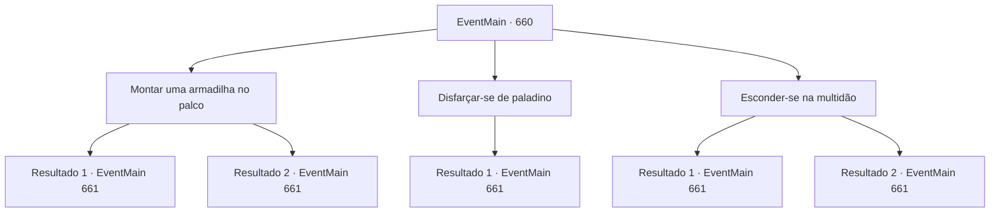

# Eventos principais · 660

[Índice da tabela](index.md) · [Índice geral](../index.md)

ID: `pt:EventMain:660` · Fonte: `EventMain4` · Versão: 1.2.47.

Mapeamento estático dos arquivos; a disponibilidade e a execução dependem do estado da run.

## Texto do evento

*Sem texto no arquivo.*

## Dados de entrada

```json
{
  "id": 660,
  "grade": 1,
  "normalGoal": "",
  "required": ""
}
```

## Mapa das escolhas



## Escolhas e resultados

### Escolha 1

Montar uma armadilha no palco

Requisitos e outros campos da escolha:

```json
{
  "required": "1_7_12"
}
```

#### Resultado 1.1

Você decide armar uma armadilha no palco. Naquela noite, você vai para a praça central e se esgueira por baixo do palco. Então, você antecipa onde Publius vai subir e raspa o suporte abaixo dele. 

 Na manhã seguinte, Publius, que está no palco conforme o programado, começa seu discurso. Você não consegue vê-lo escondido embaixo do palco, mas consegue ouvir sua voz. |drawing_speech| Você ouve o discurso solene de Publius e espera silenciosamente pelo momento certo. E quando o discurso atinge seu clímax, você dá um tapa no suporte que foi afiado. 

 'Crack! Kudang tang!' 

 O palco ruge e desaba em choque. Publius caído não consegue se levantar, mas você não pode matá-lo. Um paladino, que salta do palco urgentemente, bloqueia seu caminho. 

 "Arcebispo! Você está bem? Deixe este lugar comigo e se proteja."

 Então Publius responde. 

 "Um... Estou bem... Então vou deixar com você, Valen."

 Ele foge às pressas, e uma mulher chamada 'Valen' vem em sua direção.

Continuação registrada: [Evento 661](0661.md) na mesma tabela.

```json
{
  "required": "",
  "chance": "1|0_7_1",
  "nextEvent": 661,
  "type": 0,
  "reward": "6_2_148",
  "place": 4
}
```

#### Resultado 1.2

Você decide armar uma armadilha no palco. Naquela noite, você vai para a praça central e se esgueira por baixo do palco. Então, você antecipa onde Publius vai subir e raspa o suporte abaixo dele. 

 Na manhã seguinte, Publius, que está no palco conforme programado, começa seu discurso. Você não consegue vê-lo escondido embaixo do palco, mas consegue ouvir sua voz. |drawing_speech| Você ouve o discurso solene de Publius e espera silenciosamente pelo momento certo. E quando o discurso atinge seu clímax, você dá um tapa no suporte que foi afiado. 

 'Crack! Kudang tang!' 

 O palco ruge e desaba em choque. Mas Publius não cai. Porque não estava debaixo de seus pés, onde você o quebrou. Você faz contato visual com Publius. Ele grita assim que te vê. 

 "Valen! Prenda-o imediatamente!"

 Então um paladino ruivo chamado 'Valen' pula na sua frente.

Continuação registrada: [Evento 661](0661.md) na mesma tabela.

```json
{
  "required": "",
  "chance": "14",
  "nextEvent": 661,
  "type": 1,
  "reward": "6_0_148",
  "place": 4
}
```

### Escolha 2

Disfarçar-se de paladino

Requisitos e outros campos da escolha:

```json
{
  "required": "1_7_12|8_250_1"
}
```

#### Resultado 2.1

Você decide se disfarçar como um paladino e esperar pelo próximo dia.

 Na manhã do festival, você veste a armadura do paladino e se disfarça como paladino e segue para a praça. Logo em seguida, Publius aparece escoltado e logo sobe ao palco para começar seu discurso. |drawing_speech| Publius é um homem idoso com rugas profundas na testa e uma barba que cobre todo o seu rosto inferior, vestindo um uniforme vermelho bordado e colorido de sacerdote. Você se aproxima do palco lentamente, fingindo controlar a multidão. E no auge de seu discurso, você pula no palco e o ataca. 

 "Tossir..!"

 Mas Publius não é atacado por você. O paladino ruivo ao lado dele é atacado em seu lugar. Apesar de seus ferimentos, ela saca uma espada e a empunha contra você instantaneamente. 

 "Arcebispo! Deixe isso comigo e se afaste."

 Então Publius responde. 

 "Então eu deixarei com você, Valen."

 O Arcebispo foge do palco às pressas, Você não pode ir atrás dele. Primeiro de tudo, você precisa derrotar um paladino chamado 'Valen'.

Continuação registrada: [Evento 661](0661.md) na mesma tabela.

```json
{
  "required": "",
  "chance": "1",
  "nextEvent": 661,
  "type": 2,
  "reward": "6_2_148",
  "place": 4
}
```

### Escolha 3

Esconder-se na multidão

Requisitos e outros campos da escolha:

```json
{
  "required": ""
}
```

#### Resultado 3.1

Você decide se esconder na multidão e esperar pelo próximo dia.

 Na manhã do festival, você se esconde na multidão e segue para a praça. Logo depois, Publius aparece escoltado e logo sobe ao palco para começar seu discurso. |drawing_speech| Publius é um homem idoso com rugas profundas na testa e uma barba que cobre todo o seu rosto inferior, vestindo um uniforme vermelho de padre bordado e colorido. Você se aproxima lentamente do palco, usando as pessoas como escudos. E no auge de seu discurso, você pula no palco e o ataca. 

 "Tossir..!"

 Mas Publius não é atacado por você. A paladina ruiva ao lado dele é atacada em seu lugar. Apesar de seus ferimentos, ela saca uma espada e a empunha contra você instantaneamente. 

 "Arcebispo! Deixe isso comigo e se proteja."

 Então Publius responde. 

 "Então eu deixo com você, Valen."

 O Arcebispo foge apressadamente do palco, Você não pode ir atrás dele. Primeiro de tudo, você precisa derrotar um paladino chamado 'Valen'.

Continuação registrada: [Evento 661](0661.md) na mesma tabela.

```json
{
  "required": "",
  "chance": "1|0_6_1",
  "nextEvent": 661,
  "type": 0,
  "reward": "6_2_148",
  "place": 4
}
```

#### Resultado 3.2

Você decide se esconder na multidão e esperar pelo próximo dia.

 Na manhã do festival, você se esconde na multidão e segue para a praça. Logo em seguida, Publius aparece escoltado e logo sobe ao palco para começar seu discurso. |drawing_speech| Publius é um homem idoso com rugas profundas na testa e uma barba que cobre todo o seu rosto inferior, vestindo um uniforme vermelho de padre bordado e colorido. Você se aproxima lentamente do palco, usando as pessoas como escudos. E no auge de seu discurso, você pula no palco e o ataca. 

 'Bam!' 

 Mas Publius não é atacado por você. O paladino ruivo ao lado dele bloqueou seu ataque. 

 "Arcebispo! Deixe isso comigo e se proteja."

 Então Publius responde. 

 "Então eu deixo com você, Valen."

 O Arcebispo foge apressadamente do palco, Você não pode ir atrás dele. Antes de tudo, você precisa derrotar um paladino chamado 'Valen'.

Continuação registrada: [Evento 661](0661.md) na mesma tabela.

```json
{
  "required": "",
  "chance": "16",
  "nextEvent": 661,
  "type": 1,
  "reward": "6_0_148",
  "place": 4
}
```

## Referências que chegam a este evento

- [Evento 659 · escolha 3 · resultado 1](0659.md#escolha-3)
