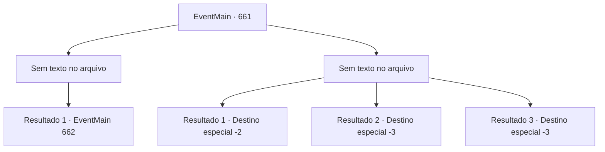

# Eventos principais · 661

[Índice da tabela](index.md) · [Índice geral](../index.md)

ID: `pt:EventMain:661` · Fonte: `EventMain4` · Versão: 1.2.47.

Mapeamento estático dos arquivos; a disponibilidade e a execução dependem do estado da run.

## Texto do evento

*Sem texto no arquivo.*

## Dados de entrada

```json
{
  "id": 661,
  "grade": 1,
  "normalGoal": "",
  "required": ""
}
```

## Mapa das escolhas



## Escolhas e resultados

### Escolha 1

*Sem texto no arquivo; o papel dessa opção depende da interface do jogo.*

Requisitos e outros campos da escolha:

```json
{
  "required": ""
}
```

#### Resultado 1.1

Paladino de cabelos vermelhos, as habilidades de Valen são melhores do que você pensava. Mas mesmo assim, ela não conseguiu impedir que você ficasse com raiva e, eventualmente, espalhasse sangue pelo chão. Você ergue sua arma para acabar com ela. Mas naquele exato momento, os paladinos da Tere que te cercam avançam em sua direção. 

 "Protejam a Irmã Valen!"

 Eles bloqueiam de forma requintada a frente da caída Valen, então se você não se livrar deles primeiro, não poderá matá-la. Você mergulha novamente na luta.

Continuação registrada: [Evento 662](0662.md) na mesma tabela.

```json
{
  "required": "",
  "chance": "1",
  "nextEvent": 662,
  "type": 2,
  "reward": "6_0_149",
  "place": 4
}
```

### Escolha 2

*Sem texto no arquivo; o papel dessa opção depende da interface do jogo.*

Requisitos e outros campos da escolha:

```json
{
  "required": ""
}
```

#### Resultado 2.1

Depois de estar na defensiva, você eventualmente decide fugir. Evitando o ataque de Valen, você vira as costas e foge. 

 "O quê...! Pare aí!"

 Ela te persegue em um ritmo assustador, De alguma forma, você consegue escapar de sua perseguição.

Continuação registrada: [Destino especial `-2`](../destinos-especiais.md).

```json
{
  "required": "1_0_2|1_1_2",
  "chance": "1",
  "nextEvent": -2,
  "type": 2,
  "reward": "0_0_-1|0_1_-1|13_4_15"
}
```

#### Resultado 2.2

Paladina de cabelos vermelhos, as habilidades de Valen são melhores do que você pensava. Sua espada corta seu pescoço num instante, e você morre sem nem mesmo se rebelar.

Continuação registrada: [Destino especial `-3`](../destinos-especiais.md).

```json
{
  "required": "2_0_2",
  "chance": "1",
  "nextEvent": -3,
  "type": 2,
  "reward": "0_0_-1|0_1_-1"
}
```

#### Resultado 2.3

Paladina de cabelos vermelhos, as habilidades de Valen são melhores do que você pensava. Sua espada corta seu pescoço num instante, e você morre sem nem mesmo se rebelar.

Continuação registrada: [Destino especial `-3`](../destinos-especiais.md).

```json
{
  "required": "2_1_2",
  "chance": "1",
  "nextEvent": -3,
  "type": 2,
  "reward": "0_0_-1|0_1_-1"
}
```

## Referências que chegam a este evento

- [Evento 660 · escolha 1 · resultado 1](0660.md#escolha-1)
- [Evento 660 · escolha 1 · resultado 2](0660.md#escolha-1)
- [Evento 660 · escolha 2 · resultado 1](0660.md#escolha-2)
- [Evento 660 · escolha 3 · resultado 1](0660.md#escolha-3)
- [Evento 660 · escolha 3 · resultado 2](0660.md#escolha-3)
