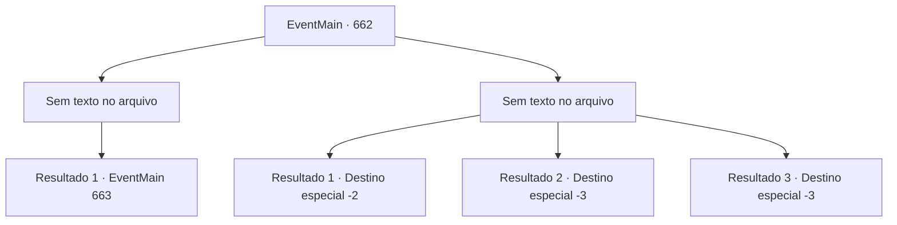

# Eventos principais · 662

[Índice da tabela](index.md) · [Índice geral](../index.md)

ID: `pt:EventMain:662` · Fonte: `EventMain4` · Versão: 1.2.47.

Mapeamento estático dos arquivos; a disponibilidade e a execução dependem do estado da run.

## Texto do evento

*Sem texto no arquivo.*

## Dados de entrada

```json
{
  "id": 662,
  "grade": 1,
  "normalGoal": "",
  "required": ""
}
```

## Mapa das escolhas



## Escolhas e resultados

### Escolha 1

*Sem texto no arquivo; o papel dessa opção depende da interface do jogo.*

Requisitos e outros campos da escolha:

```json
{
  "required": ""
}
```

#### Resultado 1.1


 "Você... você demônio...! Tem um árbitro para Tere. kuk..."

 Você retira o espírito do último paladino que proferiu a maldição e se aproxima de Valen. Antes que você percebesse, ela tropeça e tenta se levantar. Você levanta o escudo que estava caído e acerta sua cabeça. Valen desmaia, e você retira sua alma e a dedica a Kior. Então Kior sussurra em sua cabeça. 

 "Bom trabalho, {1}... Mas Publius desapareceu completamente. Que covarde."

 Como ele disse, você só consegue ver cidadãos gritando ao seu redor, mas não consegue encontrar Publius.

Continuação registrada: [Evento 663](0663.md) na mesma tabela.

```json
{
  "required": "",
  "chance": "1",
  "nextEvent": 663,
  "type": 2,
  "reward": ""
}
```

### Escolha 2

*Sem texto no arquivo; o papel dessa opção depende da interface do jogo.*

Requisitos e outros campos da escolha:

```json
{
  "required": ""
}
```

#### Resultado 2.1

Os paladinos que te cercam te atacaram sem nem mesmo te dar tempo para revidar. Você percebe que não há chance de vencer, e se espreme através da brecha entre eles. 

 "Alto!"

 Os paladinos tentam te perseguir, Você é rápido para escapar de sua perseguição.

Continuação registrada: [Destino especial `-2`](../destinos-especiais.md).

```json
{
  "required": "1_0_2|1_1_2",
  "chance": "1",
  "nextEvent": -2,
  "type": 2,
  "reward": "0_0_-1|0_1_-1|13_4_15"
}
```

#### Resultado 2.2

Os paladinos que te cercam te atacaram sem nem mesmo te dar tempo para revidar. Por fim, você morre ali porque não consegue lidar com os inúmeros ataques.

Continuação registrada: [Destino especial `-3`](../destinos-especiais.md).

```json
{
  "required": "2_0_2",
  "chance": "1",
  "nextEvent": -3,
  "type": 2,
  "reward": "0_0_-1|0_1_-1"
}
```

#### Resultado 2.3

Os paladinos que te cercam te atacaram sem nem mesmo te dar tempo para revidar. Por fim, você morre ali porque não consegue lidar com os inúmeros ataques.

Continuação registrada: [Destino especial `-3`](../destinos-especiais.md).

```json
{
  "required": "2_1_2",
  "chance": "1",
  "nextEvent": -3,
  "type": 2,
  "reward": "0_0_-1|0_1_-1"
}
```

## Referências que chegam a este evento

- [Evento 661 · escolha 1 · resultado 1](0661.md#escolha-1)
