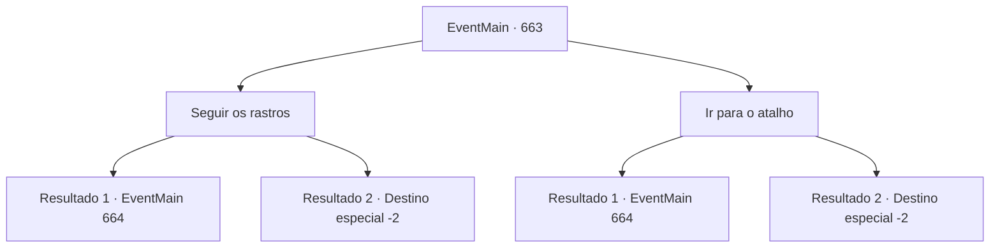

# Eventos principais · 663

[Índice da tabela](index.md) · [Índice geral](../index.md)

ID: `pt:EventMain:663` · Fonte: `EventMain4` · Versão: 1.2.47.

Mapeamento estático dos arquivos; a disponibilidade e a execução dependem do estado da run.

## Texto do evento

*Sem texto no arquivo.*

## Dados de entrada

```json
{
  "id": 663,
  "grade": 1,
  "normalGoal": "",
  "required": ""
}
```

## Mapa das escolhas



## Escolhas e resultados

### Escolha 1

Seguir os rastros

Requisitos e outros campos da escolha:

```json
{
  "required": ""
}
```

#### Resultado 1.1

Você persegue Publius, seguindo o rastro deixado na praça. Ao olhar para as pegadas que ele deixou, fica claro que ele fugiu para o portão norte de Hawa. 

 "Lá está o demônio! Peguem ele!"

 Enquanto você está perseguindo Publius, há outros paladinos vindo atrás de você. Você corre em direção ao portão norte, evitando-os.

 Continuando a perseguir fora da cidade, você encontra Publius, que está correndo junto com dois paladinos. Quando você bloqueia rapidamente na frente dele, dois paladinos sacam suas armas. Nesse momento, Publius grita e para os acompanhantes. 

 "Parem! Vocês não são páreo."

 E ele olha para você e pergunta com uma expressão sombria. 

 "Quem é você? Por que está me atacando? Por que diabos está fazendo isso?"

 Aquela voz está realmente cheia de perguntas.

Continuação registrada: [Evento 664](0664.md) na mesma tabela.

```json
{
  "required": "",
  "chance": "1|0_6_1",
  "nextEvent": 664,
  "type": 0,
  "reward": ""
}
```

#### Resultado 1.2

Você persegue Publius, seguindo o rastro deixado na praça. Ao olhar para as pegadas que ele deixou, fica claro que ele fugiu para o portão norte de Hawa. 

 "Lá está o demônio! Pegue-o!"

 Enquanto você está perseguindo Publius, outros paladinos estão vindo atrás de você. Você corre em direção ao portão norte, evitando-os.

 Depois de continuar perseguindo fora da cidade, você eventualmente para de caminhar. Você não consegue ver Publius mesmo que tenha chegado à planície aberta. No final, você sai de lá com a oportunidade de se vingar na próxima vez.

Continuação registrada: [Destino especial `-2`](../destinos-especiais.md).

```json
{
  "required": "",
  "chance": "16",
  "nextEvent": -2,
  "type": 1,
  "reward": "13_4_13"
}
```

### Escolha 2

Ir para o atalho

Requisitos e outros campos da escolha:

```json
{
  "required": ""
}
```

#### Resultado 2.1

Tendo verificado a estrutura da cidade antecipadamente, você percebe que Publius fugiu para o portão norte. Quando você estava lutando na praça central para escapar de sua visão, ele não teve escolha a não ser ir para lá. Você pensa em um atalho para o portão norte e corre para lá.

 Fora da cidade, você encontra Publius, que está correndo junto com dois paladinos. Quando você bloqueia rapidamente na frente dele, os dois paladinos sacam suas armas. Nesse momento, Publius grita e para os acompanhantes. 

 "Parem! Vocês não são páreo."

 E ele olha para você e pergunta com uma expressão sombria. 

 "Quem é você? Por que está me atacando? Por que diabos está fazendo isso?"

 Aquela voz está realmente cheia de perguntas.

Continuação registrada: [Evento 664](0664.md) na mesma tabela.

```json
{
  "required": "",
  "chance": "1|0_7_1",
  "nextEvent": 664,
  "type": 0,
  "reward": ""
}
```

#### Resultado 2.2

Após verificar a estrutura da cidade antecipadamente, você percebe que Publius fugiu para o portão norte. Enquanto você estava lutando na praça central para escapar de sua visão, ele não teve escolha a não ser ir para lá. Você pensa em um atalho para o portão norte e corre para lá.

 Depois de continuar perseguindo fora da cidade, você eventualmente para de caminhar. Você não consegue ver Publius mesmo depois de ter chegado à planície aberta. No final, você sai de lá com a oportunidade de se vingar na próxima vez.

Continuação registrada: [Destino especial `-2`](../destinos-especiais.md).

```json
{
  "required": "",
  "chance": "14",
  "nextEvent": -2,
  "type": 1,
  "reward": "13_4_13"
}
```

## Referências que chegam a este evento

- [Evento 662 · escolha 1 · resultado 1](0662.md#escolha-1)
