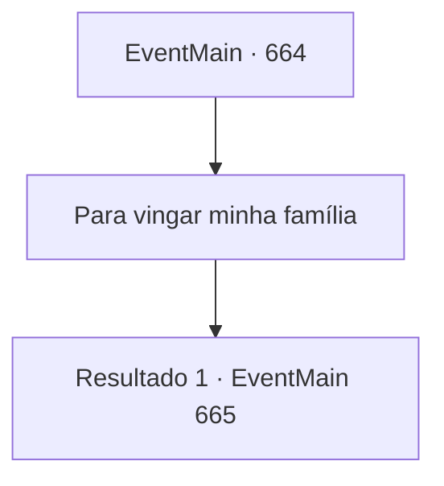

# Eventos principais · 664

[Índice da tabela](index.md) · [Índice geral](../index.md)

ID: `pt:EventMain:664` · Fonte: `EventMain4` · Versão: 1.2.47.

Mapeamento estático dos arquivos; a disponibilidade e a execução dependem do estado da run.

## Texto do evento

*Sem texto no arquivo.*

## Dados de entrada

```json
{
  "id": 664,
  "grade": 1,
  "normalGoal": "",
  "required": ""
}
```

## Mapa das escolhas



## Escolhas e resultados

### Escolha 1

Para vingar minha família

Requisitos e outros campos da escolha:

```json
{
  "required": ""
}
```

#### Resultado 1.1

Você diz 'vingar a família queimada', e Publius diz com uma expressão surpresa. 

 "Vingança da família...? De jeito nenhum. Nós teríamos queimado todos eles..."

 Enquanto murmura, ele conta a razão do incêndio em voz baixa. 

 "Sua família foi executada porque assinaram um contrato com o demônio. E aquele associado ao demônio... É uma regra inflexível executar toda a família."

 Ele diz que sua família não é exceção e as execuções são inevitáveis. Essa é o fim da conversa. Você avança em direção a ele. Publius e os paladinos se levantam para enfrentá-lo.

Continuação registrada: [Evento 665](0665.md) na mesma tabela.

```json
{
  "required": "",
  "chance": "1",
  "nextEvent": 665,
  "type": 2,
  "reward": "6_0_151",
  "place": 4
}
```

## Referências que chegam a este evento

- [Evento 663 · escolha 1 · resultado 1](0663.md#escolha-1)
- [Evento 663 · escolha 2 · resultado 1](0663.md#escolha-2)
