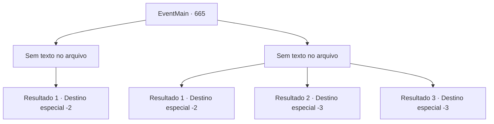

# Eventos principais · 665

[Índice da tabela](index.md) · [Índice geral](../index.md)

ID: `pt:EventMain:665` · Fonte: `EventMain4` · Versão: 1.2.47.

Mapeamento estático dos arquivos; a disponibilidade e a execução dependem do estado da run.

## Texto do evento

*Sem texto no arquivo.*

## Dados de entrada

```json
{
  "id": 665,
  "grade": 1,
  "normalGoal": "",
  "required": ""
}
```

## Mapa das escolhas



## Escolhas e resultados

### Escolha 1

*Sem texto no arquivo; o papel dessa opção depende da interface do jogo.*

Requisitos e outros campos da escolha:

```json
{
  "required": ""
}
```

#### Resultado 1.1

Você sacode o sangue da arma e se aproxima de Publius. Então Publius grita, tossindo sangue. 

 "Tosse! Você... Seus pecados nunca serão perdoados por Tere!!"

 Você ergue sua arma em desafio à maldição de Publius. Logo em seguida, seu golpe transforma Publius em um corpo frio. Um sorriso se forma ao redor de sua boca enquanto você observa seu fim desastroso. 

 "Bom trabalho... {1}. Dedique suas almas."

 Você dedica as almas de Publius e dos dois acompanhantes a Kior e sai ouvindo sua risada.

Continuação registrada: [Destino especial `-2`](../destinos-especiais.md).

```json
{
  "required": "",
  "chance": "1",
  "nextEvent": -2,
  "type": 2,
  "reward": "13_4_14"
}
```

### Escolha 2

*Sem texto no arquivo; o papel dessa opção depende da interface do jogo.*

Requisitos e outros campos da escolha:

```json
{
  "required": ""
}
```

#### Resultado 2.1

Você, que não conseguiu superar a poderosa magia de Publius, fuja de lá. Felizmente, não há perseguição, então você sai de lá em segurança.

Continuação registrada: [Destino especial `-2`](../destinos-especiais.md).

```json
{
  "required": "1_0_2|1_1_2",
  "chance": "1",
  "nextEvent": -2,
  "type": 2,
  "reward": "0_0_-1|0_1_-1|13_4_13"
}
```

#### Resultado 2.2

A janela de luz de Publius atravessa seu abdômen. No final, você desaba com o inimigo da sua família na sua frente.

Continuação registrada: [Destino especial `-3`](../destinos-especiais.md).

```json
{
  "required": "2_0_2",
  "chance": "1",
  "nextEvent": -3,
  "type": 2,
  "reward": "0_0_-1|0_1_-1"
}
```

#### Resultado 2.3

A janela de luz de Publius atravessa seu abdômen. No final, você desaba com o inimigo da sua família na sua frente.

Continuação registrada: [Destino especial `-3`](../destinos-especiais.md).

```json
{
  "required": "2_1_2",
  "chance": "1",
  "nextEvent": -3,
  "type": 2,
  "reward": "0_0_-1|0_1_-1"
}
```

## Referências que chegam a este evento

- [Evento 664 · escolha 1 · resultado 1](0664.md#escolha-1)
