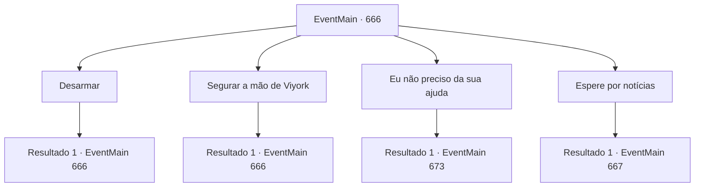

# Eventos principais · 666

[Índice da tabela](index.md) · [Índice geral](../index.md)

ID: `pt:EventMain:666` · Fonte: `EventMain4` · Versão: 1.2.47.

Mapeamento estático dos arquivos; a disponibilidade e a execução dependem do estado da run.

## Texto do evento

Você se escondeu nas sombras de um beco, ouvindo atentamente a conversa de dois homens que discutiam em voz baixa sobre a sua situação. As palavras deles eram claras e carregadas de incredulidade, e você percebeu que a caçada a você havia se espalhado por toda a cidade de Alonzo, graças ao decreto de Tere.  

 "Oh, meu Deus... Está completamente fora de si! Atacar o Grande Arcebispo de Tere..."

 "Ele enlouqueceu, dizem que fez um pacto com demônios, não?"

  Enquanto você se mantinha imóvel, esperando que os dois se afastassem, o destino lhe pregou uma peça. Uma voz familiar soou nas suas costas, quebrando o silêncio do momento.  

 "Há quanto tempo, {1}."

  Você se virou rapidamente, e ali estava ele, Viyork, vestido com sua armadura branca resplandecente. Ele estava tão confiante quanto sempre, com os braços cruzados, olhando para você com um sorriso desdenhoso.  

 "Um decreto de caçada agora, hein? Parece que as coisas ficaram bem complicadas para você."

   A ironia em suas palavras não passava despercebida. O que ele queria exatamente?

## Dados de entrada

```json
{
  "id": 666,
  "grade": 1,
  "normalGoal": "",
  "required": "1_2_100|13_4_13"
}
```

## Mapa das escolhas



## Escolhas e resultados

### Escolha 1

Desarmar

Requisitos e outros campos da escolha:

```json
{
  "required": "5_405_0"
}
```

#### Resultado 1.1

Você rapidamente puxa sua arma e aponta para ele. No entanto, Viyork relaxa os braços e levanta as mãos. 

 "Calma. Estou aqui para te ajudar. Como eu disse antes, não gosto do atual Teretiano."

 Ele sorri, dizendo que é necessário um 'sacrifício adequado' para mudar o Teretiano atual. 

 "Você se vinga, e eu me livro da sujeira de Tere, então não é uma ajuda mútua?"

 Viyork termina de falar e olha para a sua expressão por um momento. E ele estende a mão para você com um sorriso.

Continuação registrada: [Evento 666](0666.md) na mesma tabela.

```json
{
  "required": "",
  "chance": "1",
  "nextEvent": 666,
  "type": 2,
  "reward": "5_405_1"
}
```

### Escolha 2

Segurar a mão de Viyork

Requisitos e outros campos da escolha:

```json
{
  "required": "5_405_1"
}
```

#### Resultado 2.1

Você se aproxima de Viyork e segura suas mãos. Um sorriso surge em seu rosto enquanto ele olha para suas mãos. Viyork acena levemente e diz com um grande sorriso. 

 "Então eu vou te ligar em breve. Até lá."

 Viyork te dá um tapinha no ombro e desaparece na escuridão do beco.

Continuação registrada: [Evento 666](0666.md) na mesma tabela.

```json
{
  "required": "",
  "chance": "1",
  "nextEvent": 666,
  "type": 2,
  "reward": "5_405_2"
}
```

### Escolha 3

Eu não preciso da sua ajuda

Requisitos e outros campos da escolha:

```json
{
  "required": "5_405_1"
}
```

#### Resultado 3.1

Quando você recusa a oferta, Viyork retorna com um olhar desconfortável. 

 "Sinto muito em ouvir isso. Eu pensei que poderíamos ter um bom relacionamento."

 Viyork suspira silenciosamente. Então, lentamente, coloque sua mão na empunhadura da espada e a puxe para fora. 

 "Então não temos escolha a não ser fazer assim. Espero que você morra bem."

 Logo em seguida, seus homens que estão escondidos aparecem. Eles lentamente te cercam e avançam em sua direção com o poderoso comando de Viyork. 

 "Derrotem o mal!"

 As espadas de Viyork e dos paladinos voam em sua direção.

Continuação registrada: [Evento 673](0673.md) na mesma tabela.

```json
{
  "required": "",
  "chance": "1",
  "nextEvent": 673,
  "type": 2,
  "reward": "6_3_147",
  "place": 4
}
```

### Escolha 4

Espere por notícias

Requisitos e outros campos da escolha:

```json
{
  "required": "5_405_2"
}
```

#### Resultado 4.1

Alguns dias depois, você recebe uma ligação de Viyork e vai para a residência dele. A ligação é para informar que, como ele prometeu outro dia, ele cria uma oportunidade para você matar Publius e Onil. O lugar onde Viyork mora é uma pequena casa com uma parede exterior branca e um telhado azul. Quando você chega lá, Viyork se aproxima de você do lado de fora. 

 "Esta noite, estou encontrando Publius e Onil aqui. Esconda-se por aqui e entre assim que eu te der um sinal."

 Depois disso, Viyork entra na casa.

 Você estava escondido em uma árvore próxima. Uma carruagem para em frente à casa. Logo, duas pessoas descem da carruagem. Uma é Publius e a outra é Onil. Enquanto os dois entravam na casa de Viyork, eles ouviram um barulho alto.

Continuação registrada: [Evento 667](0667.md) na mesma tabela.

```json
{
  "required": "",
  "chance": "1",
  "nextEvent": 667,
  "type": 2,
  "reward": "5_405_3"
}
```

## Referências que chegam a este evento

- [Evento 666 · escolha 1 · resultado 1](0666.md#escolha-1)
- [Evento 666 · escolha 2 · resultado 1](0666.md#escolha-2)
