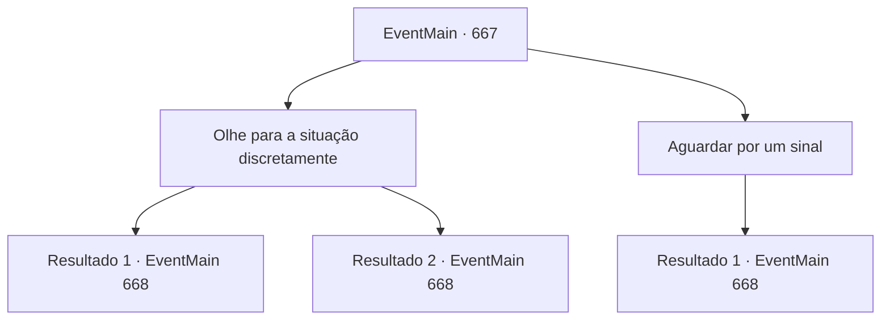

# Eventos principais · 667

[Índice da tabela](index.md) · [Índice geral](../index.md)

ID: `pt:EventMain:667` · Fonte: `EventMain4` · Versão: 1.2.47.

Mapeamento estático dos arquivos; a disponibilidade e a execução dependem do estado da run.

## Texto do evento

*Sem texto no arquivo.*

## Dados de entrada

```json
{
  "id": 667,
  "grade": 1,
  "normalGoal": "",
  "required": ""
}
```

## Mapa das escolhas



## Escolhas e resultados

### Escolha 1

Olhe para a situação discretamente

Requisitos e outros campos da escolha:

```json
{
  "required": ""
}
```

#### Resultado 1.1

Apenas por precaução, você se aproxima cuidadosamente e olha para dentro da casa através da janela. Viyork, Publius e Onil estão sentados à mesa, conversando e comendo felizes. Mas então, de repente, Publius cai de repente e Onil agarra a cabeça e começa a cambalear.

 'Apito!'
 Ao ouvir o apito chamando você, você chuta a porta e entra direto. Viyork olha para você e fala com voz calma. 

 "Agora é a hora. Primeiro, lide com Onil. Ele ainda não perdeu a consciência."

 Onil, que estava cambaleando, grita enquanto tira sua espada. 

 "Kh..! Viyork! Como você se atreve a se unir ao demônio e trair o Arcebispo!"

 Mesmo com esse grito, Viyork apenas dá um passo para trás com um sorriso suspeito. Você lentamente puxa sua arma enquanto se aproxima do cambaleante Onil.

Continuação registrada: [Evento 668](0668.md) na mesma tabela.

```json
{
  "required": "",
  "chance": "1|0_6_1",
  "nextEvent": 668,
  "type": 0,
  "reward": "6_2_145",
  "place": 10
}
```

#### Resultado 1.2

Apenas por precaução, você se aproxima cuidadosamente e olha para dentro da casa através da janela. Viyork, Publius e Onil estão sentados à mesa, conversando e comendo felizes. Mas então, de repente, Onil olha para a janela onde você está e saca uma espada. Uma voz assustada de Viyork explode. 

 "{1}!!"

 Você chuta a porta e entra direto. Então, você vê Publius deitado na mesa e Onil levantando sua espada. 

 "Maldição! Eu não disse para você esperar até eu te dar um sinal?"

 Enquanto Viyork recua nervoso, o grito de Onil se dirige a ele. 

 "Beyork! Como você se atreve a dar as mãos ao demônio e trair o Arcebispo!!"

 Você puxa sua arma enquanto se aproxima do furioso Onil.

Continuação registrada: [Evento 668](0668.md) na mesma tabela.

```json
{
  "required": "",
  "chance": "16",
  "nextEvent": 668,
  "type": 1,
  "reward": "6_0_145",
  "place": 10
}
```

### Escolha 2

Aguardar por um sinal

Requisitos e outros campos da escolha:

```json
{
  "required": ""
}
```

#### Resultado 2.1

Como Viyork disse, você espera calmamente e sem fôlego. E você está ouvindo o som de dentro da casa dele, e de repente você ouve um 'bum!'. Você desce rapidamente da árvore. Logo depois, você ouve um assobio dentro da casa e chuta a porta para dentro. Ao entrar na casa, você vê Publius deitado na mesa e Onil levantando sua espada. Viyork olha para você e fala com uma voz calma. 

 "Agora é a hora. Primeiro, lide com Onil. Ele ainda não perdeu a consciência."

 Onil, que estava cambaleando, grita enquanto tira sua espada. 

 "Kh..! Viyork! Como você se atreve a se unir ao demônio e trair o Arcebispo!!"

 Mesmo com esse grito, Viyork apenas dá um passo para trás com um sorriso suspeito. Você lentamente puxa sua arma enquanto se aproxima do cambaleante Onil.

Continuação registrada: [Evento 668](0668.md) na mesma tabela.

```json
{
  "required": "",
  "chance": "1",
  "nextEvent": 668,
  "type": 2,
  "reward": "6_2_145",
  "place": 10
}
```

## Referências que chegam a este evento

- [Evento 666 · escolha 4 · resultado 1](0666.md#escolha-4)
