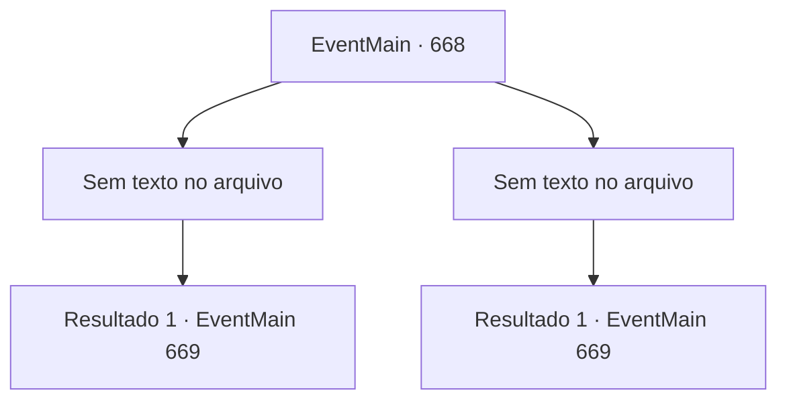

# Eventos principais · 668

[Índice da tabela](index.md) · [Índice geral](../index.md)

ID: `pt:EventMain:668` · Fonte: `EventMain4` · Versão: 1.2.47.

Mapeamento estático dos arquivos; a disponibilidade e a execução dependem do estado da run.

## Texto do evento

*Sem texto no arquivo.*

## Dados de entrada

```json
{
  "id": 668,
  "grade": 1,
  "normalGoal": "",
  "required": ""
}
```

## Mapa das escolhas



## Escolhas e resultados

### Escolha 1

*Sem texto no arquivo; o papel dessa opção depende da interface do jogo.*

Requisitos e outros campos da escolha:

```json
{
  "required": ""
}
```

#### Resultado 1.1

Você chuta o caído Onil. E você se aproxima dele, que bate na parede e segura o rosto. |drawing_drain| À medida que sua alma começa a ser levada embora, Onil treme por todo o corpo, incapaz de suportar a dor. 

 "Khuuuk...!! Gasp!!!"

 Onil, gritando de agonia, eventualmente perde toda a sua alma e morre. Então, a voz de Viyork é ouvida. 

 "Este é o último aqui, vou te dar uma chance de matar o adormecido Publius."

 Olhando para trás, você vê Publius, como ele disse, desmaiado na mesa e incapaz de recuperar a consciência. Você se aproxima dele com força em suas mãos.

Continuação registrada: [Evento 669](0669.md) na mesma tabela.

```json
{
  "required": "",
  "chance": "1",
  "nextEvent": 669,
  "type": 2,
  "reward": ""
}
```

### Escolha 2

*Sem texto no arquivo; o papel dessa opção depende da interface do jogo.*

Requisitos e outros campos da escolha:

```json
{
  "required": ""
}
```

#### Resultado 2.1

Quando a espada de Onil está prestes a atingir seu pescoço, Viyork se apressa por trás dele. Onil, que não consegue evitar o ataque, é esfaqueado pelas costas e acaba de joelhos. E você se aproxima dele e segura seu rosto. |drawing_drain| À medida que sua alma começa a ser levada embora, Onil treme por todo o corpo, incapaz de suportar a dor. 

 "Khuuuk...!! Ofegante!!!"

 Onil, gritando de agonia, eventualmente perde toda a sua alma e morre. Então, a voz de Viyork é ouvida. 

 "Este é o último aqui, vou te dar uma chance de matar o adormecido Publius."

 Olhando para trás, você vê Publius, como ele disse, desmaiado na mesa e incapaz de recuperar a consciência. Você se aproximou dele com força em suas mãos.

Continuação registrada: [Evento 669](0669.md) na mesma tabela.

```json
{
  "required": "",
  "chance": "1",
  "nextEvent": 669,
  "type": 2,
  "reward": ""
}
```

## Referências que chegam a este evento

- [Evento 667 · escolha 1 · resultado 1](0667.md#escolha-1)
- [Evento 667 · escolha 1 · resultado 2](0667.md#escolha-1)
- [Evento 667 · escolha 2 · resultado 1](0667.md#escolha-2)
