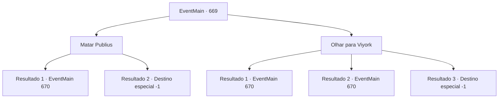

# Eventos principais · 669

[Índice da tabela](index.md) · [Índice geral](../index.md)

ID: `pt:EventMain:669` · Fonte: `EventMain4` · Versão: 1.2.47.

Mapeamento estático dos arquivos; a disponibilidade e a execução dependem do estado da run.

## Texto do evento

*Sem texto no arquivo.*

## Dados de entrada

```json
{
  "id": 669,
  "grade": 1,
  "normalGoal": "",
  "required": ""
}
```

## Mapa das escolhas



## Escolhas e resultados

### Escolha 1

Matar Publius

Requisitos e outros campos da escolha:

```json
{
  "required": ""
}
```

#### Resultado 1.1

Você dá o último golpe em Publius. Nesse exato momento. <color=red>

 "Bom trabalho. Agora que você se vingou... Você não se importa de morrer, não é?"

</color> Você sente uma dor aguda nas costas. A espada de Viyork perfura seu estômago e é retirada. Você cambaleia e empunha uma arma contra ele. Então Viyork diz com um rosto zombeteiro. 

 "Você não morre com isso... É uma vida difícil."

 Viyork sacode o sangue da espada e assobia despreocupadamente. O som abre a porta do outro quarto, e os paladinos escondidos aparecem. Eles te cercam instantaneamente e te atacam junto com Viyork.

Continuação registrada: [Evento 670](0670.md) na mesma tabela.

```json
{
  "required": "1_0_2",
  "chance": "1",
  "nextEvent": 670,
  "type": 2,
  "reward": "0_0_-1|6_3_147",
  "place": 10
}
```

#### Resultado 1.2

Você dá o último golpe em Publius. Nesse exato momento. <color=red>

 "Bom trabalho. Agora que você se vingou... Você não se importa de morrer, não é?"

</color> Você sente uma dor aguda nas costas. A espada de Viyork perfura seu estômago e depois é retirada. Você não consegue suportar a dor e cai no chão. A risada de Viyork é ouvida através da consciência turva.

Continuação registrada: [Destino especial `-1`](../destinos-especiais.md).

```json
{
  "required": "2_0_2",
  "chance": "1",
  "nextEvent": -1,
  "type": 2,
  "reward": "0_0_-1|15_5_2|15_5_13|15_5_22"
}
```

### Escolha 2

Olhar para Viyork

Requisitos e outros campos da escolha:

```json
{
  "required": "1_14_15"
}
```

#### Resultado 2.1

Logo antes de você acabar com Publius, você olha para o cheiro de Viyork. Porque a situação é tão estranha. Se Viyork quisesse matar Publius e Onil, não haveria motivo para te chamar. Supondo que ele chamou para te ajudar a se vingar, algo suspeito está acontecendo. E a resposta para essa pergunta é encontrada no próximo momento. Viyork está levantando sua espada atrás de você.

 <link=shake>'Shiik!!'</link>

 Você consegue evitar sua espada. Então o rosto de Viyork se endurece. 

 "... Ek, você entendeu? Todos, saiam!"

 Viyork grita, e a porta do outro quarto se abre. Então os paladinos escondidos aparecem. Eles te cercam instantaneamente e te atacam junto com Viyork.

Continuação registrada: [Evento 670](0670.md) na mesma tabela.

```json
{
  "required": "",
  "chance": "1|0_14_1",
  "nextEvent": 670,
  "type": 0,
  "reward": "6_3_147",
  "place": 10
}
```

#### Resultado 2.2

Justo antes de acabar com Publius, você olha para o cheiro de Viyork. Mas nada é estranho, então você dá o último golpe em Publius com toda a sua força. Nesse exato momento. <color=red>

 "Bom trabalho. Agora que você se vingou... Você não se importa se morrer, não é?"

</color> Você sente uma dor aguda nas costas. A espada de Viyork perfura seu estômago e depois é retirada. Você cambaleia e empunha uma arma contra ele. Então Viyork diz com um rosto zombeteiro. 

 "Você não morre com isso... É uma vida difícil."

 Viyork sacode o sangue da espada e assobia despreocupadamente. O som abre a porta do outro quarto, e os paladinos escondidos aparecem. Eles te cercam instantaneamente e te atacam junto com Viyork.

Continuação registrada: [Evento 670](0670.md) na mesma tabela.

```json
{
  "required": "1_0_2",
  "chance": "15",
  "nextEvent": 670,
  "type": 1,
  "reward": "0_0_-1|6_3_147",
  "place": 10
}
```

#### Resultado 2.3

Logo antes de dar um fim a Publius, você olha para o cheiro de Viyork. Mas nada é estranho, então você dá o último golpe em Publius com toda a sua força. Justo então. <color=red>

 "Bom trabalho. Agora que você se vingou... Você não se importa se morrer, não é?"

</color> Você sente uma dor aguda nas costas. A espada de Viyork perfura seu estômago e depois é retirada. Você não consegue suportar a dor e cai no chão. A risada de Viyork é ouvida através da consciência turva.

Continuação registrada: [Destino especial `-1`](../destinos-especiais.md).

```json
{
  "required": "2_0_2",
  "chance": "15",
  "nextEvent": -1,
  "type": 2,
  "reward": "0_0_-1|15_5_2|15_5_13|15_5_22"
}
```

## Referências que chegam a este evento

- [Evento 668 · escolha 1 · resultado 1](0668.md#escolha-1)
- [Evento 668 · escolha 2 · resultado 1](0668.md#escolha-2)
