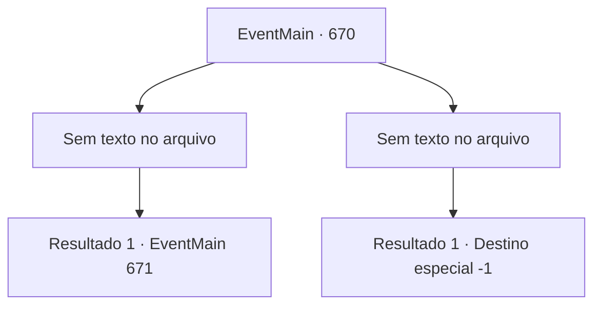

# Eventos principais · 670

[Índice da tabela](index.md) · [Índice geral](../index.md)

ID: `pt:EventMain:670` · Fonte: `EventMain4` · Versão: 1.2.47.

Mapeamento estático dos arquivos; a disponibilidade e a execução dependem do estado da run.

## Texto do evento

*Sem texto no arquivo.*

## Dados de entrada

```json
{
  "id": 670,
  "grade": 1,
  "normalGoal": "",
  "required": ""
}
```

## Mapa das escolhas



## Escolhas e resultados

### Escolha 1

*Sem texto no arquivo; o papel dessa opção depende da interface do jogo.*

Requisitos e outros campos da escolha:

```json
{
  "required": ""
}
```

#### Resultado 1.1

A casa branca de Viyork está manchada de sangue. Você se aproxima de Viyork, pingando sangue da arma. Um Viyork com uma expressão chocada grita para você. 

 "Oh meu Deus...! Você é um demônio! Vá embora!"

 Você esmaga a cabeça gritante de Viyork e se afunda em uma casa silenciosa. E de repente, você percebe que há um sorriso pendurado em sua boca. Então, a voz de Kior é ouvida. 

 "Ufa... Ele era um idiota. Agora, {1}. Me dê suas almas."

 Em suas palavras, você absorve suas almas e as dedica a Kior. A risada de Kior é ouvida com mais intensidade. 

 "Khahaha!!! Ótimo! É excelente! Bem, vou retribuir sua dedicação. Receba minha força. Vou te dar a força que você nunca experimentou antes."

 E então, com esse poder, ele te ordena apagar tudo sobre Tere.

Continuação registrada: [Evento 671](0671.md) na mesma tabela.

```json
{
  "required": "",
  "chance": "1",
  "nextEvent": 671,
  "type": 2,
  "reward": "15_5_35"
}
```

### Escolha 2

*Sem texto no arquivo; o papel dessa opção depende da interface do jogo.*

Requisitos e outros campos da escolha:

```json
{
  "required": ""
}
```

#### Resultado 2.1

Sua arma é desviada pela espada empunhada por Viyork. E Viyork segura a espada com as duas mãos para te finalizar. 

 'Sheeeek!' 

 Sua espada voa em sua direção, cortando o vento. E ela perfura seu peito ao atingir.

Continuação registrada: [Destino especial `-1`](../destinos-especiais.md).

```json
{
  "required": "",
  "chance": "1",
  "nextEvent": -1,
  "type": 2,
  "reward": "0_0_-1|0_1_-1|15_5_13|15_5_22"
}
```

## Referências que chegam a este evento

- [Evento 669 · escolha 1 · resultado 1](0669.md#escolha-1)
- [Evento 669 · escolha 2 · resultado 1](0669.md#escolha-2)
- [Evento 669 · escolha 2 · resultado 2](0669.md#escolha-2)
