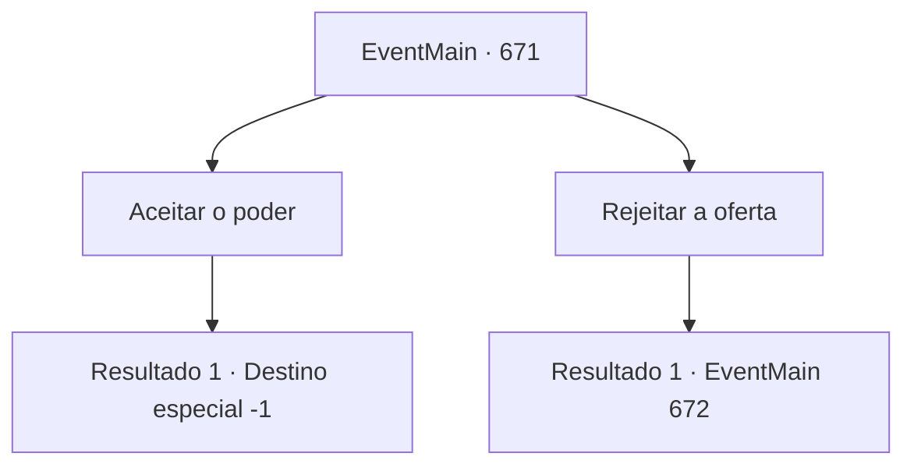

# Eventos principais · 671

[Índice da tabela](index.md) · [Índice geral](../index.md)

ID: `pt:EventMain:671` · Fonte: `EventMain4` · Versão: 1.2.47.

Mapeamento estático dos arquivos; a disponibilidade e a execução dependem do estado da run.

## Texto do evento

*Sem texto no arquivo.*

## Dados de entrada

```json
{
  "id": 671,
  "grade": 1,
  "normalGoal": "",
  "required": ""
}
```

## Mapa das escolhas



## Escolhas e resultados

### Escolha 1

Aceitar o poder

Requisitos e outros campos da escolha:

```json
{
  "required": ""
}
```

#### Resultado 1.1

Você aceita o poder do Kior. Então, a força total sentida de dentro do peito se espalha por todo o corpo ao longo da coluna. Mana escura está correndo ao redor do seu corpo, e seus olhos estão vermelhos no vidro. 

 "Ufa, você parece tão legal. Bem, então, vamos buscar mais vingança. Vamos apagar Teretian do mundo."

 Ouvindo a voz satisfatória de Kior, você sai dali.

Continuação registrada: [Destino especial `-1`](../destinos-especiais.md).

```json
{
  "required": "",
  "chance": "1",
  "nextEvent": -1,
  "type": 2,
  "reward": "15_5_5|15_5_8|15_5_14"
}
```

### Escolha 2

Rejeitar a oferta

Requisitos e outros campos da escolha:

```json
{
  "required": ""
}
```

#### Resultado 2.1

Você rejeita a oferta de Kior. Então a voz suave de Kior é ouvida. 

 "Do que você está falando? Não foi apenas Publius quem matou sua família. O próprio Teretiano causou a morte injusta de sua família. Portanto, a vingança só termina quando você se livrar de todos eles. Você não entende isso?"

 Ele afirma que é tudo por você e que você precisa abraçar uma força mais forte para acabar com sua vingança. E ele também sussurra que sua família só pode resolver sua rixa e descansar em paz.

Continuação registrada: [Evento 672](0672.md) na mesma tabela.

```json
{
  "required": "",
  "chance": "1",
  "nextEvent": 672,
  "type": 2,
  "reward": ""
}
```

## Referências que chegam a este evento

- [Evento 670 · escolha 1 · resultado 1](0670.md#escolha-1)
- [Evento 677 · escolha 1 · resultado 1](0677.md#escolha-1)
- [Evento 679 · escolha 1 · resultado 1](0679.md#escolha-1)
- [Evento 679 · escolha 1 · resultado 3](0679.md#escolha-1)
- [Evento 679 · escolha 2 · resultado 1](0679.md#escolha-2)
- [Evento 680 · escolha 1 · resultado 1](0680.md#escolha-1)
- [Evento 680 · escolha 1 · resultado 3](0680.md#escolha-1)
- [Evento 680 · escolha 2 · resultado 1](0680.md#escolha-2)
- [Evento 681 · escolha 1 · resultado 1](0681.md#escolha-1)
