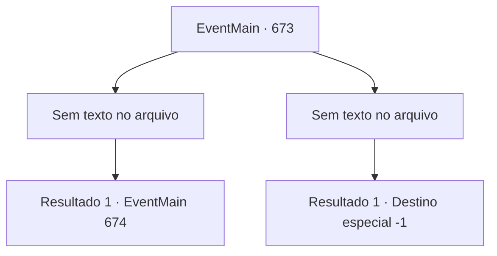

# Eventos principais · 673

[Índice da tabela](index.md) · [Índice geral](../index.md)

ID: `pt:EventMain:673` · Fonte: `EventMain4` · Versão: 1.2.47.

Mapeamento estático dos arquivos; a disponibilidade e a execução dependem do estado da run.

## Texto do evento

*Sem texto no arquivo.*

## Dados de entrada

```json
{
  "id": 673,
  "grade": 1,
  "normalGoal": "",
  "required": ""
}
```

## Mapa das escolhas



## Escolhas e resultados

### Escolha 1

*Sem texto no arquivo; o papel dessa opção depende da interface do jogo.*

Requisitos e outros campos da escolha:

```json
{
  "required": ""
}
```

#### Resultado 1.1

Você tira a vida do cavaleiro sozinho e se aproxima de Viyork. Então Viyork, que desmoronou de medo, grita para você. 

 "Espera... Espere um minuto! Vou te dar boas informações! Então me salve!"

 Diante desse grito desesperado, você o olha ainda. Ele diz com urgência se acha que você aceitou a oferta. 

 "Vou convidar Onil e Publius para minha casa em alguns dias. Então, se atacarmos eles, poderemos alcançar o que queremos."

 Um sorriso desesperado se forma em seu rosto.

Continuação registrada: [Evento 674](0674.md) na mesma tabela.

```json
{
  "required": "",
  "chance": "1",
  "nextEvent": 674,
  "type": 2,
  "reward": ""
}
```

### Escolha 2

*Sem texto no arquivo; o papel dessa opção depende da interface do jogo.*

Requisitos e outros campos da escolha:

```json
{
  "required": ""
}
```

#### Resultado 2.1

Sua arma é desviada pela espada empunhada por Viyork. E Viyork segura a espada com as duas mãos para te finalizar. 

 'Sheeeek!' 

 Sua espada voa em sua direção, cortando o vento. E ela perfura seu peito como está. Com um grande choque, sua consciência afunda na escuridão. 

 "Você não deveria ter rejeitado minha sugestão... Tsk..."

 Através da consciência desvanecida, a voz de Viyork é ouvida com desprezo.

Continuação registrada: [Destino especial `-1`](../destinos-especiais.md).

```json
{
  "required": "",
  "chance": "1",
  "nextEvent": -1,
  "type": 2,
  "reward": "0_0_-1|0_1_-1|15_5_2|15_5_13"
}
```

## Referências que chegam a este evento

- [Evento 666 · escolha 3 · resultado 1](0666.md#escolha-3)
