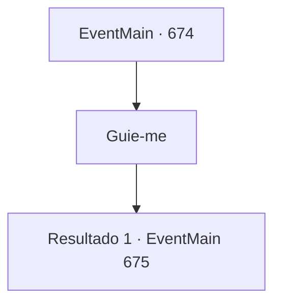

# Eventos principais · 674

[Índice da tabela](index.md) · [Índice geral](../index.md)

ID: `pt:EventMain:674` · Fonte: `EventMain4` · Versão: 1.2.47.

Mapeamento estático dos arquivos; a disponibilidade e a execução dependem do estado da run.

## Texto do evento

*Sem texto no arquivo.*

## Dados de entrada

```json
{
  "id": 674,
  "grade": 1,
  "normalGoal": "",
  "required": ""
}
```

## Mapa das escolhas



## Escolhas e resultados

### Escolha 1

Guie-me

Requisitos e outros campos da escolha:

```json
{
  "required": ""
}
```

#### Resultado 1.1

Você aponta uma arma para o pescoço dele para guiá-lo. Viyork segue suas ameaças suando frio.

 A residência de Viyork é uma pequena casa com uma parede exterior branca e um telhado azul. Você entra com Viyork. Então a mulher de meia-idade e as crianças olham para você com expressões surpresas. 

 "Querido, querido. Quem é essa? E você está ferido...?"

 Viyork te apresenta como um amigo e tenta de alguma forma se explicar.

Continuação registrada: [Evento 675](0675.md) na mesma tabela.

```json
{
  "required": "",
  "chance": "1",
  "nextEvent": 675,
  "type": 2,
  "reward": ""
}
```

## Referências que chegam a este evento

- [Evento 673 · escolha 1 · resultado 1](0673.md#escolha-1)
