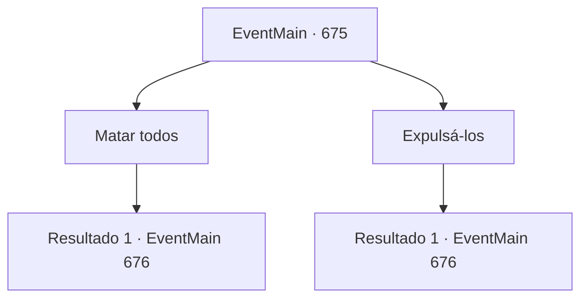

# Eventos principais · 675

[Índice da tabela](index.md) · [Índice geral](../index.md)

ID: `pt:EventMain:675` · Fonte: `EventMain4` · Versão: 1.2.47.

Mapeamento estático dos arquivos; a disponibilidade e a execução dependem do estado da run.

## Texto do evento

*Sem texto no arquivo.*

## Dados de entrada

```json
{
  "id": 675,
  "grade": 1,
  "normalGoal": "",
  "required": ""
}
```

## Mapa das escolhas



## Escolhas e resultados

### Escolha 1

Matar todos

Requisitos e outros campos da escolha:

```json
{
  "required": ""
}
```

#### Resultado 1.1

Você decide matar Viyork e toda a sua família. Viyork revida, mas ele não é seu oponente porque ele estava ferido. Você esconde os corpos deles de forma grosseira e espera por Publius e Onil.

 Ao pôr do sol, uma voz é ouvida do lado de fora com o som de uma carruagem. 

 "Viyork. Viyork. Você está aí dentro?"


Continuação registrada: [Evento 676](0676.md) na mesma tabela.

```json
{
  "required": "",
  "chance": "1",
  "nextEvent": 676,
  "type": 2,
  "reward": "0_3_-3"
}
```

### Escolha 2

Expulsá-los

Requisitos e outros campos da escolha:

```json
{
  "required": ""
}
```

#### Resultado 2.1

Você afasta Viyork e toda a sua família. Viyork sai de lá com sua família. Você se esconde e espera pelo momento em que Publius e Onil chegam.

 Após algumas horas, ao pôr do sol, uma voz é ouvida do lado de fora com o som de uma carruagem. 

 "Viyork. Viyork. Você está aí dentro?"


Continuação registrada: [Evento 676](0676.md) na mesma tabela.

```json
{
  "required": "",
  "chance": "1",
  "nextEvent": 676,
  "type": 2,
  "reward": "15_5_30"
}
```

## Referências que chegam a este evento

- [Evento 674 · escolha 1 · resultado 1](0674.md#escolha-1)
