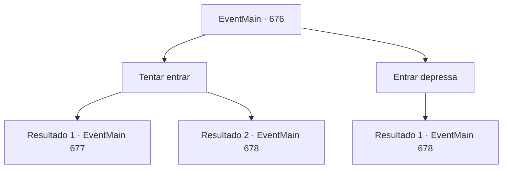

# Eventos principais · 676

[Índice da tabela](index.md) · [Índice geral](../index.md)

ID: `pt:EventMain:676` · Fonte: `EventMain4` · Versão: 1.2.47.

Mapeamento estático dos arquivos; a disponibilidade e a execução dependem do estado da run.

## Texto do evento

*Sem texto no arquivo.*

## Dados de entrada

```json
{
  "id": 676,
  "grade": 1,
  "normalGoal": "",
  "required": ""
}
```

## Mapa das escolhas



## Escolhas e resultados

### Escolha 1

Tentar entrar

Requisitos e outros campos da escolha:

```json
{
  "required": ""
}
```

#### Resultado 1.1

Você espera ansiosamente quando eles entram. Quando está silencioso lá dentro, eles abrem cuidadosamente a porta e entram como se achassem algo suspeito. 

 "Biyor... Khuk!"

 Você abre a porta primeiro e ataca aquele que entra. Você acerta o ponto vital de alguém de uma vez e verifica seu rosto à luz da lua. Ele é Onil, quem executou a queima. 

 "O, Onil!"

 Então você vê a figura de Publius atrás de Onil. Você retira a arma ensanguentada do corpo e corre em direção ao Publius confuso.

Continuação registrada: [Evento 677](0677.md) na mesma tabela.

```json
{
  "required": "",
  "chance": "1|0_6_1",
  "nextEvent": 677,
  "type": 0,
  "reward": "6_0_151",
  "place": 10
}
```

#### Resultado 1.2

Você espera ansiosamente quando eles entram. Quando está silencioso lá dentro, eles abrem cuidadosamente a porta e entram como se achassem algo suspeito. 

 "Biyor... Khuk!"

 Você abre a porta primeiro e ataca aquele que entra. Mas seu ataque falha, e você vê seu rosto à luz da lua. Ele é Onil, quem executou a queima. 

 "O, Onil!"

 "Senhor, recue! Eu lidarei com isso!"

 Onil balança sua espada em você, protegendo o assustado Publius.

Continuação registrada: [Evento 678](0678.md) na mesma tabela.

```json
{
  "required": "",
  "chance": "16",
  "nextEvent": 678,
  "type": 1,
  "reward": "6_0_145",
  "place": 10
}
```

### Escolha 2

Entrar depressa

Requisitos e outros campos da escolha:

```json
{
  "required": ""
}
```

#### Resultado 2.1

Você não aguenta esperar e sai correndo pela porta. Então, Onil, que rapidamente puxa a espada, e Publius, que está envergonhado, são vistos. 

 "Oh, Onil!"

 "Senhor, recue! Eu vou lidar com isso!"

 Onil balança sua espada em sua direção, protegendo o assustado Publius.

Continuação registrada: [Evento 678](0678.md) na mesma tabela.

```json
{
  "required": "",
  "chance": "1",
  "nextEvent": 678,
  "type": 2,
  "reward": "6_0_145",
  "place": 10
}
```

## Referências que chegam a este evento

- [Evento 675 · escolha 1 · resultado 1](0675.md#escolha-1)
- [Evento 675 · escolha 2 · resultado 1](0675.md#escolha-2)
