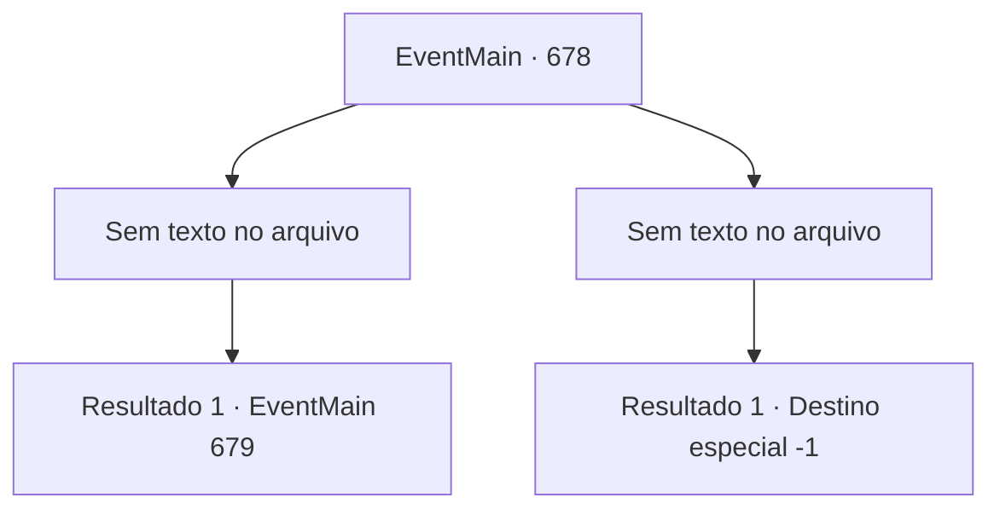

# Eventos principais · 678

[Índice da tabela](index.md) · [Índice geral](../index.md)

ID: `pt:EventMain:678` · Fonte: `EventMain4` · Versão: 1.2.47.

Mapeamento estático dos arquivos; a disponibilidade e a execução dependem do estado da run.

## Texto do evento

*Sem texto no arquivo.*

## Dados de entrada

```json
{
  "id": 678,
  "grade": 1,
  "normalGoal": "",
  "required": ""
}
```

## Mapa das escolhas



## Escolhas e resultados

### Escolha 1

*Sem texto no arquivo; o papel dessa opção depende da interface do jogo.*

Requisitos e outros campos da escolha:

```json
{
  "required": ""
}
```

#### Resultado 1.1

Onil, que voou para longe em um forte choque, está preso na parede. Você pega sua espada que caiu no chão e se aproxima dele para dar o golpe final. Justo nesse momento. De repente, uma voz alta sai de Publius e te impede. A voz é poderosa o suficiente para te forçar. <b><link=shake>

 "Ajoelhe-se!"

</link></b> O que Publius diz é um feitiço chamado 'palavra de poder' que força a ação de alguém. Suas pernas estão tentando se ajoelhar independentemente da sua vontade.

Continuação registrada: [Evento 679](0679.md) na mesma tabela.

```json
{
  "required": "",
  "chance": "1",
  "nextEvent": 679,
  "type": 2,
  "reward": ""
}
```

### Escolha 2

*Sem texto no arquivo; o papel dessa opção depende da interface do jogo.*

Requisitos e outros campos da escolha:

```json
{
  "required": ""
}
```

#### Resultado 2.1

Sua arma é desviada pela espada empunhada por Onil. Ele não perde a chance, segura a espada com as duas mãos e ataca novamente. Com o som de cortar o vento, sua espada fica presa em seu estômago. Uma dor intensa se espalha por todo o seu corpo, e você desaba. 

 "Não mate. Ele tem que pagar por seus crimes..."

 À medida que a voz de Publius se afasta cada vez mais, você perde a consciência.

Continuação registrada: [Destino especial `-1`](../destinos-especiais.md).

```json
{
  "required": "",
  "chance": "1",
  "nextEvent": -1,
  "type": 2,
  "reward": "15_5_2|15_5_13"
}
```

## Referências que chegam a este evento

- [Evento 676 · escolha 1 · resultado 2](0676.md#escolha-1)
- [Evento 676 · escolha 2 · resultado 1](0676.md#escolha-2)
