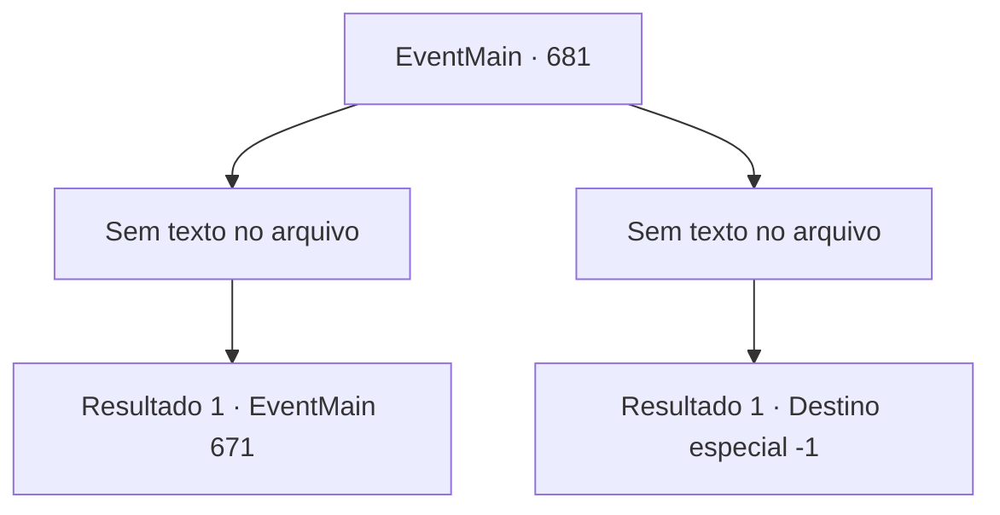

# Eventos principais · 681

[Índice da tabela](index.md) · [Índice geral](../index.md)

ID: `pt:EventMain:681` · Fonte: `EventMain4` · Versão: 1.2.47.

Mapeamento estático dos arquivos; a disponibilidade e a execução dependem do estado da run.

## Texto do evento

*Sem texto no arquivo.*

## Dados de entrada

```json
{
  "id": 681,
  "grade": 1,
  "normalGoal": "",
  "required": ""
}
```

## Mapa das escolhas



## Escolhas e resultados

### Escolha 1

*Sem texto no arquivo; o papel dessa opção depende da interface do jogo.*

Requisitos e outros campos da escolha:

```json
{
  "required": ""
}
```

#### Resultado 1.1

Você retira a mão que penetra o peito de Onil e olha para Publius. Já é depois de Publius ter desmaiado com uma grande ferida. 

 "Tossindo!... Te... Tere... não te perdoará..."

 Publius, que caiu no chão, profere uma maldição. Você se aproxima dele, ignorando a maldição. Então, você dedica as almas de Publius e Onil a Kior. 

 "Khahaha!!! Ótimo! É excelente! Bem, vou retribuir sua dedicação. Receba minha força. Vou te dar a força que você nunca experimentou antes."

 E então, com esse poder, Ele te ordena apagar tudo sobre Tere.

Continuação registrada: [Evento 671](0671.md) na mesma tabela.

```json
{
  "required": "",
  "chance": "1",
  "nextEvent": 671,
  "type": 2,
  "reward": ""
}
```

### Escolha 2

*Sem texto no arquivo; o papel dessa opção depende da interface do jogo.*

Requisitos e outros campos da escolha:

```json
{
  "required": ""
}
```

#### Resultado 2.1

A espada de Onil te perfurou no abdômen. A dor te faz tropeçar, e sem perder a oportunidade, Publius lança o feitiço. 

 "Demônio! Desapareça!"

 A intensa luz de Publius atravessa seu corpo. Sua consciência fica embaçada com a luz, e você ouve a voz de um Kior decepcionado. 

 "Acabar assim... Isso é patético..."

 Você tenta pedir por outra chance, mas sua voz não sai. Você falha em sua vingança.

Continuação registrada: [Destino especial `-1`](../destinos-especiais.md).

```json
{
  "required": "",
  "chance": "1",
  "nextEvent": -1,
  "type": 2,
  "reward": "15_5_2|15_5_13"
}
```

## Referências que chegam a este evento

Nenhum `nextEvent` positivo da mesma tabela aponta para este nó. Isso não prova que seja inacessível: sorteio e estado de história podem selecioná-lo.

