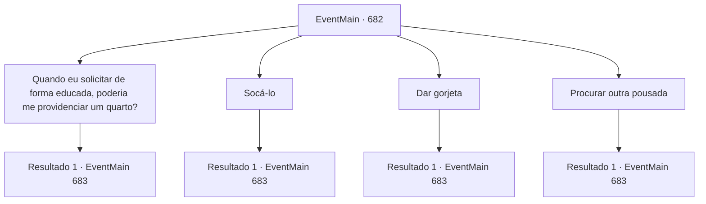

# Eventos principais · 682

[Índice da tabela](index.md) · [Índice geral](../index.md)

ID: `pt:EventMain:682` · Fonte: `EventMain4` · Versão: 1.2.47.

Mapeamento estático dos arquivos; a disponibilidade e a execução dependem do estado da run.

## Texto do evento

Ao entrar em uma taverna deserta, você pediu um quarto ao proprietário. Ele olhou rapidamente para você, alternando o olhar entre você e o jornal que você carregava, com uma expressão de pânico. 

 "Ah... bem... infelizmente, não há quartos disponíveis..."

 O proprietário da taverna estava claramente relutante em lhe oferecer um quarto.  Kior ri em sua mente. 

 "Heh, parece que você ta ficando famoso, não é?"


## Dados de entrada

```json
{
  "id": 682,
  "grade": 1,
  "normalGoal": "",
  "required": "1_2_100|13_4_14"
}
```

## Mapa das escolhas



## Escolhas e resultados

### Escolha 1

Quando eu solicitar de forma educada, poderia me providenciar um quarto?

Requisitos e outros campos da escolha:

```json
{
  "required": ""
}
```

#### Resultado 1.1

Você grita com ele para apagar um quarto quando você pede educadamente. Então ele entrega a chave suando frio. 

 "Pensando bem, só resta um. Ha..haha..."

 Depois de dar uma desculpa ruim, o dono da pousada diz que você pode usar o terceiro quarto no segundo andar.

Continuação registrada: [Evento 683](0683.md) na mesma tabela.

```json
{
  "required": "",
  "chance": "1",
  "nextEvent": 683,
  "type": 2,
  "reward": ""
}
```

### Escolha 2

Socá-lo

Requisitos e outros campos da escolha:

```json
{
  "required": ""
}
```

#### Resultado 2.1

Você espancou o dono da pousada. Então, seja uma sala que não existia criada, o dono da pousada entrega a chave e diz. 

 "Desculpe! Segundo andar... Por favor, use o terceiro quarto..."

 Ele se desculpa com o rosto inchado, e você decide aceitar seu 'pedido de desculpas sincero'.

Continuação registrada: [Evento 683](0683.md) na mesma tabela.

```json
{
  "required": "",
  "chance": "1",
  "nextEvent": 683,
  "type": 2,
  "reward": "0_3_-1"
}
```

### Escolha 3

Dar gorjeta

Requisitos e outros campos da escolha:

```json
{
  "required": "1_4_20"
}
```

#### Resultado 3.1

Você entrega algum ouro ao dono da pousada e solicita um quarto novamente. Então ele hesita por um momento, depois entrega a chave com um sorriso constrangido. 

 "A...A propósito, só resta um. Ha..haha..."

 Após dar uma desculpa fraca, o dono da pousada diz que você pode usar o terceiro quarto no segundo andar.

Continuação registrada: [Evento 683](0683.md) na mesma tabela.

```json
{
  "required": "",
  "chance": "1",
  "nextEvent": 683,
  "type": 2,
  "reward": "0_4_-20"
}
```

### Escolha 4

Procurar outra pousada

Requisitos e outros campos da escolha:

```json
{
  "required": "5_406_0"
}
```

#### Resultado 4.1

Você se vira e procura por outra estalagem. Felizmente, há outra estalagem nas proximidades. Você para lá e pergunta se há um quarto. O dono da estalagem acena com a cabeça com uma expressão entediada. 

 "Entre"

 Ela diz para você ir para o quarto no final do segundo andar.

Continuação registrada: [Evento 683](0683.md) na mesma tabela.

```json
{
  "required": "",
  "chance": "1",
  "nextEvent": 683,
  "type": 2,
  "reward": "5_406_1"
}
```

## Referências que chegam a este evento

Nenhum `nextEvent` positivo da mesma tabela aponta para este nó. Isso não prova que seja inacessível: sorteio e estado de história podem selecioná-lo.

