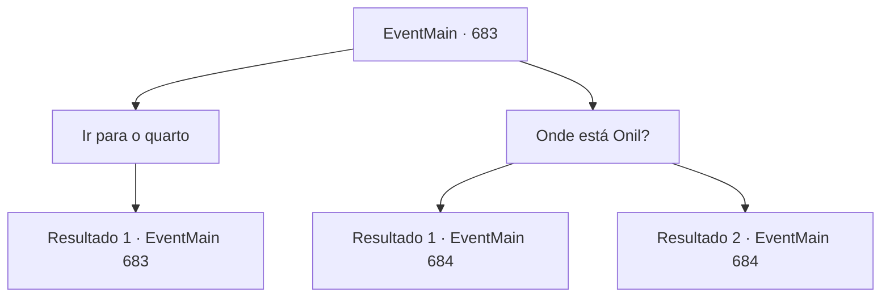

# Eventos principais · 683

[Índice da tabela](index.md) · [Índice geral](../index.md)

ID: `pt:EventMain:683` · Fonte: `EventMain4` · Versão: 1.2.47.

Mapeamento estático dos arquivos; a disponibilidade e a execução dependem do estado da run.

## Texto do evento

*Sem texto no arquivo.*

## Dados de entrada

```json
{
  "id": 683,
  "grade": 1,
  "normalGoal": "",
  "required": ""
}
```

## Mapa das escolhas



## Escolhas e resultados

### Escolha 1

Ir para o quarto

Requisitos e outros campos da escolha:

```json
{
  "required": "5_407_0"
}
```

#### Resultado 1.1

Você joga seu corpo cansado na cama assim que entra no quarto. Logo depois, sua consciência é sugada para a escuridão. 

 Quanto tempo você dormiu? De repente, você acorda com a voz de Kior em sua cabeça. Há uma leve tensão em sua voz. 

 "...Parece que Onil vem até você pessoalmente. Há muitos paladinos ao redor desta estalagem."

 Ao ouvir a voz, você olha pela janela. A situação é como ele disse. Você pode ver homens de robes andando pela estalagem e conversando.

Continuação registrada: [Evento 683](0683.md) na mesma tabela.

```json
{
  "required": "",
  "chance": "1",
  "nextEvent": 683,
  "type": 2,
  "reward": "5_407_1"
}
```

### Escolha 2

Onde está Onil?

Requisitos e outros campos da escolha:

```json
{
  "required": "5_407_1"
}
```

#### Resultado 2.1

Você guarda suas armas e pergunta a Kior onde Onil está. 

 "Eu consigo sentir a energia dele vindo do norte... Não está longe, então se você sair, ele aparecerá."

 Depois de se preparar, você sai dali. Então os paladinos aparecem e bloqueiam seu caminho. E Onil passa por entre eles. 

 "Você está saindo rastejando sozinho. Ótimo. Eu vou lidar com você. Como você se atreve a machucar o Arcebispo... Vou fazer você perceber isso com seu próprio corpo!"

 No momento certo, Onil e os paladinos se aproximam correndo em sua direção.

Continuação registrada: [Evento 684](0684.md) na mesma tabela.

```json
{
  "required": "18_406_1",
  "chance": "1",
  "nextEvent": 684,
  "type": 2,
  "reward": "6_2_145|5_407_2",
  "place": 4
}
```

#### Resultado 2.2

Você guarda suas armas e pergunta a Kior onde Onil está. 

 "Eu consigo sentir a energia dele vindo do norte... Não está longe, então se você sair, ele aparecerá."

 Logo após terminar de se preparar, você sai do quarto e vai até a dona da pousada. Ela está limpando a mesa com uma expressão estranha e, ao se aproximar, ela sai apressada da pousada. Logo em seguida, os paladinos entram na pousada. 

 "Demônio! Renda-se!"

 Então os paladinos se aproximam e bloqueiam seu caminho. E Onil passa por entre eles. 

 "Como você se atreve a machucar o Arcebispo... Vou fazer você perceber isso com seu próprio corpo!"

 Em seguida, Onil e os paladinos se aproximam correndo em sua direção.

Continuação registrada: [Evento 684](0684.md) na mesma tabela.

```json
{
  "required": "5_406_1",
  "chance": "1",
  "nextEvent": 684,
  "type": 2,
  "reward": "6_2_145|5_407_2",
  "place": 4
}
```

## Referências que chegam a este evento

- [Evento 682 · escolha 1 · resultado 1](0682.md#escolha-1)
- [Evento 682 · escolha 2 · resultado 1](0682.md#escolha-2)
- [Evento 682 · escolha 3 · resultado 1](0682.md#escolha-3)
- [Evento 682 · escolha 4 · resultado 1](0682.md#escolha-4)
- [Evento 683 · escolha 1 · resultado 1](0683.md#escolha-1)
