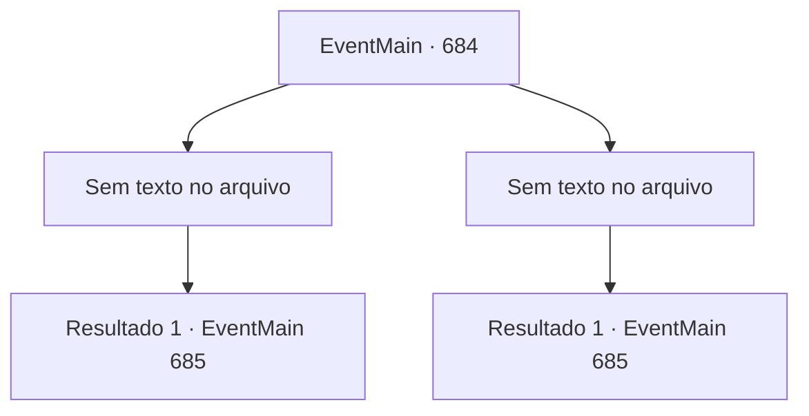

# Eventos principais · 684

[Índice da tabela](index.md) · [Índice geral](../index.md)

ID: `pt:EventMain:684` · Fonte: `EventMain4` · Versão: 1.2.47.

Mapeamento estático dos arquivos; a disponibilidade e a execução dependem do estado da run.

## Texto do evento

*Sem texto no arquivo.*

## Dados de entrada

```json
{
  "id": 684,
  "grade": 1,
  "normalGoal": "",
  "required": ""
}
```

## Mapa das escolhas



## Escolhas e resultados

### Escolha 1

*Sem texto no arquivo; o papel dessa opção depende da interface do jogo.*

Requisitos e outros campos da escolha:

```json
{
  "required": ""
}
```

#### Resultado 1.1

O cerco dos paladinos está desorganizado e o ataque de Onil contra você é fraco. Então, quando você rompe o cerco, Onil ordena que você recue sem hesitação. 

 "Recuar! Recuar!"

 Eles imediatamente viram as costas e começam a fugir.

Continuação registrada: [Evento 685](0685.md) na mesma tabela.

```json
{
  "required": "",
  "chance": "1",
  "nextEvent": 685,
  "type": 2,
  "reward": ""
}
```

### Escolha 2

*Sem texto no arquivo; o papel dessa opção depende da interface do jogo.*

Requisitos e outros campos da escolha:

```json
{
  "required": ""
}
```

#### Resultado 2.1

A luta está acontecendo de forma tão estranha. O cerco dos paladinos está desorganizado, e o ataque de Onil a você é fraco. E quando você quebra o cerco, Onil ordena que você recue sem hesitação. 

 "Recuar! Recuar!"

 Assim como Onil e os paladinos estavam programados para recuar, eles imediatamente viram as costas e fogem da cidade.

Continuação registrada: [Evento 685](0685.md) na mesma tabela.

```json
{
  "required": "",
  "chance": "1",
  "nextEvent": 685,
  "type": 2,
  "reward": ""
}
```

## Referências que chegam a este evento

- [Evento 683 · escolha 2 · resultado 1](0683.md#escolha-2)
- [Evento 683 · escolha 2 · resultado 2](0683.md#escolha-2)
