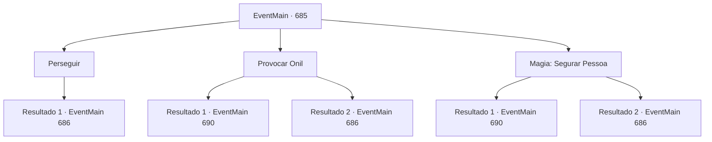

# Eventos principais · 685

[Índice da tabela](index.md) · [Índice geral](../index.md)

ID: `pt:EventMain:685` · Fonte: `EventMain4` · Versão: 1.2.47.

Mapeamento estático dos arquivos; a disponibilidade e a execução dependem do estado da run.

## Texto do evento

*Sem texto no arquivo.*

## Dados de entrada

```json
{
  "id": 685,
  "grade": 1,
  "normalGoal": "",
  "required": ""
}
```

## Mapa das escolhas



## Escolhas e resultados

### Escolha 1

Perseguir

Requisitos e outros campos da escolha:

```json
{
  "required": ""
}
```

#### Resultado 1.1

Você corre atrás de Onil com pressa. Onil e os paladinos deixam a vila e vão para as montanhas próximas.

 Quando você chega ao meio da montanha, eles param de repente. E viram as costas e encaram você de frente. Nesse momento, atrás de você, vários paladinos aparecem com Viyork. 

 "Hahaha. Você é estúpido. {1}. Cair em uma emboscada tão óbvia, esse é o seu nível."

 Ele ri de você ao máximo e continua, limpando a garganta. 

 "Então por que você não se rende? Prometo dar um fim indolor a você."


Continuação registrada: [Evento 686](0686.md) na mesma tabela.

```json
{
  "required": "",
  "chance": "1",
  "nextEvent": 686,
  "type": 2,
  "reward": ""
}
```

### Escolha 2

Provocar Onil

Requisitos e outros campos da escolha:

```json
{
  "required": ""
}
```

#### Resultado 2.1

Você provoca Onil, referindo-se à morte de Publius. O Arcebispo teve um fim miserável, ao contrário do Arcebispo de Tere, implorando por sua vida. Quando você grita e insulta Publius, Onil para. 

 "Isso... Isso é lixo...!"

 Onil, corando, corre em sua direção com um grito. Agora você pode ver que ele está vindo em sua direção com todo o seu coração.

Continuação registrada: [Evento 690](0690.md) na mesma tabela.

```json
{
  "required": "",
  "chance": "1|0_12_1",
  "nextEvent": 690,
  "type": 0,
  "reward": "6_0_145",
  "place": 4
}
```

#### Resultado 2.2

Você provoca Onil, referindo-se à morte de Publius. O arcebispo realmente teve um fim miserável. Mas Onil não se deixa provocar. No final, você decide ir atrás dele, mesmo que se sinta desconfortável. Onil e os paladinos deixam a vila e vão para as montanhas próximas.

 Quando você chega ao meio da montanha, eles param de repente. E viram as costas e encaram você de frente. Nesse momento, atrás de você, vários paladinos aparecem com Viyork. 

 "Hahaha. Você é estúpido. {1}. Cair em uma emboscada tão óbvia, esse é o seu nível."

 Ele ri de você ao máximo e continua, limpando a garganta. 

 "Então por que você não se rende? Prometo dar um fim indolor a você."


Continuação registrada: [Evento 686](0686.md) na mesma tabela.

```json
{
  "required": "",
  "chance": "16",
  "nextEvent": 686,
  "type": 1,
  "reward": ""
}
```

### Escolha 3

Magia: Segurar Pessoa

Requisitos e outros campos da escolha:

```json
{
  "required": "20_0_3|1_1_2"
}
```

#### Resultado 3.1

Você lança Hold Person em direção ao Onil em fuga. Então Onil, capturado por um poderoso mana, geme e para de andar. Você pula e ataca Onil. 

 "Tsk! Agora que não há outra opção!"

 Onil rapidamente quebra o feitiço, rola para o lado e evita seu ataque. Em seguida, após se levantar em reação, ele corre em sua direção gritando.

Continuação registrada: [Evento 690](0690.md) na mesma tabela.

```json
{
  "required": "",
  "chance": "1|0_7_1|0_12_1",
  "nextEvent": 690,
  "type": 0,
  "reward": "0_1_-1|6_0_145",
  "place": 4
}
```

#### Resultado 3.2

Você conjura Hold Person em direção ao fugitivo Onil. Mas Onil rapidamente quebra o feitiço e continua correndo e fugindo. No final, você decide ir atrás dele mesmo se sentindo desconfortável. Onil e os paladinos deixam a vila e vão para as montanhas próximas.

 Quando você chega ao meio da montanha, eles param de repente. E viram as costas e encaram você de frente. Nesse momento, atrás de você, vários paladinos aparecem com Viyork. 

 "Hahaha. Você é estúpido. {1}. Cair em uma emboscada tão óbvia, esse é o seu nível."

 Ele ri de você ao máximo e continua, limpando a garganta. 

 "Então por que você não se rende? Prometo dar um fim indolor a você"

.

Continuação registrada: [Evento 686](0686.md) na mesma tabela.

```json
{
  "required": "",
  "chance": "16",
  "nextEvent": 686,
  "type": 1,
  "reward": "0_1_-1"
}
```

## Referências que chegam a este evento

- [Evento 684 · escolha 1 · resultado 1](0684.md#escolha-1)
- [Evento 684 · escolha 2 · resultado 1](0684.md#escolha-2)
