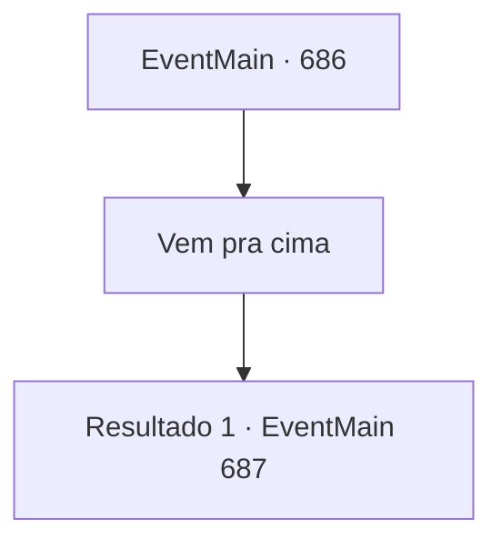

# Eventos principais · 686

[Índice da tabela](index.md) · [Índice geral](../index.md)

ID: `pt:EventMain:686` · Fonte: `EventMain4` · Versão: 1.2.47.

Mapeamento estático dos arquivos; a disponibilidade e a execução dependem do estado da run.

## Texto do evento

*Sem texto no arquivo.*

## Dados de entrada

```json
{
  "id": 686,
  "grade": 1,
  "normalGoal": "",
  "required": ""
}
```

## Mapa das escolhas



## Escolhas e resultados

### Escolha 1

Vem pra cima

Requisitos e outros campos da escolha:

```json
{
  "required": ""
}
```

#### Resultado 1.1

Viyork olha com desdém para suas palavras.  Encarando você por um tempo, ele diz em um tom ridículo.  

 "Então, você não vai se render. Tudo bem, então vou ter que te forçar a ir."

  Viyork dá ordens aos paladinos para te atacarem.  Então, os paladinos que estão cercando a área se reúnem com um grito.

Continuação registrada: [Evento 687](0687.md) na mesma tabela.

```json
{
  "required": "",
  "chance": "1",
  "nextEvent": 687,
  "type": 2,
  "reward": "6_3_149",
  "place": 1
}
```

## Referências que chegam a este evento

- [Evento 685 · escolha 1 · resultado 1](0685.md#escolha-1)
- [Evento 685 · escolha 2 · resultado 2](0685.md#escolha-2)
- [Evento 685 · escolha 3 · resultado 2](0685.md#escolha-3)
