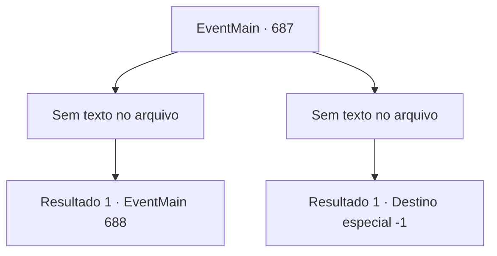

# Eventos principais · 687

[Índice da tabela](index.md) · [Índice geral](../index.md)

ID: `pt:EventMain:687` · Fonte: `EventMain4` · Versão: 1.2.47.

Mapeamento estático dos arquivos; a disponibilidade e a execução dependem do estado da run.

## Texto do evento

*Sem texto no arquivo.*

## Dados de entrada

```json
{
  "id": 687,
  "grade": 1,
  "normalGoal": "",
  "required": ""
}
```

## Mapa das escolhas



## Escolhas e resultados

### Escolha 1

*Sem texto no arquivo; o papel dessa opção depende da interface do jogo.*

Requisitos e outros campos da escolha:

```json
{
  "required": ""
}
```

#### Resultado 1.1

Todos os paladinos que vieram até você encontram seu fim. Você se livra do último paladino restante e olha para Viyork. Nos seus olhos, Viyork se assusta e recua. Então, Onil fala com uma voz calma. 

 "Não tenha medo, Viyork. É apenas um. Se trabalharmos juntos, definitivamente podemos vencer!"

 Com suas palavras, Viyork concorda com a cabeça e puxa sua espada. E no próximo momento, junto com ele, Onil vem em sua direção. 

 "Vou te mostrar qual é o julgamento de Tere!"

 Em uma vida de ameaça, você agora pode ver que ele está vindo com o coração.

Continuação registrada: [Evento 688](0688.md) na mesma tabela.

```json
{
  "required": "",
  "chance": "1",
  "nextEvent": 688,
  "type": 2,
  "reward": "6_3_145",
  "place": 1
}
```

### Escolha 2

*Sem texto no arquivo; o papel dessa opção depende da interface do jogo.*

Requisitos e outros campos da escolha:

```json
{
  "required": ""
}
```

#### Resultado 2.1

Seus ataques são frequentemente bloqueados por escudos e armaduras. Por outro lado, os ataques deles te machucam aos poucos. Você foi cortado na canela, esfaqueado no ombro, espancado na parte de trás da cabeça e ferido várias vezes, e em algum momento, você perde a consciência. Por fim, a espada do paladino, cercada por uma luz brilhante, te dá o fim.

Continuação registrada: [Destino especial `-1`](../destinos-especiais.md).

```json
{
  "required": "",
  "chance": "1",
  "nextEvent": -1,
  "type": 2,
  "reward": "0_0_-1|0_1_-1|15_5_13|15_5_25"
}
```

## Referências que chegam a este evento

- [Evento 686 · escolha 1 · resultado 1](0686.md#escolha-1)
