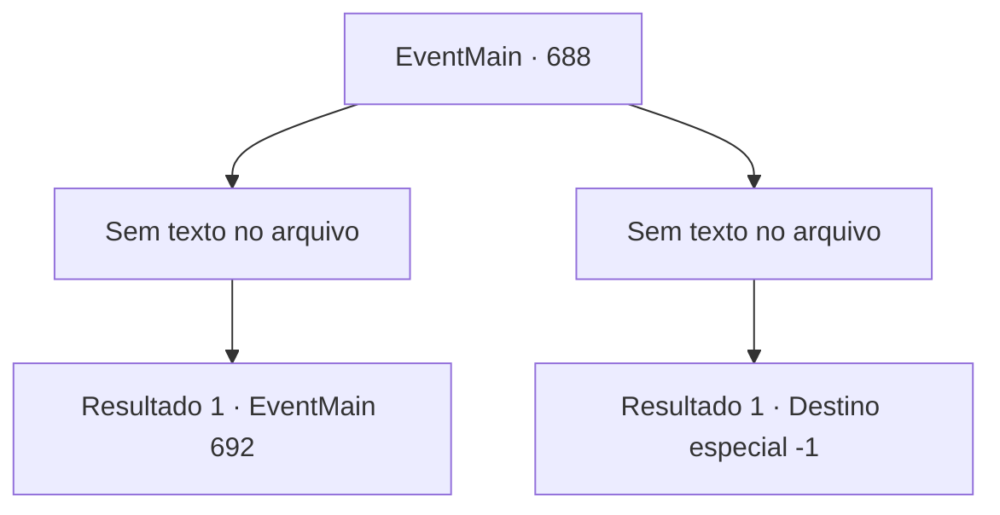

# Eventos principais · 688

[Índice da tabela](index.md) · [Índice geral](../index.md)

ID: `pt:EventMain:688` · Fonte: `EventMain4` · Versão: 1.2.47.

Mapeamento estático dos arquivos; a disponibilidade e a execução dependem do estado da run.

## Texto do evento

*Sem texto no arquivo.*

## Dados de entrada

```json
{
  "id": 688,
  "grade": 1,
  "normalGoal": "",
  "required": ""
}
```

## Mapa das escolhas



## Escolhas e resultados

### Escolha 1

*Sem texto no arquivo; o papel dessa opção depende da interface do jogo.*

Requisitos e outros campos da escolha:

```json
{
  "required": ""
}
```

#### Resultado 1.1

A cabeça do Viyork cai no chão. Você passa pela cabeça e se aproxima de Onil, que está ofegante. Onil cospe sangue e solta um suspiro áspero. 

 "Ah... Haha... Entendi. Você é..."

 Somente então, aparentemente reconhecendo você, ele solta uma risada amarga e abaixa a cabeça. 

 "Você está vivo?... Com certeza... você está morto..."

 Você se aproxima dele murmurando e agarra sua cabeça. E assim como está, você suga sua alma através da sua mão. |drawing_drain| 

 "Khuuuk...!! Ofegante!!!"

 Onil, gritando de agonia, eventualmente perde toda sua alma e morre. Você sorri satisfeito para ele, que morre com uma expressão dolorosa. Então, você ouve um som de risada satisfeita vindo de Kior. 

 "Khahaha!!! Ótimo! É excelente! Bem, vou retribuir sua dedicação. Receba minha força. Vou te dar a força que você nunca experimentou antes."

 E então, com esse poder, Ele te diz para apagar tudo sobre Tere.

Continuação registrada: [Evento 692](0692.md) na mesma tabela.

```json
{
  "required": "",
  "chance": "1",
  "nextEvent": 692,
  "type": 2,
  "reward": "15_5_35"
}
```

### Escolha 2

*Sem texto no arquivo; o papel dessa opção depende da interface do jogo.*

Requisitos e outros campos da escolha:

```json
{
  "required": ""
}
```

#### Resultado 2.1

Sua arma é desviada pela espada empunhada por Onil. E Viyork, mirando nessa brecha, corre em sua direção. 

 'Sheeeek!' 

 Sua espada voa em sua direção, cortando o vento. E ela perfura seu peito como está. Com um grande choque, sua consciência afunda na escuridão.

Continuação registrada: [Destino especial `-1`](../destinos-especiais.md).

```json
{
  "required": "",
  "chance": "1",
  "nextEvent": -1,
  "type": 2,
  "reward": "0_0_-1|0_1_-1|15_5_13|15_5_25"
}
```

## Referências que chegam a este evento

- [Evento 687 · escolha 1 · resultado 1](0687.md#escolha-1)
