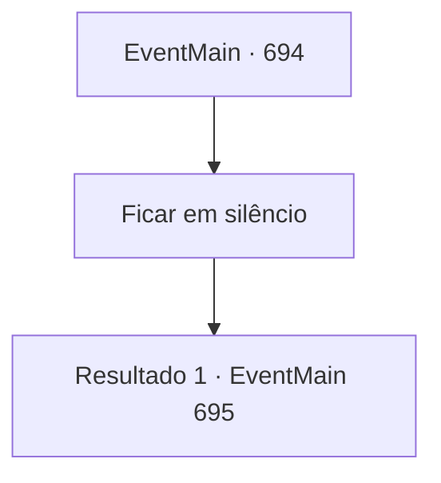

# Eventos principais · 694

[Índice da tabela](index.md) · [Índice geral](../index.md)

ID: `pt:EventMain:694` · Fonte: `EventMain4` · Versão: 1.2.47.

Mapeamento estático dos arquivos; a disponibilidade e a execução dependem do estado da run.

## Texto do evento

Já tarde da noite, você chegou a uma pequena vila e, graças à boa vontade de uma mulher, acabou passando a noite no sótão de sua casa. O sótão, que parecia ser usado como depósito, estava cheio de objetos empilhados, mas felizmente havia espaço suficiente para você se deitar.  Ao entrar no quarto, você deixou sua mochila no canto e se deitou, pronto para dormir, pois estava tão cansado que parecia que adormeceria em instantes.  Foi quando ouviu o som de vozes lá fora, vindas da mulher e sua família.  

 "Por que trouxe um estranho para dentro? Não ouviu os boatos? Dizem que um criminoso que fez um pacto com um demônio está vagando por aí!"

 "Mas, por favor, você não vai mandá-lo embora a essa hora?"

  A voz dela ecoou na sua mente, e Kior sussurrou.  

 "Parece que seus rumores chegaram até este fim de mundo. E agora, o que você vai fazer?"


## Dados de entrada

```json
{
  "id": 694,
  "grade": 1,
  "normalGoal": "",
  "required": "1_2_100|13_4_15"
}
```

## Mapa das escolhas



## Escolhas e resultados

### Escolha 1

Ficar em silêncio

Requisitos e outros campos da escolha:

```json
{
  "required": ""
}
```

#### Resultado 1.1

Você não responde à pergunta de Kior e fica em silêncio. Então ele chuta a língua e fala em voz baixa. 

 "{1}. Será apenas uma questão de tempo até você ser pego. Então por que você não faz uma aposta?"

 Enquanto você hesita por um momento, Kior continua com uma voz solene. 

 "Não temos escolha senão fortalecer nossa conexão. Sacrifique toda a cidade para mim agora mesmo."

 Kior afirma que esta será a única chance de vencer.

Continuação registrada: [Evento 695](0695.md) na mesma tabela.

```json
{
  "required": "",
  "chance": "1",
  "nextEvent": 695,
  "type": 2,
  "reward": ""
}
```

## Referências que chegam a este evento

Nenhum `nextEvent` positivo da mesma tabela aponta para este nó. Isso não prova que seja inacessível: sorteio e estado de história podem selecioná-lo.

